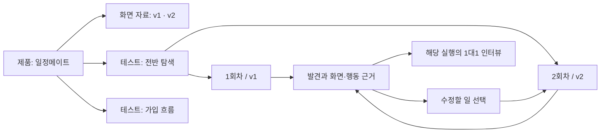

# PersonaLab 총체 검토와 개선 실행안

작성·재검토: 2026-11-10 · 최종 코드 대조 01:40 KST  
대상: 현재 로컬 구현, 기존 제품 기획, 한 앱을 여러 관점으로 반복 검토하려는 사용자 요구  
문서 상태: **제품 방향과 해결책 권고안. 구현 완료 보고서나 시장 검증 결과가 아니다.**

기존 [56개 위험 진단](PRODUCT_RISK_REVIEW_2026-11-10.md)을 다시 확인하고, 실제 코드에서 달라진 사실을 정정했다. 이번에는 문제를 나열하는 데서 끝내지 않고 **고객의 일 → 제품 구조 → 화면의 역할 → 기술 수정 → 검증 → 출시 판단**으로 연결한다.

이번 검토는 코드·문서와 공식 외부 자료를 사용했다. 실제 고객 사용 조사, 새 유료 LLM 실행, 원본 페르소나 전송, 전체 브라우저 육안 검수는 수행하지 않았다. 기존 함수 재현 세 건은 앞선 진단의 결과이며 이번에 다시 실행한 검사가 아니다. 코드에서 확인된 사실, 제품 가설, 권장 설계를 구분한다.

## 먼저 읽을 결론

**PersonaLab의 방향 자체를 버릴 필요는 없다. 다만 고객이 계속 돌아올 이유를 ‘AI가 화면을 사용하는 모습’에서 ‘한 제품을 수정하고 다시 확인하는 일’까지 완성해야 한다.**

검토 중에도 별도 코드 변경이 진행돼, 아래 2-3에 새로 반영된 내용과 남은 검증을 구분했다. 이 문서는 01:40 KST 대조 시점의 판단이며 이후 변경까지 보장하지 않는다.

현재는 연결·페르소나·에이전트·3D·보고서·인터뷰가 각각 존재한다. 하지만 이 기능들이 이어져 **이번에 무엇을 고칠지, 지난번 수정이 이번에도 확인됐는지**를 짧게 결정하게 만드는 부분은 약하다.

권장 제품 정의:

> **PersonaLab은 하나의 앱·웹을 여러 AI 페르소나의 관점으로 탐색하고, 화면·행동 근거가 붙은 UI·UX 문제 후보를 확인하며, 수정한 뒤 같은 검토를 반복하는 작업 공간이다.**

기존의 UI·UX 중심 범위, 전반 탐색 기본값, 선택적 집중 확인, 같은 페르소나와의 후속 인터뷰는 유지한다. 기획 타당성·구매 의향·시장 규모·가격 조사로 다시 넓히지 않는다.

가장 먼저 할 일은 다음 다섯 가지다.

1. **같은 제품에 다른 테스트를 추가하는 경로를 복원한다.** 현재 숨겨진 제품 선택 때문에 다양한 검토가 수정 회차로 몰릴 수 있다.
2. **‘끝까지 갔는가’와 ‘중간에 무엇이 불편했는가’를 분리한다.** 성공 경로의 문제도 근거와 함께 검토 대상으로 남긴다.
3. **한 실행의 상태와 증거를 일치시킨다.** 화면·행동·설명·페르소나·종료 상태가 서로 달라 보이면 나머지 기능도 신뢰하기 어렵다.
4. **수정할 항목을 결과에 남기고 다음 실행에 연결한다.** 채팅이나 PDF를 읽고 끝나는 흐름을 넘어야 한다.
5. **지원하는 환경에서 유용성을 먼저 증명한다.** 범용 사이트·네이티브 앱·수백 명 자동 실행은 그 다음 확장이다.

빠르게 찾기:

- 방향이 왜 어긋났는지: **3장**
- 로그인 후 실제 사용 흐름: **6~7장**
- 무엇을 어떻게 고칠지: **8장 S01~S10**
- 좋은 리포트가 어떤 것인지: **9장**
- 개발 순서와 완료 기준: **12~13장**
- 기존 56개 항목의 해결 묶음: **16장**

## 1. 평가 기준: 기능 수 대신 고객이 끝낼 일

다음 질문에 답할 수 있어야 제품이 완성에 가까워진다.

| 고객의 질문 | 제품이 줘야 하는 답 | 현재 우선 보완점 |
| --- | --- | --- |
| 우리 제품을 실제로 살펴볼 수 있나? | 수집·조작 가능 범위와 확인하지 못할 기능 | 연결 성공과 검토 가능성을 분리 |
| 무엇부터 고치면 되나? | 우선 볼 문제 후보, 정확한 화면·행동, 수정 가설 | 중단자 중심 발견과 일반적인 조언 보완 |
| 이 지적을 믿어도 되나? | 관찰 사실, AI 해석, 재현 방법, 한계 | 그럴듯한 설명과 근거의 일치 검증 |
| 고친 뒤 어떻게 다시 확인하나? | 같은 테스트·조건을 유지한 새 회차 | 자료 버전·테스트·회차 구분 |
| 지난번 문제는 이번에 어땠나? | 다시 관찰됨·미관찰·조건 다름·판단 보류 | 단순 증감을 개선으로 표시하는 부분 정정 |
| 바쁠 때도 쓸 수 있나? | 실행 중 다른 일, 완료 후 짧은 결과, 중단 복구 | 관람과 반복 설정을 필수 작업에서 제외 |

로그인·클릭·보고서 출력이 된다는 것은 동작 기반의 증거다. **고객이 더 좋은 수정 결정을 더 적은 노력으로 내린다는 증거와는 구분**해야 한다.

## 2. 이번 재검토에서 바로잡은 현재 상태

### 2-1. 이미 구현된 기반

- 이메일·비밀번호 가입/로그인, 쿠키 세션과 계정 소유권 검사.
- 실제 브라우저 캡처와 DOM 요소를 함께 받는 LLM 실행.
- 개별 페르소나의 일시 실패 격리와 제한된 동시 실행.
- 캡처 디코드 후 같은 기록의 행동·설명을 표시하는 보호.
- 서버 상태와 종료 기록을 함께 보는 최종/부분 리포트 접근 조건.
- 제품 식별자와 테스트명, 수정 회차, 제품별 목록 묶음의 코드.
- 종료 시 저장하는 `RunReport` 결과 스냅샷.
- 동일 실행·페르소나에 연결된 인터뷰 저장과 복원.

이 기반을 없애고 새 앱을 처음부터 작성하는 것은 권장하지 않는다.

### 2-2. 이전 진단과 문서에서 정정할 내용

| 항목 | 이번 확인 | 해결에 주는 의미 |
| --- | --- | --- |
| 같은 제품에 새 테스트 추가 | `MockupApp.ts`는 제품 선택을 숨기고, 숨겨져 있으면 새 제품으로 처리한다. 상속 함수는 있지만 현재 대화상자의 정상 경로로 연결됐다고 볼 수 없다. | 함수 존재가 아니라 사용자가 두 개의 독립 테스트를 만들 수 있는지로 완료 판단 |
| 과거 결과 보존 | `RunReport.results_json/rules_version`과 종료 시 저장·스냅샷 우선 조회가 이미 있다. | 기존 스냅샷 활용. 전체 입력·모델 조건·화면 버전 및 프론트 재집계의 불변성은 추가 검토 |
| 이메일 인증 | 현재 확인한 것은 이메일·비밀번호 계정 인증이다. 이메일 주소 소유 확인과 비밀번호 복구를 구현 완료로 부르면 안 된다. | 외부 고객 운영 전에 계정 복구 경로를 별도 완성 |
| 기획 문서 최신성 | `PRODUCT_CONTINUOUS_TESTING.md` 15장에 구현 현황이 있다. 다만 그 설명과 현재 숨겨진 제품 선택 경로, 앞부분의 기획 문구가 서로 맞지 않는다. | 문서가 전혀 없다는 문제가 아니라 상태 기준이 분산된 문제 |
| 반복 방문 차단 | LLM 모드는 동일 화면을 제한 범위에서 재판단한다. 시스템의 반복 종료는 자발적 이탈과 구분한다. | 예전 즉시 종료 동작을 다시 문제 삼거나 종료 보호를 제거하지 않기 |

근거: [앱 생성 경로](../frontend/src/mockup/MockupApp.ts), [결과 모델](../backend/app/models/run.py), [결과 API](../backend/app/api/runs.py), [로그인 API](../backend/app/api/auth.py), [현재 구현 설명](PRODUCT_CONTINUOUS_TESTING.md).

### 2-3. 검토 중 반영된 수정과 아직 남은 일

이번 리포트 작성 중 소스가 별도로 갱신됐다. 아래는 **코드 확인**이며 새 기능의 통합 실행 검증을 완료했다는 뜻은 아니다. 이 리포트 작업에서 해당 앱 코드를 수정한 것은 아니다.

| 항목 | 최종 대조에서 확인 | 남은 일 |
| --- | --- | --- |
| 종료 설명·증감 색상 | NAVIGATION_LOST 설명 분기, 시스템 종료/방문량/참여 수의 중립 표시 | 프론트·서버·기존 결과·내보내기까지 일치 검증 |
| 중간 불편 기록 | concern 출력·관찰 저장·결과 응답으로 전달하는 코드 추가 | 핵심 발견 집계는 아직 dropped 중심. 성공 경로의 후보·검토 경험 연결 |
| 실행 조건·사용량 | engine/model/prompt_rev/usage/failed_personas 메타와 비교 조건 추가 | 실제 저장·복원·과거 누락 조건 처리, 고객 예산·정산과 연결 |
| 비교 분모 | 관련 화면 도착 인원 계산 추가 | 동일 제목의 다른 화면 매칭, 미방문 처리, 결과 해석 검증 |
| 비교의 오차 표시 | 고정 2명 또는 전체의 10%를 임계값으로 사용하는 코드 | 실측 없는 수치를 ‘오차 범위’로 표시하지 않도록 정정 |

따라서 아래 S01·S02·S07·S09는 **이미 반영된 코드의 회귀 검증과 아직 남은 설계/통합을 함께 묶은 작업**이다. 이전 56개 진단 전체가 여전히 미수정이라고 읽지 않는다.

## 3. 방향이 어긋나는 다섯 지점과 권장 선택

### 3-1. ‘앱을 개선한다’와 ‘테스트를 새로 만든다’의 단위가 다르다

사용자는 앱 하나를 오래 관리한다. 가입·검색·설정 등 서로 다른 검토를 저장하고, 각 검토를 수정 후 반복한다. 이를 한 줄짜리 회차 목록에 모두 넣으면 질문이 바뀐 것과 화면이 바뀐 것을 구별하기 어렵다.

**권장:** 제품 아래 여러 테스트를 두고, 각 테스트 아래 회차를 둔다. 기본 ‘전반 탐색’ 하나는 자동으로 제안하되, 다른 질문을 추가할 수 있어야 한다.

### 3-2. ‘웹 전체 확인’이라는 기대가 실제 탐색 범위를 초과한다

구조 수집은 발견 가능한 링크·화면을 정리한다. 페르소나는 그중 일부를 실제로 조작한다. 인증 뒤 상태, 입력값별 분기, 동적 탭, 오류 상태까지 전부 확인했다는 뜻은 아니다.

**권장:** 전반 탐색 기본값은 유지하되, 이름과 결과는 **이번에 확인한 범위**를 기준으로 한다. 부족한 범위에서 다음 검토를 제안한다. “사이트 전체 100% 검증” 수치를 만들지 않는다.

범위를 넓히는 탐색과 같은 시작점의 사용자 관점 비교는 실행 목적이 다르다. 내부 계획에서 구분하고, 상세 결과에 시작점 배정 방식을 남긴다.

### 3-3. 페르소나를 보유한 사실과 제품 가치는 별개다

400개 카드·실사형 얼굴·한국 기반 특성이 있어도, 해당 앱의 실제 불편을 더 잘 찾는지는 별도로 입증해야 한다.

**권장:** 카드는 계속 사용하되 적합성, 행동 차이, 추가 발견을 평가한다. 고객에게는 ‘어떤 관점이 포함됐는가’를 설명한다. 인구 특성만으로 전문성·성격·행동을 새로 추정하지 않는다.

페르소나가 일반 AI보다 부가가치를 만들지 못하면 카드 수를 늘리기보다 행동 조건과 선택 기준을 수정한다. 브랜드를 바로 버릴 이유는 없지만 “실제 고객 집단의 반응을 예측한다”는 약속은 검증 전 확대하지 않는다.

### 3-4. 3D와 인터뷰가 사용의 목적이 되어선 곤란하다

3D는 실제 진행을 이해하고 근거를 확인하는 유용한 방식이다. 인터뷰는 특정 장면에서 더 묻는 방식이다. 매 실행을 끝까지 시청하고 대화를 길게 해야 결과를 이해한다면 반복 사용 비용이 커진다.

**권장:** 둘 다 유지한다. 실행을 두고 다른 일을 할 수 있게 하고, 완료 후 중요한 장면으로 바로 이동한다. 인터뷰에서 유용한 답은 해당 발견에 붙여 다음 회차에서도 찾게 한다.

### 3-5. 토큰 소비 중심 수익은 고객 가치와 어긋날 수 있다

고객은 토큰을 많이 쓰기 위해 오지 않는다. 고칠 일을 빨리 찾고 같은 검토를 반복하기 위해 온다. 긴 대화·많은 인원이 곧 매출이 되는 설계는 사용자의 비용 불안과 충돌한다.

**권장 가설:** 제품의 반복 검토를 기본 이용 단위로 삼고, 실행 규모·인터뷰 한도를 명확히 제공한다. 내부 원가는 토큰·브라우저 시간·저장·재시도까지 측정한다. 가격과 상품 구성은 파일럿 이후 결정한다.

### 방향 선택표

| 선택지 | 강점 | 위험 | 권장 |
| --- | --- | --- | --- |
| 광범위한 합성 소비자 조사 | 기존 카드와 대화 경험 활용 | 현재 합의한 UI·UX 범위와 다르고 실제 응답 대체를 검증하기 어려움 | 현재 범위에서 제외 |
| 범용 자동 QA 플랫폼 | 조작과 재현을 명확하게 설명 가능 | 기능·보안·성능·환경 호환까지 기대가 급격히 확대 | 엔진 품질 원칙만 참고 |
| **제품별 반복 UI·UX 검토** | 사용자 요구, 실제 화면 근거, 회차·인터뷰가 하나의 일로 연결 | 비교 무결성과 발견 품질을 먼저 갖춰야 함 | **집중할 권장 방향** |

세 시장의 기능을 한 번에 다 가져오기보다, 세 번째 흐름의 성공을 우선한다. 이는 현재 시장 점유율이나 수요를 확정한 결론이 아니라 제품 설계 판단이다.

## 4. 첫 고객과 첫 번째 가치

### 권장 초기 고객 가설

**자기 제품의 테스트 환경을 제공할 수 있고, 화면을 자주 수정하는 소규모 제품팀의 디자이너·PM.** 개발자는 발견을 재현하고 고치는 협력자다.

적합한 상황은 첫 사용 흐름, 가입·검색·입력·오류 안내, 탐색 구조를 수정하는 때다. 인증과 결제가 복잡한 운영 서비스 전체, 네이티브 OS 동작 전체를 첫 고객 약속으로 삼으면 안 된다.

### 한 고객의 실제 사용 이야기

1. 일정 관리 웹을 연결하고 현재 화면을 확인한다.
2. 별도 목표를 길게 쓰지 않고 전반 탐색을 실행한다.
3. 결과에서 “날짜 선택 뒤 저장 위치가 불분명한 장면”을 본다.
4. 근거를 확인하고 ‘수정할 항목’으로 남긴다.
5. 개발자가 수정한 URL/자료를 새 화면 버전으로 등록한다.
6. 같은 조건의 전반 탐색을 다시 실행하고, 해당 문제를 집중 확인하는 별도 테스트도 남긴다.
7. 두 결과가 다르면 관련 장면을 비교하거나 당시 페르소나에 질문한다.
8. 다음 화면 변경 때 저장된 테스트를 다시 사용한다.

**첫 가치:** 내 화면에서 검토할 문제 후보와 그 근거 하나를 이해하는 것.  
**반복 가치:** 다음 수정본에서 같은 검토를 다시 준비하는 일이 줄고, 이전 문제의 상태를 잃지 않는 것.

문제를 반드시 한 개 만들어내야 한다는 뜻은 아니다. 유효한 문제를 못 찾았다면 확인한 범위와 자료 부족을 정확히 보여주는 것이 맞다.

## 5. 제품 구조: 무엇을 어디에 저장하는가

아래는 **논리적 책임**이다. 새 DB 테이블·컬럼을 이번 보고서에서 확정하거나 추가하지 않는다.

| 단위 | 의미 | 바뀌면 안 되는 관계 |
| --- | --- | --- |
| 제품 | 고객이 개선하는 앱·웹 | 테스트의 명시적 소속. 이름/URL로 자동 병합하지 않음 |
| 화면 자료 버전 | 특정 시점의 연결 자료·화면 및 수집 조건 | 과거 실행의 자료를 최신 자료로 덮어쓰지 않음 |
| 테스트 | 반복 확인할 관점·범위·기본 구성 | 가입 검토와 검색 검토는 별도 테스트 |
| 회차 | 같은 테스트의 설정·자료를 확정한 검토 시도 | 어떤 자료 버전과 조건이 쓰였는지 보존 |
| 실행 | 실제 수행과 저장 상태 | 재시도·취소·부분 결과의 관계를 기록 |
| 발견 | 특정 화면·행동에 근거한 문제 후보 | 여러 회차의 근거를 연결하되 원본 기록 보존 |
| 인터뷰 | 선택 실행·페르소나·장면에 대한 후속 질문 | 현재 앱 전체의 일반 기억으로 자동 확장하지 않음 |



핵심 규칙:

- **다른 질문이면 테스트 추가, 같은 질문을 다시 보면 새 회차.**
- 주소가 같아도 화면은 달라질 수 있다. 고객 버전 이름·관찰 시각·실제 캡처를 함께 남긴다.
- 외부 웹 전체를 완전히 고정했다고 주장하지 않는다. 변경 불가능한 자료 묶음과 시점별 외부 관찰은 구분한다.
- 제품 공통값을 바꿔도 과거 회차를 수정하지 않는다. 새 테스트/회차에 적용할 때 차이를 보여준다.
- 페르소나 구성은 재사용 가능하되 실행에 사용한 특성과 버전은 해당 회차 기준이다.
- 기존 제품 식별자·회차·결과 스냅샷을 우선 활용한다. 저장 확장이 필요하면 개발계획서에 API·저장·이관 계약을 먼저 작성한다.

## 6. 사용자 흐름: 처음은 짧게, 반복은 더 짧게

### 6-1. 첫 방문

**랜딩 → 가입 → 제품 연결 → 연결 범위 확인 → 참여 구성·범위 확인 → 실행 → 리포트**

- ‘로그인’은 기존 계정, ‘시작하기’는 가입/최초 제품 연결로 목적을 구분한다.
- 샘플 결과는 로그인 전에 열 수 있게 유지한다.
- 처음부터 제품 이름·테스트 이름·과제·설명·조건을 모두 필수로 받지 않는다.
- 제품 이름은 연결 화면에서 제안하고 수정 가능하게 한다. 첫 테스트는 ‘전반 탐색’으로 시작한다.
- 시작 캡처를 확인하는 화면과 긴 수집 상세는 나눈다.
- 현재 활성 수집이 끝나지 않았으면 확정/실행을 막는다. 상한·제한 때문에 일부만 확인했다면 남은 범위를 명시하고 사용자가 범위를 결정하게 한다.
- 다음 단계의 잠금은 필수 조건에만 적용한다. 뒤로 가기·저장·이탈까지 불필요하게 막지 않는다.

**설정 페이지는 길이를 줄이기 위해 나눴던 기존 결정을 유지한다.** 연결 / 확인 범위 / 대상 설명 / 참여 구성 / 탐색 범위 / 실행 확인의 상세 화면을 무리하게 합치지 않는다. 먼저 재방문 때 저장된 유효 값을 요약 확인하고 필요한 페이지만 편집하는 경로를 추가한다. 첫 실행의 단계 수를 줄일지는 실제 완주 검수 후 결정한다.

### 6-2. 같은 앱에 다른 테스트를 추가할 때

**제품 홈 → 테스트 추가 → 무엇을 볼지 선택/입력 → 기존 자료·구성 확인 → 실행**

전반 탐색, 특정 흐름, 이전 발견 재확인은 시작 방법이다. 모든 사용자에게 정해진 테스트 종류를 강요하지 않는다. 기능·페이지 목록에서 확인할 부분을 직접 지정할 수 있어야 한다.

자료가 그대로이고 상태가 유효하면 URL·파일·사용자 설명을 다시 요구하지 않는다. 현재 상속이 지원하지 않는 자료 형식은 가능하다고 표시하지 않는다.

### 6-3. 수정한 앱을 다시 볼 때

**제품 홈 → 화면 업데이트 → 이전 테스트에서 ‘다시 확인’ → 바뀐 조건 확인 → 실행 → 이전 발견 재확인**

- 자료만 바뀌었다면 기존 구성·범위를 유지한다.
- 대상 사용자나 시작점도 바꾸면 ‘조건이 달라진 비교’로 남긴다.
- 동일 조건 비교용 새 탐색에는 이전 인터뷰·발견 정답·수정 의도를 주입하지 않는다. 같은 페르소나 특성은 재사용하되 이전 실행의 답을 새 판단에 알려주지 않는다.
- 이전 문제를 알려주고 해당 장면을 확인하는 실행은 ‘집중 재확인’으로 구분한다. 일반 탐색의 개선 비교와 같은 결과로 합치지 않는다.
- 소규모 파일럿에서는 한 테스트씩 실행한다. 여러 테스트 묶음은 예산·큐가 갖춰진 뒤 연다.
- 자료 변경을 감지했다는 이유로 유료 실행을 자동 시작하지 않는다.

### 6-4. 실행 중이거나 실패했을 때

- 실행을 떠나 제품 홈·기존 결과·다른 초안을 볼 수 있다.
- 변경할 수 없는 것은 실행 중인 해당 회차의 입력이다. 워크스페이스 전체를 잠그지 않는다.
- 종료 후 누락 인원이 있으면 부분 결과로 진입한다. 누락 결과를 정상 종료로 채우지 않는다.
- 서버 재시작은 현재 정책에 따라 중단으로 남기고 저장된 기록을 제공한다. 자동 유료 재개는 별도 정책 없이 하지 않는다.
- 재시도는 원본 실행과 관계가 남는 새 시도다. 성공한 결과를 덮어쓰지 않는다.

## 7. 화면별 역할과 첫 화면에 들어갈 내용

### 7-1. 전체 화면 계약

| 화면 | 첫 화면의 핵심 | 주 행동 | 상세로 옮길 내용 |
| --- | --- | --- | --- |
| 랜딩 | 제품의 반복 검토 가치, 실제 화면 근거 예시 | 내 화면으로 시작 | 긴 기술 설명·원본 카드 |
| 로그인/가입 | 현재 목적과 오류·복귀 위치 | 로그인 또는 가입 | 제품 소개 반복 |
| 제품 홈 | 현재 자료, 저장된 테스트, 실행/재검토할 일 | 상태에 따라 이어서/다시 확인 | 전체 로그·인물 목록 |
| 연결 | 입력, 실제 시작 캡처, 조작 가능 여부 | 화면 연결/확인 | DOM·요청·구조 원문 |
| 확인 범위 | 수집한 화면, 제외·제한, 진행 상태 | 범위 확정 | 수백 개 링크 원문 |
| 대상·구성 | 조건과 인원, 선택된 관점 요약 | 구성 확인 | 전체 카드 검색·내부 프롬프트 |
| 실행 확인 | 자료·구성·범위·비용 상한 | 실행 | 개별 설정 편집 |
| 실행 관찰 | 3D 실화면, 선택 인물, 행동, 진행 상태 | 관찰 전환/중단 | 전체 원문 로그 |
| 리포트 | 먼저 볼 발견, 근거, 판단 범위 | 근거 보기/수정할 일 선택 | 전체 세션·DOM·조건 원문 |
| 발견 상세 | 관찰·해석·수정 가설·재확인 조건 | 수정 예정/기각/재확인 | 관련 없는 대화 |
| 1대1 인터뷰 | 선택한 장면·인물과 대화 | 해당 기록에 질문 | 전체 페르소나 DB |
| 비교 | 달라진 조건, 같은 문제의 이전/이번 근거 | 재검토 또는 판단 보류 | 큰 수치 카드 나열 |

리포트·발견·인터뷰는 관계가 다른 데이터다. 그러나 모두 최상위 메뉴가 될 필요는 없다. 초기 제품 홈은 **테스트 목록 중심**, 결과 목록은 제품 내부 탭, 발견은 해당 결과의 상세부터 구현한다. 여러 결과의 발견을 모아야 할 실제 수요가 확인되면 제품 발견 목록을 확장한다.

### 7-2. 제품 홈의 구체적인 구성

```text
[제품 선택] 일정메이트                  [화면 업데이트] [테스트 추가]
현재 자료 v2 · 마지막 확인 시각

테스트          마지막 검토 자료   상태               다음 행동
전반 탐색       v1                 새 자료 검토 전     다시 확인
가입 흐름       v2                 실행 중             실행 보기
검색 흐름       v2                 결과 저장됨         결과 보기

수정 후 다시 볼 항목 2개
날짜 선택 뒤 저장 위치 / 필수 입력 안내
```

이는 배치 예시이며 실제 수치가 아니다.

- 큰 환영 문구·소개 히어로·의미 없는 사용량 차트는 넣지 않는다.
- 결과가 있는 것과 현재 자료에서 확인한 것을 구분한다.
- 제품이 하나면 곧바로 이 홈으로 간다. 여러 제품이면 마지막 제품을 복원하고 선택기를 제공한다.
- 테스트와 제품의 이름 변경·보관·복원·소속 변경은 범위를 명확히 한다. 제품 삭제가 하위 기록에 미치는 영향도 먼저 알려준다.
- 실행 중 테스트와 미완료 초안은 숨기지 않되, 빈 초안 수가 많을 때만 접어 정리한다.
- 내부 로고는 워크스페이스 홈으로 이동한다. 제품 맥락은 보존한다.

### 7-3. 내비게이션과 길이

- 테스트 내부는 설정·실행·리포트·1대1 인터뷰의 위치를 고정한다. 이용 가능 여부와 상태만 바꾼다.
- 설정의 이전/다음과 실행 이후의 행동을 구분한다. 리포트에서 ‘다음’보다 ‘이 장면 질문하기’, ‘다시 확인’처럼 목적을 쓴다.
- 직접 주소와 메뉴·버튼의 진입 조건은 같은 상태 판단을 사용한다.
- 첫 화면에서 중요한 결과나 주 작업을 볼 수 있게 한다. 긴 목록은 검색·필터·페이지 나누기, 선택한 내용은 상세 패널로 연다.
- 페이지를 줄이려고 글씨를 줄이지 않는다. 본문은 15~16px부터 검토하고 핵심 상태에 지나치게 연한 색을 쓰지 않는다.
- 1366×768, 1440×900, 200% 확대에서 실제 작업을 검수한다. 작은 화면에서는 필요한 스크롤을 허용한다.
- 로그인 이후 공통 폰트·색·간격·상태 라벨을 먼저 통일한다. 새 시안 여러 개 제작보다 상태 간 일관성을 우선한다.

### 7-4. 랜딩에 필요한 업데이트

좋아하는 얼굴·타이포·절제된 색감은 유지한다. 소개의 중심을 실제 내부 가치와 맞춘다.

권장 카피 초안:

> 화면은 같아도, 경험은 다르니까.  
> AI 페르소나가 화면을 탐색하며 남긴 근거로, 고칠 곳을 찾고 바뀐 화면을 다시 확인하세요.

본문은 네 구역이면 충분하다.

1. 위 가치와 시작/샘플 결과.
2. 화면 연결 → 탐색 → 수정·재확인의 짧은 흐름.
3. 실제 화면·행동·발견·후속 질문이 연결되는 예시 하나.
4. 지원 입력, 확인 범위, AI 페르소나, 비용에 대한 짧은 FAQ.

‘실제 사용자 100명이 먼저 써본 결과’, ‘모든 웹·앱 완벽 분석’, ‘수정하면 전환율 향상’ 같은 미검증 약속을 넣지 않는다. 준비 중 배지를 늘리기보다 현재 제공 범위만 명료하게 소개한다. 공개 샘플과 실제 실행도 출처가 달라야 한다.

## 8. 해결책을 구현 가능한 열 개 묶음으로 정리

**P0는 결과를 오해시키는 문제와 핵심 신뢰, P1은 반복 사용을 막는 문제, P2는 확장 문제**다. 작업 규모는 상대적 평가이며 인력·일정 약속이 아니다.

### S01. 결과 해석과 상태 기준 통일 — P0 / 작은 범위부터

- **해결 대상:** 종료 제목과 접근 잠금의 기준 불일치. 시스템 종료의 긍정 색상과 잘못된 MAX_TURNS 설명은 수정 코드를 확인했으므로 회귀 검증 대상으로 전환한다. R24·R36·R37·R45.
- **수정:** 서버 실행 상태·개별 종료 결과·결과 저장 상태를 구분하는 공통 읽기 모델을 사용한다. 시스템 종료·방문량 증감은 중립으로 표현한다. 실패·취소·정상 종료를 보존한다.
- **현재 기반:** `ExecutionState.ts`, `ReportModel.ts`, `WorkflowView.ts`, `RunReport`.
- **완료 기준:** 결과가 먼저 도착해도 서버 확인 전 완료를 선언하지 않음. 반복 종료 질문에 MAX_TURNS라고 답하지 않음. 시스템 종료 증가가 개선으로 표시되지 않음.
- **주의:** 원본 종료 코드나 8개 분류를 바꾸는 작업이 아니다. 과거 보고서 해석을 바꾸면 재분석 여부를 알려야 한다.

### S02. 성공·중단을 모두 보는 발견 계층 — P0 / 중간 규모

- **문제:** 핵심 발견 집계는 마지막 중단에 치우쳐 있다. 검토 중 concern을 중간 행동에서 남기는 서버 경로가 추가됐지만 성공 경로의 발견 통합은 남아 있다. R29~R35.
- **수정:** 모든 행동 근거에서 검토할 후보를 만들고, 종료 결과와 별도로 관리한다. 관찰 사실·AI의 해석·수정 가설을 나눈다. 같은 문제로 묶어도 원본 근거를 유지한다.
- **최소 출시안:** 추가된 concern 기록을 활용해 전체 이벤트를 검토할 수 있게 하고 명시적 불편 발화·조작 오류 등 후보를 표시한다. 고객이 확정·기각할 수 있게 한다. 단순 클릭 설명을 문제로 올리지 않는다.
- **후속:** 자동 의미 추출·묶기는 정상 사례와 문제 사례 평가를 통과한 뒤 사용한다. 모든 로그에 별도 LLM을 반복 호출하는 구조는 피한다.
- **완료 기준:** 목표에 도달했어도 중간의 유효한 불편을 볼 수 있음. 단순 우회/재시도만으로 사용자 혼란을 확정하지 않음. 후보에서 정확한 캡처·행동을 열 수 있음.
- **저장:** 이탈 코드 추가 대신 발견의 보조 구조를 설계한다. 영속 저장 확장은 API·이관 명세를 먼저 정한다.

### S03. 한 제품의 여러 테스트와 자료 재사용 — P1, 핵심 경로는 선행 / 단계 분리

- **문제:** 숨겨진 제품 선택, 공통값 출처 불명확, 자료 재입력, 실행 중 새 초안 차단. R01~R07.
- **최단 수정:** 제품의 ‘테스트 추가’와 테스트의 ‘다시 확인’을 분리한다. 기존 `product_id/test_title/root_study_id/revision` 경로를 올바르게 연결하고 저장 실패를 보이게 한다.
- **다음 단계:** 공통 자료·테스트별 예외·실행 당시 값의 책임을 분리한다. HTML/Figma/이미지까지 입력 형식별 재사용 계약을 작성한다.
- **완료 기준:** 같은 제품에 전반 탐색·가입 테스트를 만들고 가입에만 2회차를 추가해도 서로 섞이지 않음. 새 브라우저 로그인 후 같은 소속·자료·회차를 복원함.
- **반례:** 이름이나 URL이 같다는 이유로 다른 제품을 합침. 다른 질문을 같은 테스트의 다음 회차로 강제함. 초안 작성이 실행 결과를 덮어씀.

### S04. 입력 호환성·관찰 범위 계약 — P1, P0 발견 품질의 선행 / 중간~큰 규모

- **문제:** 캡처 성공이 실제 조작 가능을 보장하지 않고, 자동화가 사람보다 많은 정보를 볼 수 있다. R08~R14·R19·R20·R25.
- **수정:** 연결 결과를 ‘화면 수집’, ‘조작 가능한 영역’, ‘확인 못 하는 기능’으로 나눈다. 구조 수집용 DOM과 발견성 평가용 관찰을 구분한다.
- **관찰 개선:** 현재 보이는 영역·모달·탭을 우선하고, 스크롤로 새 영역을 발견한 경로를 남긴다. 화면 밖 요소를 locator가 자동 스크롤해 누른 것은 쉽게 발견한 증거로 취급하지 않는다.
- **실행 계약:** 읽기용 POST·로그인·팝업 등이 필요한 환경은 모의 데이터/허용된 테스트 환경을 별도로 지원한다. 현재 보호를 일괄 해제하지 않는다.
- **완료 기준:** POST 검색 차단은 ‘검색 UX 문제’가 아니라 ‘이 환경에서 확인 못함’으로 분류. 지연 로딩 화면은 제한 시간 내 재확인 후 상태를 표시. 동적 시각 변화와 업무 화면 상태를 구분.
- **범위:** 위/아래 스크롤·뒤로·호버·키보드 등의 지원은 실제 사용 시나리오별로 추가·검증한다. 한도만 크게 늘리는 방식은 우선 해법이 아니다.
- **전반 탐색의 종료:** 실행 종료·기록 저장을 ‘사용성 통과’와 구분한다. 계획한 범위, 실제 관찰 범위, 종료 원인을 함께 반환한다. 자연 종료 판단을 추가하려면 기존 네 종료 보호를 유지하는 명세부터 정한다.
- **외부 콘텐츠 경계:** 화면에 적힌 지시문이 원래 검토 범위나 허용 행동을 바꾸지 않도록 검증한다. 페이지에 ‘다른 사이트로 이동/정보 전송’ 문구를 넣은 자체 사례로 경계를 시험한다. 이는 현 코드의 취약점을 확정한 진단이 아니라 실행 품질 기준이다.

### S05. 3D를 실제 관찰 도구로 완성 — P0/P1 / 중간 규모

- **문제:** 선택 인물과 재생 축이 다르거나, 실패한 인물이 계속 대기로 보인다. R22~R28.
- **수정:** 사람 고정 모드의 이전·다음·재생은 그 사람의 이벤트만 순회한다. 전체 피드는 별도 모드로 구분한다. 종료·실패·누락을 진행 수에서 분리한다.
- **화면:** 중앙 실제 캡처, 측면 다른 사람의 최근 관찰, 아래 행동 한 줄과 짧은 경로. 이유 전문·전체 로그는 상세로 연다.
- **정확성:** 동일 evidence ID의 이미지·좌표·설명을 묶고 이미지 디코드 전 행동 마커를 앞당기지 않는다. 대기 미리보기에는 클릭 연출을 하지 않는다.
- **완료 기준:** A/B 이벤트가 교차 도착해도 A 고정이 유지됨. 서버 종료 후 실패자에게 탐색 중 표시가 남지 않음. 저장 재생과 최신 수신 기록을 구분.
- **시각 검수:** 작은 화면·확대·키보드·reduced motion에서 평면 확대와 중요한 행동 확인이 가능해야 함. 실제 인간의 반응 속도나 체류 시간을 표현한다고 주장하지 않는다.

### S06. 페르소나 적합성과 추가 가치 검증 — P0 검증 / 연구와 구현 병행

- **문제:** 다양성 추천이 제품 관련성과 같지 않고 카드의 추가 효용도 미검증이다. R15~R21.
- **수정:** 필수 적합 조건과 관점 다양성 조건을 분리한다. 실제 보유 특성으로 추천 이유를 설명한다. 지원하지 않는 경험은 ‘자료 없음’으로 둔다.
- **기본 UX:** 인원·조건을 함께 보여주고 추천 구성 확인 → 한 자리 교체 → 상세 검색 순서로 제공한다. 수백 명을 처음부터 직접 고르게 하지 않는다.
- **비교 실험:** 같은 모델·자료·시작점·행동/비용 예산으로 일반 AI, 행동 특성 중심 구성, 현재 카드 구성을 비교한다.
- **완료 기준:** 말투 차이 외에 추가로 발견한 재현 가능한 문제와 중복·거짓 지적·비용을 설명할 수 있음. 추가 가치가 없으면 카드 확대를 멈추고 선택/행동 모델을 재설계.
- **노출:** 고객에게 필요한 요약·선택 이유·AI 대표 이미지 출처를 표시한다. 원본 카드·내부 프롬프트 전체 공개를 기본 기능으로 두지 않는다.
- **자료 관리:** 이미 보유한 원자료·가공 카드·대표 이미지별로 출처, 사용 가능한 범위, 모델에 전달할 요약, 공개할 항목을 정리한다. 파일을 보유했다는 사실만으로 공개·상업 이용 권한까지 확인됐다고 간주하지 않는다. 이번 보고서는 특정 자료의 이용 조건에 대한 법적 판단을 하지 않는다.

### S07. 동일 문제의 재확인과 비교 — P1, 잘못된 해석은 P0 / 중간~큰 규모

- **문제:** 이름+코드 매칭의 불확실성과 확률적 변동이 남는다. 모델/프롬프트/설명 조건과 화면 도착 분모는 추가된 코드를 실제 저장·복원·표시까지 검증해야 한다. R03·R38~R42.
- **수정:** 첫 화면에 비교 가능한 조건·달라진 조건·기록되지 않은 조건을 표시한다. 화면 대응이 불확실하면 사용자가 연결하거나 판단 보류한다.
- **결과:** ‘다시 관찰됨’, ‘이번에 관찰 안 됨’, ‘관련 화면 미방문’, ‘조건이 달라 판단 보류’를 구분한다. 미관찰을 자동 해결로 바꾸지 않는다.
- **분모:** 전체 참여, 해당 화면 방문, 해당 문제 관찰을 각각 보여준다. AI 구성의 기록 수이지 실제 고객 발생률이 아니다.
- **현재 기반:** `RunReport`와 추가된 `RunMetaOut`을 활용한다. 모델·프롬프트·엔진·입력 조건이 API에서 복원되고 비교에 반영되는지 확인하며 집계 규칙의 조회 계약을 보완한다. 과거 미기록 정보는 추정해 채우지 않는다.
- **새로 확인한 정정 대상:** `Math.max(2, Math.round(total * 0.1))`은 실측한 반복 분산이나 신뢰구간이 아니다. 이를 ‘오차 범위’라고 표시하거나 문제 개수 차이에 인원 기준을 적용하지 않는다. 반복 실측 전에는 관찰 차이·판단 유보로 표시한다.
- **완료 기준:** 화면 제목이 같아도 다른 문제를 자동 합치지 않음. 해당 화면을 안 본 후속 실행에서 해결됐다고 말하지 않음. 수정 없는 반복 변동과 수정 후 관찰 차이를 함께 볼 수 있음. 이전 답을 알려준 집중 재확인은 별도 조건으로 표시.

### S08. 근거에 연결된 1대1 인터뷰 — P1, 사실 오해 방지는 P0 / 중간 규모

- **문제:** 존재하는 근거 ID가 주장까지 뒷받침하지 않을 수 있고, 이미지 없는 질문·장기 대화·중복 요청이 문제다. R43~R49.
- **수정:** 리포트의 특정 인물·장면에서 시작한다. 당시 기록과 후속 해석을 나누고 미관찰 내용은 답변 범위를 제한한다.
- **기록 조회:** 경로·종료·확인 범위는 명시적 조회 행동으로 제공한다. 키워드 몇 개로 질문 뜻을 추측해 엉뚱한 경로를 반복하지 않는다.
- **시각 질문:** 색·간격 질문은 해당 관찰 이미지가 실제 입력에 있는지 확인한다. 이미지 참조 확대는 토큰·권한·화면 선택 기준과 함께 설계한다.
- **저장/비용:** 요청 식별자와 완료 응답 재사용으로 같은 요청의 중복 수행을 막는다. 원격 호출 후 상태가 불확실하면 무작정 재호출하지 않고 복구 상태로 둔다.
- **완료 기준:** 미방문 화면·근거와 반대되는 주장·잘못된 ID·이전 대화 누락·응답 유실을 각각 시험. 자연스러운 사후 설명을 당시 결정 원인으로 확정하지 않음.
- **재사용:** 답변의 유용한 부분은 출처를 유지해 해당 발견에 첨부한다. 별도 새 문제를 자동 확정하지 않는다.

### S09. 실행·저장·비용 운영 — P1, 묶음/유료 출시 전 필수 / 단계 분리

- **문제:** 재시작·취소·저장 실패·재시도와 여러 실행의 원가를 고객이 예측하기 어렵다. R49~R53.
- **수정:** 준비·실행 중·중단 요청·실행 종료·결과 저장 완료·부분 저장을 구분한다. 저장 실패를 숨기지 않고 복구 가능하게 한다.
- **예산:** 새로 추가된 usage 메타가 실제 호출·재시도를 포함해 저장되는지 확인한다. 사용량 필드와 고객별 예산/정산 원장은 다르다. 행동 수뿐 아니라 전체 모델 호출·재시도·인터뷰를 포함한 실행/계정 한도를 둔다. 실행 전 표시한 정책을 서버에서도 적용한다.
- **재시도:** 실패 인원만 새 시도로 재실행하는 경우 이전 결과와 합산 규칙·조건을 명시한다. 독립 실행인 것처럼 중복 집계하지 않는다.
- **완료 기준:** 서버 종료, 모델 실패, 결과 저장 실패, 네트워크 유실, 취소가 일어나도 기록·사용량·현재 상태를 추적할 수 있음. 자동으로 유료 작업을 재개하지 않음.
- **확장:** 원장·큐·프로세스 소유권·저장 보관정책은 명세 후 단계적으로 추가. 현재 단일 서버를 이유 없이 전면 분산화하지 않는다.

### S10. 품질 기준과 변경 관리 — P0 검증/P2 구조 / 지속 작업

- **문제:** 많은 검사 수가 UX 발견 정확도를 보장하지 않고, 구현·기획·설명이 어긋날 수 있다. R54~R56.
- **수정:** 정상/문제/지원 밖 사례를 가진 고정 평가 자료, 기능별 현재 상태·검증일·근거 목록을 관리한다.
- **구조:** 실행 상태, 결과 집계, 화면 표현을 변경 경계별로 분리한다. 큰 앱 파일과 전역 스타일은 실제 수정 영역부터 정리한다. 전체 프레임워크 재작성은 우선하지 않는다.
- **완료 기준:** 동일 입력으로 종료·결과·비교·인터뷰 해석이 일치. 규칙 변경 후 과거 결과가 조용히 달라지지 않음. 기능 설명이 활성 UI 경로와 일치.
- **운영:** 확정 요구·제안·구현·검증을 문서에서 구분하고, 과거 작업 일지를 현재 명세로 사용하지 않는다.

## 9. 리포트는 ‘고칠 일’까지 한 묶음이어야 한다

### 9-1. 리포트 첫 화면

순서는 **판단 범위 → 먼저 볼 발견 → 선택한 발견의 근거 → 다음 행동**이다.

- 상단 한 줄: 이번 회차·자료·유효 기록·부분 여부.
- 본문 왼쪽: 먼저 볼 발견 3~5개. 더 많은 항목은 필터/페이지 이동.
- 본문 오른쪽: 선택한 발견의 화면·행동·설명.
- 하단 행동: 수정할 일로 남기기 / 이 장면 질문하기 / 다시 확인.
- 확인 범위와 조건은 별도 탭 또는 상세. 부분 결과처럼 해석에 필수인 제한은 상단에 유지.
- 총점·가짜 개선률·큰 감정 수치로 요약하지 않는다.

### 9-2. 발견 하나의 예시

아래는 **설계를 설명하기 위한 가상 예시**이며 실제 실행 결과가 아니다.

| 필드 | 표시 예시 |
| --- | --- |
| 제목 | 날짜를 고른 뒤 다음 행동을 찾기 어려울 수 있어요 |
| 위치 | 일정 만들기 · 날짜 선택 후 상태 |
| 관찰 사실 | AI 구성 A가 날짜를 선택한 뒤 다른 메뉴를 열었고, 저장 버튼이 어디인지 묻는 이유를 남김 |
| 연결 근거 | 회차 2 · 관찰 5의 캡처 / 행동 4~6 |
| AI 해석 | 선택 완료 상태와 저장 행동의 연결이 약할 가능성 |
| 다른 설명 | 저장 버튼이 늦게 렌더됐거나 관찰 입력에서 빠졌을 가능성 |
| 수정 가설 | 날짜 선택 직후 저장 행동을 일관된 위치에 표시하고 완료 상태를 명확히 안내 |
| 재확인 조건 | 같은 시작 화면·구성·뷰포트에서 날짜 선택 후 경로를 다시 확인 |
| 이번 관찰 | 해당 화면 방문 3개 AI 기록 중 관련 근거 1개. 실제 고객 발생률이 아님 |
| 사용자 결정 | 검토 전 / 수정 예정 / 보류 / 해당 없음 |
| 후속 관찰 | 미실행 / 다시 관찰됨 / 이번에 관찰 안 됨 / 비교 불가 |

**고칠 우선순위**는 영향의 크기, 근거의 충분함, 재현 조건, 이번 작업 관련성으로 판단한다. AI 인원 수만으로 자동 심각도를 만들지 않는다. 사업 우선순위는 고객이 정할 수 있게 한다.

### 9-3. 성공과 해결을 구별한다

‘목표에 도달’은 과제 결과다. ‘문제가 다시 안 나옴’은 이번 관찰 결과다. ‘고객이 수정 완료로 표시’는 관리 상태다. 세 상태를 한 개의 완료 배지로 합치지 않는다.

최종 산출물은 긴 문서 하나보다 **근거를 열 수 있는 발견 목록과 재검토 관계**가 중심이어야 한다. PDF·Markdown은 공유용 사본으로 유지한다. 모델의 해석과 사용자 결정을 내보내기에서도 구분한다.

## 10. 과금과 사업성: 검증할 가설

### 10-1. 권장 상품 가설

초기에는 제품의 반복 검토와 제한된 실행량을 묶는 방식이 적합한지 시험한다. 추가 실행과 인터뷰 규모는 사전에 알 수 있게 한다. 가격·무료량·무제한 약속은 지금 정하지 않는다.

고객이 지불할 이유로 검증할 것:

- 수작업으로 화면을 둘러보고 문제를 정리하는 노력이 줄어드는가.
- 일반 AI에 매번 화면·맥락을 붙이는 것보다 재검토가 쉬운가.
- 개발자가 근거를 보고 문제를 재현할 수 있는가.
- 이전 발견과 이번 자료를 연결하는 기록이 팀에 남는가.

### 10-2. 원가와 고객 표시

원가는 모델 입력/출력뿐 아니라 브라우저 수행, 스크린샷 저장·전송, 재시도, 후속 답변, 고객 지원까지 포함해 측정한다.

표시는 ‘실행 전 상한/예상 범위 → 실행 중 누적 사용 → 종료 후 사용 내역’으로 이어져야 한다. 불확실한 예상값을 확정 비용처럼 쓰지 않는다. 토큰 단가는 내부 원가 계산이며 고객의 성과 지표가 아니다.

실패 정책 권장안:

| 상황 | 고객에게 필요한 처리 |
| --- | --- |
| 조작 불가가 사전 진단에서 확인됨 | 제한과 대안을 먼저 알리고 불필요한 유료 실행 방지 |
| 서비스 내부 오류 | 저장된 결과 제공, 재처리/정산 정책 안내 |
| 일부 인원만 실패 | 성공·실패 범위와 이미 사용한 자원을 분리 |
| 고객 취소 | 새 작업 배정 중단, 진행 중 요청과 이미 발생한 사용량 안내 |
| 결과 전달 유실 | 저장된 결과 복구를 먼저 시도, 동일 요청의 자동 중복 수행 방지 |

이는 요금 약관을 확정한 것이 아니다. 외부 유료 고객을 받기 전에 실제 사용량과 맞춰 정책을 정해야 한다.

## 11. 유지·축소·연기할 것

| 결정 | 대상 | 이유 |
| --- | --- | --- |
| 유지 | 얼굴 랜딩, 현재 타이포 방향, 3D, 후속 인터뷰 | 사용자가 원하는 정체성이며 핵심 근거에 연결 가능 |
| 먼저 완성 | 다양한 테스트·반복, 성공 경로 발견, 상태 일치, 증거, 비교 조건 | 고객의 수정 판단과 재사용을 직접 개선 |
| 기본 화면에서 축소 | 전체 카드 선택, 내부 ID, 원본 프롬프트, DOM, 긴 이유 전문, 중복 개요 | 판단에 필요한 정보가 묻히지 않도록 상세로 이동 |
| 제거/정정 | 시스템 종료 증가의 긍정 표시, 잘못된 종료 문구, 지원 밖 기능의 완료 인상 | 잘못된 해석을 유발 |
| 후순위 | 자동 배포 트리거, 묶음 실행, 대규모 패널, 복잡한 협업 역할 | 비용·큐·반복 가치가 검증된 뒤 확장 |
| 별도 실행기로 확장 | APK/IPA·네이티브 OS 조작 | 모바일 브라우저와 능력이 다름 |
| 현재 범위 제외 | 구매/시장/가격 조사, 근거 없는 시선·감정·체류 시간 추정 | 합의한 UI·UX 범위와 근거 수준에 맞지 않음 |

기능을 숨겨 미완성을 덮는 것과 정보 우선순위를 정하는 것은 다르다. 제한·저장 실패·부분 결과는 중요한 정보이므로 계속 보여준다.

## 12. 구현 순서: 전면 개편 대신 완주 가능한 묶음

기간은 현재 인력·회귀 범위·운영 환경을 확인하지 않고 확정하지 않는다. 아래는 **선후 관계와 통과 기준**이다.

| 단계 | 작업 | 산출물 | 다음 단계로 가는 기준 |
| --- | --- | --- | --- |
| 0. 기준 고정 | S01 수정 코드 회귀 검증, 임의 오차 표현 정정, 기준 사례 정의 | 공통 상태 해석·종료/비교 회귀 사례 | 시스템 종료·부분 저장을 완료/개선으로 오해시키지 않음 |
| 1. 한 제품에서 한 번 더 | S03 최소 경로 + S02 후보/근거 + S05 사람 고정 | 같은 제품 2테스트, 그중 1테스트 2회차 | 결과를 보고 수정할 일을 선택한 뒤 같은 검토를 다시 실행 가능 |
| 2. 신뢰 가능한 반복 | S04 지원 진단 + S07 조건/문제 비교 + S08 근거 질문 | 지원 환경별 완주·비교·후속 질문 | 미방문을 해결로 표시하지 않고 없는 사실을 답변하지 않음 |
| 3. 실제 팀 파일럿 | S06 가치 실험 + S10 평가 + S09 비용/복구 | 품질·반복 사용·원가 기록 | 아래 파일럿 기준으로 계속/축소/재설계 판단 |
| 4. 유료 베타 | 계정 복구·예산·정산·운영 검증 | 제한 범위의 유료 서비스 | 실패·취소·저장·권한·비용 설명이 실제 처리와 일치 |
| 5. 지원 확대 | 묶음 실행·인증 환경·네이티브 등 선택 | 환경별 새 지원 계약 | 기존 정확도·비용·복구 기준을 유지 |

단계 1 동안에도 S06의 평가 자료 설계는 병행한다. 유효성이 없는 방향을 크게 구현한 뒤 처음 평가하는 순서는 피한다.

### 바로 개발 티켓으로 옮길 여덟 가지

1. 제품 내부 ‘테스트 추가’ 경로 복원 — 같은 productId에 별도 테스트와 독립 회차.
2. 공통 종료/저장 상태 모델 적용 — 제목·버튼·사이드바·직접 주소 일치.
3. 수정된 종료 문구·중립 증감의 통합 회귀 검증, 임의 ‘오차 범위’ 표현 정정.
4. 3D 한 사람 고정 재생·실패/누락 표시 정정.
5. 성공 경로까지 포함한 발견 후보와 정확한 근거 연결.
6. 제품 자료·구성 재사용의 입력 종류별 계약과 저장 실패 표시.
7. 기존 결과 스냅샷에 대한 읽기/재분석 계약, 비교 조건 차이 표시.
8. 선택한 발견 → 같은 실행 인터뷰 → 새 자료 재확인의 한 흐름 검수.

각 티켓은 독립 검수·되돌림이 가능해야 한다. 80개 아이디어를 한 번에 출시 범위로 넣지 않는다.

## 13. 검증: 무엇이 좋아졌다고 판단할 것인가

### 13-1. 기능 완주 시나리오

| 시나리오 | 반드시 확인할 결과 |
| --- | --- |
| 같은 앱의 전반 탐색과 가입 검토 | 두 테스트가 같은 제품에 있지만 회차·발견이 섞이지 않음 |
| 가입 검토만 수정 후 2회차 | 이전 회차 자료 보존, 조건 변경 표시, 새 자료로 실행 |
| 성공한 경로의 중간 불편 | 근거 후보에 남고 성공했다고 자동 삭제되지 않음 |
| 정상적인 메뉴 탐색 | 평범한 행동을 불편으로 대량 생성하지 않음 |
| 3명 중 1명 실행 실패 | 진행/누락/부분 리포트/인터뷰 대상이 모두 일치 |
| 캡처가 늦게 도착 | 이전 화면에 다음 클릭 마커가 나타나지 않음 |
| 같은 제목의 다른 화면 | 비교에서 자동으로 같은 문제라고 합치지 않음 |
| 문제 화면을 미방문한 재실행 | 해결로 표시하지 않음 |
| 인터뷰에 없는 사실을 질문 | 기록 부족/추정 범위를 설명하고 경험을 만들어내지 않음 |
| 저장 실패 후 새 로그인 | 실패와 복구 상태가 남고 성공 저장처럼 보이지 않음 |
| 결과 수신 실패 후 재요청 | 이미 저장된 결과부터 복구하고 중복 수행하지 않음 |
| 화면 확대·키보드 사용 | 주요 행동과 상태를 잃지 않고 한 작업 완주 |

이는 앞으로 통과해야 할 기준이다. 이번 문서 작성으로 통과한 검사 목록이 아니다.

### 13-2. 발견 품질 실험

**시작용 평가 설계 제안:** 팀이 통제하는 6개 작은 웹/프로토타입, 알려진 문제 24개와 정상·환경 제한 사례를 함께 만든다. 수량은 예산과 파일럿 결과에 따라 조정한다.

비교 조건은 다음과 같다.

- 같은 자료를 보는 일반 AI 검토.
- 같은 브라우저 도구를 사용하는 일반 에이전트.
- 동일 엔진에 현재 페르소나 구성을 적용한 탐색.
- 수정하지 않은 자료의 반복 실행.
- 사람이 확인한 문제·실제 사용자 관찰과의 대조.

모델·도구·행동 예산이 다른 비교는 카드 자체의 효과로 해석하지 않는다. 같은 예산의 비교와 실제 고객이 선택할 작업 방식의 비교를 별도로 보고한다.

평가할 지표:

| 지표 | 계산/판단 방식 | 피할 해석 |
| --- | --- | --- |
| 유효 발견 비율 | 검토자가 실제 화면 근거로 인정한 후보 / 전체 후보 | 그럴듯한 문장 수를 정확도로 셈 |
| 중요한 문제 누락 | 미리 심은 문제와 실제 관찰 사례 중 놓친 것 | 한정된 정답 묶음으로 세상 모든 UX 포괄 |
| 근거 일치 | 주장과 연결한 화면·행동이 실제로 맞는가 | 존재하는 ID이면 검증 완료 |
| 추가 가치 | 일반 에이전트 대비 새 유효 발견·중복·원가 | 인원 증가만으로 페르소나 효과 주장 |
| 반복 안정성 | 수정하지 않은 화면에서 발견·경로의 변동 | 한 번의 차이를 수정 효과로 확정 |
| 판단 노력 | 읽기 시작부터 수정/보류 결정까지 걸린 고객의 실제 작업 | 모델 응답 시간을 사용자 망설임으로 사용 |
| 지원 완주 | 지원한다고 정한 환경에서 결과가 유효하게 저장되는 비율 | 모든 웹의 성공률로 일반화 |
| 재사용 | 수정본에서 이전 테스트를 다시 쓰는 데 든 작업 | 자동 실행 수를 자발적 수요로 간주 |

### 13-3. 파일럿 진행과 중단 판단

시작용 제안은 5개 팀이 각자의 한 제품을 두 번 이상 검토하는 사용성 파일럿이다. 이는 지시한 과제의 완주 검수이며, 자발적 재방문이나 시장 수요의 증거가 아니다. 이후 실제 변경본을 가지고 선택적으로 다시 사용하는 기간을 따로 관찰한다.

- 실험 전에 유효 발견 기준과 ‘중요한 문제’를 합의한다. 정상 사례도 포함한다.
- 인물이 붙은 결과인지 모르게 후보를 검토할 수 있는 경우 블라인드 검토하고 의견 차이를 기록한다.
- 내부 사용성 기준 초안: 선정된 핵심 기능 시나리오 전부 통과, 최종 판정한 중요한 주장에 근거 불일치 없음, 파일럿에서 최소 3개 팀이 수정본 재검토 과제를 완료. 이 수치만으로 수요·구독 가치를 통과 처리하지 않는다.
- 반복 수요는 의무 과제 종료 후 실제 수정본을 선택적으로 가져온 팀, 돌아온 이유, 제공받은 도움·인센티브를 별도로 기록해 판단한다.
- 위 숫자는 업계 기준이나 관측 결과가 아니다. 데이터 수집 전에 팀이 채택할 기준이며, 결과를 본 뒤 유리하게 고치지 않는다.
- 잘못된 지적을 정리하는 시간이 절약 시간보다 크면 자동 발견 범위를 줄인다.
- 페르소나 추가 가치가 없으면 인원·카드 확장을 중지하고 특성/관찰 조건을 수정한다.
- 두 번째 사용이 발생하지 않으면 자동화와 구독 확대를 보류하고 첫 결과의 유용성을 다시 확인한다.
- 환경 제한 때문에 반복적으로 실패하면 지원 유형을 축소하거나 해당 어댑터를 먼저 개선한다.

## 14. 지금 정할 결정과 권장 기본값

아래는 사용자 승인 완료 사항이 아니라 **다음 구현에 사용할 권장안**이다. 기존 합의와 충돌하는 기술 변경은 명세에 반영한 뒤 진행해야 한다.

| 결정 | 권장 기본값 | 바꿀 조건 |
| --- | --- | --- |
| 중심 사용자 | 테스트 환경을 제공하는 소규모 제품팀 | 파일럿에서 다른 집단의 반복 수요가 더 강함 |
| 기본 모드 | 제한 범위를 명시한 전반 탐색 | 고객이 특정 흐름을 지정하면 해당 테스트 |
| 기본 제품 구조 | 제품 → 여러 테스트 → 회차/실행 | 하나의 질문과 회차를 명확히 표현하는 동등한 구조 |
| 지원 확대 순서 | 웹·모바일 웹/HTML 품질 → 프로토타입 경로 → 인증 환경 → 설치 앱 | 고객 가치·완주율·구현 비용 근거로 변경 |
| 추천 인원 | 작게 시작하고 근거에 따라 확대 | 파일럿에서 추가 발견 대비 비용이 유리함 |
| 인원별 시작점 | 관점 비교는 공통 시작, 범위 탐색은 분산 가능 | 결과에 목적·배정을 명시 |
| 인터뷰 | 선택한 실행/장면의 근거 질의 | 실제로 추가 자료가 입력되고 범위를 표시 |
| 비교 판정 | 관찰 차이를 표시, 자동 개선 확정은 보류 | 통제된 검증과 판정 기준 확보 |
| 핵심 상품 | 반복 검토와 명확한 사용 한도 가설 | 원가·파일럿 지불 의사로 검증 |
| 외부 공유 | 근거·권한·노출 범위를 정한 읽기용 결과 | 팀 권한/보관 정책이 갖춰진 뒤 확대 |

‘몇 명이면 충분한가’, ‘어느 정도 시간을 절약하는가’, ‘얼마에 팔리는가’는 지금 코드만 보고 확답할 수 없다. 대신 위 실험과 실제 반복 사용에서 결정할 수 있게 준비한다.

## 15. 외부 사례에서 가져올 것과 가져오지 않을 것

확인일: 2026-11-10. 아래 자료는 우리 앱 성능이나 수요를 입증하지 않는다.

| 공식/원저 출처 | 확인한 사실 | PersonaLab에 적용할 판단 |
| --- | --- | --- |
| [Maze: 실행 중 테스트 수정](https://help.maze.co/articles/5420819327-editing-a-live-study) | 실행 중 프로토타입 변경을 제한하고 변경이 결과에 영향을 줄 수 있음을 설명 | 실행 당시 조건 보존. 복제만으로 제품의 반복 이력이 해결되는 것은 아니므로 관계를 남김 |
| [Lyssna: 프로젝트 관리](https://help.lyssna.com/en/articles/4952934-creating-projects) | 프로젝트는 테스트·인터뷰를 정리하는 폴더이며 기존 항목 이동 지원 | 기존 테스트의 명시적 제품 편입 참고. 폴더와 공통 자료/버전 기능을 동일시하지 않음 |
| [Dovetail: Docs 공개, 2026-06-03](https://dovetail.com/changelog/docs-general-availability/) | 채팅 결과를 영속 문서로 남기고 문서 버전 이력을 제공 | 중요한 후속 답을 근거와 함께 남김. 범용 연구 저장소 전체까지 만들 필요는 없음 |
| [BrowserStack: App Automate 업로드](https://www.browserstack.com/docs/app-automate/api-reference/appium/apps) | 네이티브 앱 파일과 Appium 기반 모바일 실행 경로 제공 | 설치 앱 지원은 별도 실행 능력. 모바일 브라우저 크기 변경과 구분 |
| [Kapania 외, CHI 2025](https://www.shivanikapania.com/assets/chi2025paper1.pdf) | 정성 연구자 19명과 합성 인터뷰의 맥락·경험 한계 연구 | 자연스러운 답변을 실제 사람 경험의 증거로 확대하지 않음. 브라우저 조작 성능의 직접 평가 자료는 아님 |

공식 제품 문서는 제공 동작의 근거다. **그 동작을 우리 제품에 적용하면 성공한다는 결론은 위 자료가 아니라 이번 권장 설계와 파일럿으로 검증해야 할 가설**이다.

## 16. 기존 56개 진단의 해결 경로

새로운 문제 목록을 무작정 늘리는 대신 기존 항목을 위 작업 묶음에 연결한다. 한 항목이 여러 묶음에 걸치면 첫 열은 주 담당 묶음이며 선행 작업을 함께 적용한다.

| 기존 번호 | 주 해결 묶음 | 핵심 산출물 |
| --- | --- | --- |
| R01~R07 | S03 + S07 | 제품/테스트/회차 경로, 자료 재사용, 현재 자료와 결과 연결 |
| R08~R14 | S04 | 지원 환경·관찰·조작 계약과 제한 처리 |
| R15~R21 | S06 + S04 | 적합성·다양성 구분, 페르소나 추가 가치 평가 |
| R22~R28 | S05 + S01 | 사람별 재생, 상태 일치, 캡처·행동 동기화 |
| R29~R35 | S02 | 성공 경로 포함 발견, 근거·수정·재확인 |
| R36~R42 | S07 + S01 | 중립 집계, 조건 비교, 문제·노출 기준 매칭 |
| R43~R49 | S08 + S09 | 근거 답변, 시각 질문 범위, 요청 중복·복구 |
| R50~R53 | S09 | 실행/저장/비용/취소의 추적·복구 |
| R54~R56 | S10 | 변경 경계, 현재 명세, 품질 평가 |

### 코드 근거와 문서 관계

- [MockupApp.ts](../frontend/src/mockup/MockupApp.ts): `openNewTestDialog`, `submitNewTest`, `inheritFromProduct`, `createStudy`.
- [WorkspaceView.ts](../frontend/src/mockup/WorkspaceView.ts): 제품별 목록과 회차 진입.
- [workflow.py](../backend/app/schemas/workflow.py): 제품 소속·테스트명·회차 메모의 현행 입력.
- [browser.py](../backend/app/services/browser.py): 관찰·행동·지원 제한·방문 보호.
- [runner.py](../backend/app/services/runner.py): 시작점·동시 실행·결과 저장.
- [LiveStage.ts](../frontend/src/mockup/LiveStage.ts), [ExecutionState.ts](../frontend/src/mockup/ExecutionState.ts): 관찰과 접근 상태.
- [ReportModel.ts](../frontend/src/mockup/ReportModel.ts), [WorkflowView.ts](../frontend/src/mockup/WorkflowView.ts): 발견·종료 설명·비교.
- [RunReport](../backend/app/models/run.py), [결과 API](../backend/app/api/runs.py): 기존 결과 스냅샷.
- [interview.py](../backend/app/services/interview.py), [인터뷰 API](../backend/app/api/interviews.py): 입력 근거·응답 검사·저장.
- [구성 추천](../backend/app/services/audience_recommendation.py): 현행 다양성 선택.
- [기존 위험 진단](PRODUCT_RISK_REVIEW_2026-11-10.md): 세부 문제 근거.
- [반복 테스트 기획](PRODUCT_CONTINUOUS_TESTING.md), [화면 구성](PRODUCT_SCREEN_SPEC.md), [주 구성](PRODUCT_MASTER_PLAN.md): 기존 합의와 상세 제안.
- [개발계획서](DEVELOPMENT_PLAN.md): 실제 구현 시 저장·API·종료 규칙의 기준. 이 보고서가 기존 보호 규칙을 자동 변경하지 않는다.

이번 산출물은 **추천 방향, 화면별 역할, 열 개 개선 묶음, 단계별 통과 기준, 실험 설계**다. 앱 코드·DB·배포는 변경하지 않았다. 다음 구현의 첫 완료 목표는 **‘같은 제품의 두 테스트 중 하나를 고친 화면으로 다시 실행하고, 이전 발견을 근거와 함께 재확인하는 전 과정’**이다.
