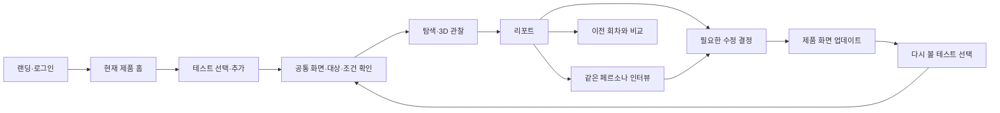

# PersonaLab 제품 구성 기획서

작성: 2026-11-07  
목적: **실제 사용자가 무엇을 하러 들어오고, 어느 화면에서 무엇을 확인하며, 어떤 결정을 하고 나가는지 정의한다.**

이 문서는 디자인 시안이 아니라 구현을 위한 구성 권장안이다. 기존에 합의한 범위를 유지하고, 구체적인 배치와 동작을 제안한다. 새 기능 후보는 [아이디어 백로그](PRODUCT_IDEA_BACKLOG.md)에 따로 둔다. 이 문서에 적혔다고 현재 구현된 것은 아니다. 기술 명세와 변경 금지 규칙은 [DEVELOPMENT_PLAN.md](DEVELOPMENT_PLAN.md), 기존 화면별 요구사항은 [PRODUCT_SCREEN_SPEC.md](PRODUCT_SCREEN_SPEC.md)를 따른다.

> **최신 방향 반영:** 한 제품 안에 다양한 테스트와 반복 회차를 관리합니다. [제품 중심 반복 검토 상세](PRODUCT_CONTINUOUS_TESTING.md). 이전의 ‘제품 계층은 나중’ 권장안은 사용자 요청으로 대체했습니다.

## 빠르게 찾기

- [제품 정의와 문제](#1-누구의-어떤-문제를-푸는가)
- [정보 구조](#2-제품의-단위와-정보-구조) · [전체 흐름](#3-전체-사용-흐름과-재방문)
- [배치 원칙](#4-공통-배치와-문구-규칙) · [랜딩](#5-랜딩-페이지) · [로그인](#6-가입로그인)
- [워크스페이스 홈](#7-워크스페이스-홈-무엇을-어디에-넣는가)
- [설정 여섯 페이지](#8-테스트-내부와-여섯-개-설정-페이지)
- [3D 실행](#9-실행-화면-3d와-실제-행동을-어떻게-이해시키는가)
- [리포트](#10-리포트-무엇을-먼저-보여줄-것인가) · [인터뷰](#11-1대1-인터뷰)
- [수정 회차·비교](#12-수정-회차와-비교-재사용하게-만드는-기능)
- [미해결 질문](#16-반드시-풀고-넘어갈-질문) · [구현 순서](#17-구현-순서와-현재-상태)
- [검수 시나리오](#18-시나리오로-검수할-것) · [추가 아이디어 80개](PRODUCT_IDEA_BACKLOG.md)

## 먼저 정할 여덟 가지

| 결정 | 권장안 | 이유 |
| --- | --- | --- |
| 제품의 중심 | 문제 지점 → 화면 근거 → 같은 페르소나에게 질문 → 수정 후 재검토 | 페르소나 수나 채팅량보다 수정할 결정을 만드는 것이 가치다. |
| 홈의 중심 | 현재 제품의 다양한 테스트와 최신 화면에서의 검토 상태 | 같은 앱을 개선하며 무엇을 다시 볼지 결정한다. |
| 작업 단위 | 제품 → 테스트 → 회차·실행, 화면 버전은 별도 연결 | 다른 UX 질문과 같은 질문의 재검토를 구분한다. |
| 기본 탐색 | 전반 탐색, 집중 확인은 선택 | 처음부터 과제를 잘 써야만 쓸 수 있는 도구가 되지 않게 한다. |
| 참여자 선택 | 대상 설명 → 열린 조건·인원 → 구성 추천 → 필요한 사람만 교체 | 수백 명의 카드를 일일이 비교하게 만들지 않는다. |
| 실행 화면 | 한 사람의 실제 화면이 중앙, 다른 사람은 옆, 행동 경로는 아래 | 사람 전환과 화면 이동이 서로 다른 축임을 분명히 한다. |
| 결과 화면 | 핵심 발견과 관련 화면이 먼저 | 큰 숫자나 읽기 긴 AI 총평보다 근거를 먼저 확인하게 한다. |
| 인터뷰 목적 | 이미 관찰한 선택을 더 이해하기 | 시장성·가격·기획 설문으로 범위를 다시 넓히지 않는다. |

**우선 만들 완성 경험:** 제품 등록·공통 화면 연결 → 전반/집중 테스트 저장 → 탐색·리포트·인터뷰 → 화면 업데이트 → 필요한 테스트를 같은 조건으로 재검토. 팀 기능·설치 앱·결제 상품·자동 이슈 연동은 이 경험이 안정된 뒤 확장한다.

## 1. 누구의 어떤 문제를 푸는가

### 핵심 사용자와 사용 장면

| 사용자 | 들어오는 계기 | 서비스에서 확인할 것 | 나갈 때 가져갈 것 |
| --- | --- | --- | --- |
| 초기 제품 디자이너 | 새 온보딩을 만들었다 | 첫 화면 이해·버튼 발견·입력 흐름 | 먼저 고칠 지점 2~3개와 화면 근거 |
| 서비스 기획자 | 여러 메뉴의 흐름이 복잡하다 | 주요 기능 발견·이동·상태 안내 | 문제가 관찰된 경로와 영향받은 페르소나 |
| 프론트엔드 개발자 | 구현한 웹을 검토한다 | 동적 탭·폼·오류 안내가 실제로 작동하는지 | 재현 가능한 화면·행동 기록 |
| 소규모 제품팀 | 개편 전후를 비교한다 | 이전 문제가 같은 조건에서도 반복되는지 | 조건 차이가 표시된 두 회차의 비교 |

고객의 핵심 질문은 “화면이 예쁜가?”보다 **“누가 어떤 화면에서 무엇을 이해하지 못했으며, 그 근거를 보고 무엇을 수정하면 될까?”**다.

### 지금의 근본 문제

1. 설정·실행·저장된 재생·결과가 연속된 작성 단계처럼 보여 현재 상황을 읽기 어렵다.
2. 캡처가 없는 상태에도 클릭 설명이나 준비 이미지가 보여 실제 에이전트 행동인지 의심하게 된다.
3. 연결 단계의 기술 경고가 UI·UX 문제처럼 읽힌다.
4. 메뉴와 하단 이동이 서로 다른 기준으로 열려 다음 행동이 흔들린다.
5. 페르소나는 많지만 왜 이번 구성에 포함됐는지 이해하기 어렵다.
6. 결과의 숫자는 있어도 “그래서 어느 부분을 먼저 볼지”가 충분히 정리되지 않는다.
7. 한 테스트를 수정하며 반복하는 흐름보다 새 테스트를 만드는 흐름이 더 두드러진다.
8. 디자인 실험에서 홈·내 테스트·전체 목록처럼 비슷한 메뉴가 늘어나 역할이 중복됐다.

해결 순서는 색상 변경보다 **상태와 이동의 일관성 → 화면과 행동의 신뢰 → 결과의 행동 가능성 → 시각 정리**다.

## 2. 제품의 단위와 정보 구조

```text
워크스페이스
└─ 제품: 일정메이트
   ├─ 공통 자료: 연결·환경·화면 버전·저장 참여 구성
   ├─ 테스트: 전반 탐색
   │  ├─ 1회차: 초기 화면
   │  └─ 2회차: v1.4
   ├─ 테스트: 가입과 첫 일정
   │  ├─ 1회차: v1.3 → 리포트·인터뷰
   │  └─ 2회차: v1.4 → 리포트·인터뷰·이전 회차 비교
   ├─ 테스트: 검색·일정 찾기
   ├─ 발견 모음
   └─ 전체 실행 기록
```

- **제품**은 계속 개선하는 하나의 앱·웹이다. 테스트보다 상위의 기본 작업 맥락이다.
- **테스트**는 가입·검색·전반 탐색 등 반복해서 확인할 UX 질문이다.
- **화면 버전**은 제품의 특정 시점 자료다. 테스트 회차와 다르다.
- **회차·실행**은 특정 자료·환경·참여 구성·범위를 고정한 검토다.
- 제품 하나 안에 여러 독립 테스트를 두고 각 테스트 아래 반복 기록을 쌓는다.
- 질문이 달라지면 테스트 추가, 같은 질문의 화면/조건이 바뀌면 새 회차로 재검토한다.
- 같은 제품의 웹·모바일 환경을 묶되 서로 다른 실행 조건임을 표시한다.
- 공통 자료는 기본값으로 재사용하며 이미 종료한 실행을 덮어쓰지 않는다.
- 제품 이름·URL만으로 기존 테스트를 자동 병합하지 않는다.
- 제품 계층을 추가하기로 한 것은 최신 사용자 방향이다. DB 저장·이관은 별도 기술 설계가 필요하다.

### 네 종류의 화면 틀

| 화면 틀 | 구성 | 쓰는 곳 |
| --- | --- | --- |
| 공개 | 로고·소개·로그인·시작하기 | 랜딩·샘플 |
| 전체 제품 | 제품 목록·제품 등록·계정 | 여러 앱 관리 |
| 제품 홈 | 제품 선택기·테스트·발견 모음·실행 기록·공통 자료 | 같은 앱의 지속 검토 |
| 테스트 내부 | 제품/테스트명·회차, 설정·실행·리포트·인터뷰 | 특정 UX 검토 |

제품이 하나면 로그인 후 제품 홈으로 바로 들어간다. 내부 로고는 현재 제품 홈, 제품 선택기의 전체 보기는 전체 제품 목록으로 이동한다. 공개 로고는 랜딩이다.

## 3. 전체 사용 흐름과 재방문



| 진입 상황 | 주 버튼 | 실제 도착점 |
| --- | --- | --- |
| 제품이 없음 | 앱·웹 등록 | 제품 이름·첫 자료 연결 |
| 제품이 하나/마지막 제품 있음 | 이어서 보기 | 해당 제품 홈 또는 원래 작업 |
| 같은 앱에 다른 관점 추가 | 테스트 추가 | 공통 자료를 상속한 설정 |
| 작성하던 테스트 있음 | 이어서 설정 | 마지막 유효 저장 단계 |
| 실행 중 | 실행 보기 | 고정한 버전의 현재 관찰 |
| 종료함 | 결과 보기 | 선택 회차의 리포트 |
| 예전 버전에서만 검토함 | 최신 화면으로 재검토 | 새 자료·기존 조건 확인 |
| 일부 저장하고 중단 | 부분 기록 보기 | 원인·저장/누락 범위 |
| 특정 인터뷰로 재진입 | 대화 이어가기 | 동일 회차·실행·페르소나 |

직접 주소·사이드바·버튼의 진입 조건은 동일해야 한다. 화면 업데이트만으로 유료 실행하지 않는다.

## 4. 공통 배치와 문구 규칙

### 정보의 위치

| 위치 | 반드시 들어갈 것 | 넣지 않을 것 |
| --- | --- | --- |
| 상단 문맥 줄 | 제품·테스트명·화면 버전·회차·현재 상태(상세는 필요할 때) | 긴 설명 문단·내부 DB ID |
| 제목 바로 아래 | 이 화면에서 할 행동 한 문장 | 매번 반복하는 서비스 소개 |
| 첫 화면의 주 영역 | 지금 결정할 내용과 관련 화면 | DOM 원문·수십 개 조건·전체 로그 |
| 오른쪽 또는 상세 창 | 선택한 대상의 근거·설명 | 독립된 두 번째 작업 흐름 |
| 하단 | 설정 단계의 이전·다음, 필요한 경우 저장 상태 | 실행 이후에도 남는 설정용 다음 버튼 |
| 화면 최상단 중앙 | 짧은 동작 결과 알림 | 목록을 밀어내는 긴 빨간 배너 |
| 입력란 옆 | 해당 필드 오류·수정 방법 | 상단에서만 보이는 모호한 ‘실패’ |

### 길이와 밀도

- 일반 작업 화면은 데스크톱에서 **제목·핵심 작업·주 버튼이 첫 화면에 들어오는 것**을 목표로 한다. 작은 노트북·확대 보기에서는 필요한 스크롤을 허용한다.
- 홈은 제목과 조작부에 약 150~190px 안쪽을 쓰는 방향으로 검토한다. 큰 히어로 문구는 두지 않는다.
- 데스크톱 사이드바 약 208~232px, 본문 간격 24~32px는 초기 설계 범위다. 실제 렌더링으로 조정한다.
- 폼 본문은 14~16px, 설명은 13~14px를 출발점으로 한다. 핵심 정보를 10~11px 연한 회색에 넣지 않는다.
- 페이지를 짧게 하려고 글씨를 줄이지 않는다. 주제 분리·탭·페이지 이동·선택 상세로 줄인다.
- 보고서와 인터뷰처럼 목록/대화가 긴 곳만 해당 영역에 내부 스크롤을 허용한다. 내부 스크롤 영역을 여러 겹 만들지 않는다.
- 표는 비교할 데이터, 카드는 구분할 대상, 그래프는 실제 추세·분포가 있을 때 사용한다.
- 사용자용 기본 문구는 한국어다. ‘LIVE SESSION’ 같은 영어 장식은 상태를 혼동시킨다면 빼고 ‘탐색 중’, ‘저장된 기록’으로 쓴다.

## 5. 랜딩 페이지

현재 마음에 든 얼굴 랜딩을 유지하면서 네 덩어리만 명확히 한다.

| 순서 | 내용 | 구체적인 배치와 클릭 |
| --- | --- | --- |
| 1. 첫 화면 | 한 문장 가치·짧은 설명·시작하기·샘플 | 제목 중앙, 사람 이미지는 기존 배치 유지. 옆에 큰 결과 패널을 새로 붙이지 않음 |
| 2. 이용 방식 | 화면 연결 → 다양한 시선으로 탐색 → 근거와 인터뷰 | 가로 3개 설명. 같은 서비스 소개를 길게 반복하지 않음 |
| 3. 결과 예시 | 문제 하나와 해당 화면·관찰 이유 | 샘플 리포트로 연결. 필요하면 인터뷰 예시도 같은 맥락에서 확인 |
| 4. FAQ와 마무리 | AI 여부·입력 형식·확인 범위·결과 질문 | 넓은 질문 행, 오른쪽 기존 펼침 버튼. 끝에 시작하기 한 번 |

카피 권장안:

> 화면은 같아도, 경험은 다르니까.  
> 다양한 AI 페르소나가 화면을 탐색하고, 막힌 지점과 선택의 이유를 기록합니다.  
> 근거를 확인하고, 같은 페르소나에게 더 물어보세요.

얼굴 클릭: 해당 위치 가까운 작은 팝오버에 공개용 프로필·행동 특성·AI 이미지 표시. 프롬프트 복사나 원문 카드 공개는 하지 않는다. 사진 밖으로 긴 콘텐츠가 추가되어 랜딩이 아래로 밀리지 않게 한다.

헤더 ‘로그인’은 기존 계정 입력, ‘시작하기’는 신규 가입. 이미 로그인했다면 시작하기는 워크스페이스로 간다. 샘플은 계정 생성이나 유료 실행 없이 확인하게 한다.

## 6. 가입·로그인

중앙의 작은 폼을 사용하고, 랜딩에서 이미 한 제품 설명을 다시 길게 붙이지 않는다.

| 요소 | 위치·행동 |
| --- | --- |
| 로고 | 폼 위. 공개 랜딩으로 돌아감 |
| 제목 | 로그인 또는 계정 만들기 |
| 입력 | 이메일·비밀번호. 비밀번호 보기 지원 |
| 안내 | 현재 구현과 일치하는 최소 길이 4자. 운영 정책을 바꾸면 별도 일괄 반영 |
| 오류 | 틀린 필드 아래. 서버 문제는 폼 위에 짧게 표시 |
| 주 버튼 | 로그인 또는 계정 만들기. 전송 중 중복 제출 차단 |
| 전환 | ‘처음 오셨나요? 계정 만들기’ / ‘이미 계정이 있나요? 로그인’ |
| 완료 | 제품이 있으면 마지막 제품 홈, 없으면 첫 제품 등록. 세션 복원은 원래 작업 위치 |

이메일 확인·비밀번호 복구는 출시 전 운영 과제다. 실제 경로가 없는 소셜 로그인·복구 버튼을 장식으로 붙이지 않는다. 로그아웃하면 이전 계정의 캡처·대화·캐시가 다음 계정 화면에 남지 않아야 한다.

## 7. 워크스페이스 홈: 무엇을 어디에 넣는가

홈의 기준은 **계속 개선하는 제품**이다. [제품 중심 상세 배치](PRODUCT_CONTINUOUS_TESTING.md#4-제품-홈의-구체적인-배치)를 따른다.

### 전체 제품과 현재 제품

전체 제품 화면은 앱 카드와 제품 등록 버튼이다. 제품이 하나면 선택 화면을 매번 거치지 않고 바로 현재 제품 홈을 연다.

```text
제품 선택기: 일정메이트 ▾

일정메이트 / 현재 화면 v1.4                  [화면 업데이트]
진행 중인 검토 한 줄                          [실행 보기]

[검색] [전체 / 진행 중 / 재확인 필요]           [+ 테스트 추가]

테스트               마지막 검토               다음 행동
전반 탐색            v1.3 · 1회차              [v1.4로 재검토]
가입과 첫 일정        v1.4 · 실행 중            [관찰]
검색·일정 찾기        v1.3 · 2개 발견            [v1.4로 재검토]
예약 변경            작성 중                   [이어서 설정]
```

### 제품 홈에 들어갈 것

| 위치 | 내용 |
| --- | --- |
| 왼쪽 위 | 제품 선택기·전체 제품으로 이동 |
| 사이드바 | 테스트 / 발견 모음 / 실행 기록. 구현이 준비된 역할만 노출 |
| 상단 | 제품명·현재 화면 버전·화면 업데이트 |
| 상단 보조 | 진행 중인 작업이 있을 때만 짧은 요약 |
| 목록 도구 | 테스트 검색·상태/최신성 필터·추가 버튼 |
| 본문 | 여러 UX 질문의 테스트 목록, 각 테스트의 최신 회차를 대표로 표시 |
| 선택한 항목 | 다음 실행의 자료·조건 확인. 묶음 실행은 큐/상한을 갖춘 뒤 |
| 공통 자료 | 연결·환경·수집 버전·저장한 대상/참여 구성 |

테스트 행에는 이름·확인 관점·마지막 검토 화면 버전·회차·상태·짧은 결과·주 버튼 하나를 둔다. 모든 회차를 개별 카드로 펼치지 않는다. 카드/목록 전환은 가능하되 드래그로 실행 완료 상태를 바꾸지 않는다.

### 상태와 버전의 두 축

‘완료’여도 현재 화면 v1.4가 아니라 예전 v1.3의 결과일 수 있다. 마지막 결과와 현재 버전 검토 여부를 구분한다. ‘현재 버전에서 안 본 테스트’는 전체 앱의 미검증 비율이 아니라 저장한 테스트의 최신성이다.

- 작성 중: 이어서 설정.
- 실행 중: 실행 보기.
- 현재 자료에서 종료: 결과 보기.
- 이전 자료에서만 종료: 최신 화면으로 재검토. 클릭 후 조건 확인.
- 부분 기록: 부분 기록 보기.
- 기록 없는 오류: 연결/설정 확인.

### 제품 등록과 관리

첫 제품 등록은 이름·연결 자료만으로 시작하고 첫 버전 이름은 제안한다. 추가 팀·폴더·프로젝트를 강제하지 않는다. 제품 삭제, 테스트 삭제, 회차 보존의 범위는 구분해 안내한다. 기존 테스트를 제품으로 옮길 때 기록·인터뷰 소속과 권한을 보존한다.

새 앱을 등록하는 빈도보다 같은 앱에서 반복 검토하는 빈도가 높다는 전제를 둔다. 홈의 목적은 **이번 제품에서 다음으로 무엇을 검토할지** 정하는 것이다.

## 8. 테스트 내부와 여섯 개 설정 페이지

제품 공통 자료가 있으면 연결·대상 설명·참여 구성을 상속하고 유효한 저장 상태를 확인한다. 여섯 페이지는 세부 편집 경로이며 매 테스트마다 모두 빈 폼으로 다시 채우게 하지 않는다. 새 버전·미저장 조건·실패 연결은 필요한 단계에서 재확인한다.

### 사이드바의 역할

상단은 현재 제품 홈으로 돌아가기, 제품/테스트명, 회차 선택. 그 아래 **설정 / 실행 / 리포트 / 1대1 인터뷰** 네 항목의 위치를 고정한다.

- 작성 중 리포트·인터뷰는 잠금 이유를 짧게 보여준다. 누르면 빈 화면으로 이동하지 않는다.
- 설정 안에서만 여섯 단계 진행 표시와 이전·다음을 쓴다.
- 완료된 설정의 다음 페이지는 직접 열 수 있다. 현재 저장 중이거나 선행 조건이 깨지면 수정 위치를 안내한다.
- 실행을 시작한 회차의 설정 변경은 새 수정 회차로 만든다. 이미 저장된 근거의 맥락을 바꾸지 않는다.

### 8-1. 화면 연결

| 위치 | 내용 |
| --- | --- |
| 상단 | ‘살펴볼 화면을 연결하세요’ / 단계 1 |
| 왼쪽 | 제품 유형·입력 방식·주소/업로드·화면 크기·테스트 이름 |
| 오른쪽 | 연결된 시작 화면·제목·주소·캡처 새로고침·확대 |
| 하단 | 다음: 수집 화면 확인 |
| 선택 상세 | 짧은 배경 설명, 입력 형식별 제약 |

주 버튼은 입력 옆 ‘화면 연결’. 이름은 연결 제목으로 제안하되 사용자가 수정한 내용은 유지한다. 새 주소 연결에 실패하면 이전 결과를 새 주소의 화면인 것처럼 남기지 않는다.

자료 유형은 **제품 플랫폼**과 **입력 방식**을 나눠 설명한다. iOS를 선택했다고 설치 앱을 바로 실행하는 것처럼 보이면 안 된다.

| 입력 | 다룰 수 있는 것 | 사용자가 알 부분 |
| --- | --- | --- |
| 공개 웹 URL | 실제 브라우저 화면·지원되는 클릭·입력·스크롤 | 로그인·다른 사이트·서버 변경 동작의 제한 |
| HTML/ZIP | 업로드된 정적 화면과 내부 연결 | 빌드 서버·API·DB가 자동으로 생기지 않음 |
| Figma·직접 등록 화면 | 이미지·문구·명시된 이동 연결 | 실제 웹 실행과 구분. 가져오기 방식은 검증된 경로만 노출 |
| 모바일 프로토타입 | 모바일 화면 크기의 탐색 | APK·IPA 설치와 OS 기능은 별도 지원 과제 |

### 8-2. 수집 화면 확인

| 위치 | 내용 |
| --- | --- |
| 제목 아래 | 수집 중/종료/일부 확인 필요 + 실제 처리 개수 |
| 주 영역 | 수집 화면 카드 6개 내외, 확대·선택·페이지 이동 |
| 보조 영역 | 접근하지 못한 화면·이미지 실패 등 요약 |
| 상세 | 기술 정보·원본 주소·시도 내역 |
| 하단 | 이전 / 다음: 대상 사용자 |

기본 페이지에서는 DOM 요소 60개·차단 요청 21개·H1 여부를 핵심 성과로 보여주지 않는다. 연결 품질의 정보와 사용성 문제는 별개다.

사전 수집은 빠른 구조·이미지 확보 단계다. 링크 중심의 수집으로 못 찾는 탭·모달·로그인 뒤 상태는 이후 실제 탐색의 범위로 남는다. 여기서 모든 버튼을 전부 누르게 하면 느려지고, 실제 사용자 탐색과도 역할이 겹친다.

진행 표시:

- 미발견 화면 수를 알 수 없을 때: ‘12개 확보 · 3개 확인 중’.
- 고정된 처리 목록을 만들었다면: ‘발견한 20개 중 12개 처리’. 백분율은 이 목록 기준임을 표시.
- 더 발견되면 분모가 바뀔 수 있음을 인정하고 사이트 전체의 60%라고 쓰지 않는다.
- 실행 중 다음 이동 잠금. 종료·취소 후 유효 화면이 있으면 확보 범위를 확인하고 진행. 유효 화면 0개면 재연결.

### 8-3. 대상 사용자

하나의 중심 입력 영역: ‘어떤 사용자를 위한 화면인가요?’와 2~4줄 입력. 예시는 ‘예약과 고객 응대를 혼자 처리하는 소규모 매장 운영자’. 선택 입력은 실제 사용 상황 한 줄이다.

제품 기획서·사업 목표·주요 기능·시장 세그먼트를 다시 작성하게 하지 않는다. 다음 참여 구성 화면에서 쓸 문맥만 만든다. 대상 설명을 입력했다고 보유 카드에 없는 직업 경험을 만들어 붙이지 않는다.

### 8-4. 참여 구성

```text
[이번에 참여할 사람들]
┌ 열린 조건·인원 ────────────┬─ 추천된 참여 구성 ───────────────────┐
│ 인원 [ 5 ]명              │ 5명 구성 · 중복 원천 제외           │
│ 연령 / 직무 / 지역         │ 구성 요약: 연령·직무·디지털 친숙도   │
│ 디지털 친숙도             │ 얼굴  핵심 특성        [교체] [제외] │
│ 조건에 맞는 후보 48명      │ 얼굴  핵심 특성        [교체] [제외] │
│ [구성 추천받기]           │ 필요할 때 직접 고르기               │
└───────────────────────────┴────────────────────────────────────┘
```

기본 조건은 열려 있고 인원이 같은 영역에 있다. 원자료에 있는 조건만 사용한다. 긴 지역 목록은 검색·전체/선택 보기로 다루고 잘못된 축약명을 쓰지 않는다.

추천을 받으면 먼저 **구성 전체**를 확인한다. 각 인물의 연령·직무·친숙도와 이번 관점에 관련 있는 공개용 설명만 보여준다. ‘왜 이 구성인가요?’는 조건 일치와 중복 감소의 설명이지 실제 시장 대표성의 주장이어서는 안 된다.

교체할 때 동일 조건 후보 3~6명 정도를 작은 창에서 비교하게 한다. 후보 부족 시 요청 인원·가능 인원을 명시하고 인원 감소/조건 완화를 사용자가 선택한다. 실패·취소 시 기존 구성을 보존한다.

인물 사진은 AI 이미지임을 구성 영역에 명시한다. 사진이 서로 다른 실존 응답자를 나타낸다고 오해시키지 않는다. 원문 카드·내부 점수·원천 ID·엔진 프롬프트는 고객용 기본 정보가 아니다.

### 8-5. 탐색 범위

첫 화면에는 두 선택지만 둔다.

- **전반적으로 살펴보기**: 기본. 시작 화면·메뉴·이동·주요 입력·안내를 지원 범위에서 탐색.
- **특정 흐름 확인하기**: 시작점·하려는 행동·완료 기준을 지정.

그 아래 ‘특히 확인하고 싶은 부분’은 선택. 예: ‘가입 과정이 복잡한지’, ‘예약 변경을 찾기 쉬운지’. 핵심 항목은 최대 5개 등 현재 저장 규칙에 맞춘다. 고급 설정의 행동 상한·시간 제한은 필요할 때만 펼친다.

전반 탐색에서는 자유롭게 사이트 전체를 검토한다는 방향을 유지하되 모든 상태를 빠짐없이 보장하지 않는다. 목적이 다른 탐색을 자동 배분하는 기능은 후속 기획이며, 현재 배분 근거·미확인 범위를 먼저 보여준다.

### 8-6. 실행 확인

전체 설정 폼을 다시 길게 출력하지 않는다. 네 줄 요약과 수정 링크만 둔다.

1. 어떤 화면: 이름·자료 종류·화면 크기.
2. 누구의 시선: 대상 설명·인원·주요 구성.
3. 어디까지: 탐색 방식·확보 화면·접근 제한.
4. 실행 규모: 행동/시간 상한·실제 제공 가능한 사용량 안내.

주 버튼 ‘탐색 시작’. 외부 모델에 쓰일 정보와 비용 안내는 관련 요약 가까이 짧게 둔다. 계산되지 않은 예상 비용을 만들어 넣지 않는다. 시작 후 중복 제출을 막고 서버 작업 ID를 확인해 실행 화면으로 이동한다.

## 9. 실행 화면: 3D와 실제 행동을 어떻게 이해시키는가

### 첫 화면 배치

```text
일정메이트 / 가입 / v1.4 / 2회차        탐색 중 · 5명 중 2명 종료       [중단]
─────────────────────────────────────────────────────────────
[민감정보에 신중한 사용자] [새 기능에 익숙한 사용자] [더 보기]

    다른 사람의 최근 화면      선택한 사람의 화면      다른 사람의 최근 화면
             ╲            ┌────────────────────┐             ╱
              ╲           │ 실제 캡처와 행동 위치│            ╱
                          └────────────────────┘

선택한 사람 · 회원가입 [클릭]  “인증 방법 안내를 먼저 확인했어요.”

시작 화면 → 회원가입 → 인증 안내 → …     [이전] [재생] [다음]
─────────────────────────────────────────────────────────────
2명 기록 저장 · 2명 탐색 중 · 1명 대기                    [최신 기록]
```

- 중앙은 한 사람의 관찰 화면. 양옆은 다른 페르소나의 마지막 실제 기록이다.
- 사람을 바꾸는 것과 같은 사람의 다음 화면으로 가는 것을 다른 위치에서 조작한다.
- 하단에는 ‘5/5’와 ‘01 클릭’을 중복해 놓기보다 **선택한 사람의 3번째 행동 / 회원가입**처럼 읽히는 표기를 쓴다.
- 자동으로 기록이 도착하더라도 사용자가 선택한 사람·읽던 과거 기록을 임의로 바꾸지 않는다. ‘최신 기록 따라가기’를 명시적으로 제공한다.
- 이미지 확대·원문은 보조 동작이다. 기본 화면에는 판단 요약 1~2줄만 둔다.
- 실행을 나갔다 돌아와도 서버 작업을 중복 생성하지 않고 이어 본다.

### 캡처와 행동의 시간 관계

이 부분이 이 제품의 신뢰를 결정한다.

1. 에이전트가 관찰한 화면 A를 표시한다.
2. A에서 결정한 클릭·입력·스크롤을 A의 실제 좌표/대상에 표시한다.
3. 행동 이후 다음 관찰 B가 확보되면 같은 사람의 다음 기록으로 전환한다.
4. B가 아직 없으면 ‘다음 화면 확인 중’. 클릭했다는 사실만으로 이동 성공을 미리 표현하지 않는다.
5. 실패한 조작이면 A와 실패 원인을 보존한다. 성공한 클릭처럼 애니메이션을 끝내지 않는다.
6. 새 이미지가 로드되기 전에는 설명·포인터를 새 기록으로 먼저 바꾸지 않는다.

같은 URL이어도 탭·모달·입력·스크롤 위치가 다르면 다른 화면 상태일 수 있다. URL 수를 실제 화면 상태 수로 대체하지 않는다. 이 내용은 관찰 기록 간 연결 규칙이며 DB 스키마 변경 지시가 아니다.

### 대기·로딩·실패한 이미지

| 상태 | 보여줄 것 |
| --- | --- |
| 아직 탐색하지 않은 사람 | ‘탐색 대기’ 자리 표시. 시작 화면 예시는 실제 방문 기록과 분리 |
| 다음 캡처 로딩 | 이전 실제 캡처 + ‘다음 화면 확인 중’. 새 포인터 숨김 |
| 캡처 파일 오류 | ‘화면을 불러오지 못했어요’와 재시도. 저장된 텍스트 기록 유지 |
| 화면 자체가 비어 있음 | 캡처 상태와 관찰 한계를 표시. 정상 클릭 화면처럼 꾸미지 않음 |
| 재생 중 새 기록 도착 | 도착 순서대로 누락 없이 처리. 저장된 행동의 재생임을 명시 |

### 실행의 네 가지 모드

| 모드 | 제목·설명 | 주 행동 |
| --- | --- | --- |
| 실행 중 | ‘탐색 중’ / 인원별 현재 상태 | 관찰·사람 전환·중단 |
| 정상 종료 | ‘탐색 기록이 저장됐어요’ / 종료 인원 | 리포트 보기 |
| 중단·부분 기록 | ‘탐색이 중단됐어요’ / 원인·저장/누락 인원 | 부분 기록 보기·설정 수정 |
| 과거 기록 재생 | ‘저장된 탐색 기록’ / 실행 시각 | 재생·리포트로 이동 |

종료한 화면에 LIVE 문구와 깜빡이는 실행 표시를 남기지 않는다. 하단 ‘이전·설정 확인 / 다음’은 작성 흐름이므로 실행 이후 제거하고 위 상태별 행동으로 바꾼다.

### 진행률과 종료의 의미

- 사람 수 기반 진행은 ‘5명 중 2명 종료’. 이는 과제 성공률이 아니다.
- 행동 수 상한 대비 비율은 실제 작업 완료율로 표시하지 않는다. 어떤 사람은 일찍 끝날 수 있다.
- 사용자가 그만두겠다고 표현한 기록과 시스템 차단·시간/턴 한도·이미지 실패를 구분한다.
- 모든 사람의 종료 기록이 저장되고 서버 상태가 확인돼야 최종 리포트로 표시한다.
- 일부만 저장됐으면 부분 리포트. 기록이 전혀 없으면 문제 해결 화면으로 간다.
- 유효한 사람의 종료 기록이 있어야 그 사람과 인터뷰한다. 미방문·미종료를 AI 답변으로 채우지 않는다.

## 10. 리포트: 무엇을 먼저 보여줄 것인가

### 첫 화면 배치

```text
일정메이트 / 결제 경험 / v1.4 / 3회차           [내보내기] [다시 검토]
AI 탐색 기록 · 5명 종료 · 실제 방문 9개 화면 상태 · 일부 범위 미확인

[핵심 발견] [페르소나별 기록] [확인 범위]
──────────────────────────────────────────────────────────────
먼저 살펴볼 지점 3개            선택한 발견의 화면
┌────────────────────┐      ┌───────────────────────────┐
│ 인증 안내를 찾기 어려움│      │ 해당 화면 + 관련 요소 표시 │
│ 이 화면 방문 3명 중 2명│      │                           │
├────────────────────┤      └───────────────────────────┘
│ 쿠폰 적용 결과 불명확 │      관찰 사실 / AI 해석 / 확인 제안
├────────────────────┤      근거 기록 2건 [기록 보기]
│ 뒤로 가기 시 입력 소실│      [이 페르소나에게 질문]
└────────────────────┘
```

리포트는 긴 AI 총평을 첫 화면에 쓰지 않는다. 숫자 패널은 꼭 필요한 범위 요약만 작은 줄로 제공한다. 첫 발견을 선택한 상태로 열어 빈 오른쪽 패널이 나오지 않게 한다.

### 발견 하나에 들어갈 내용

| 요소 | 내용·예시 |
| --- | --- |
| 제목 | ‘인증 안내를 찾기 어려워 다음 입력을 결정하지 못함’ |
| 관련 화면 | 회원가입 / 관찰한 상태 / 근거 캡처 |
| 관찰 사실 | ‘이 화면을 방문한 3명 중 2명이 인증 안내 링크를 탐색함’ |
| 당시 표현 | 기록에 저장된 AI 페르소나의 짧은 이유. AI 생성임을 표시 |
| 해석 | 안내 위치·문구가 다음 행동을 충분히 설명하지 못할 가능성 |
| 확인 제안 | ‘인증 입력 옆에 방법·필요 이유를 표시한 수정안을 재검토’ |
| 근거 행동 | 해당 사람의 정확한 장면·행동 기록으로 이동 |
| 후속 질문 | 이 장면을 본 페르소나와의 인터뷰로 이동 |

관찰·해석·제안은 다른 성격이다. 하나의 사실 문장처럼 합쳐 확신을 부풀리지 않는다. 페르소나 2명의 반응을 전체 고객의 40% 문제라고 쓰지 않는다.

### 우선순위와 집계

- 기본 정렬은 관찰된 진행 차질 → 같은 맥락에서 반복된 혼란 → 단발 확인 지점 순으로 권장한다.
- ‘중요’는 재현된 행동·도달 방해·관련 화면 방문 인원으로 설명한다. 근거 없는 87점, AI 신뢰도 92%는 만들지 않는다.
- 5명 선택·3명 방문·2명 관련 관찰이면 **‘방문한 3명 중 2명’**, 필요할 때 전체 5명도 함께 표시한다.
- 한 사람이 같은 문제를 세 번 말해도 영향 인원을 세 명으로 세지 않는다.
- 시스템 한도 종료는 사용자 이탈 건수에 더하지 않는다.
- 전반 탐색에는 정의된 과제 완료율이 없으므로 성공률을 메인 지표로 만들지 않는다.
- 문제가 관찰되지 않았으면 ‘해당 기록에서 문제를 확인하지 못했어요’. ‘사용성 완벽’으로 표현하지 않는다.

### 세 개 탭의 역할

| 탭 | 기본 내용 | 상세 열기 |
| --- | --- | --- |
| 핵심 발견 | 발견 4개 이내 목록 + 선택한 화면/근거 | 원문·다른 관련 장면·인터뷰 |
| 페르소나별 기록 | 종료 상태·실제 경로·관찰한 문제 | 한 사람의 재생·인터뷰 |
| 확인 범위 | 확보한 화면·실제 방문·미방문·접근 제한 | URL·동일 URL의 다른 상태·제외 사유 |

기술 연결 경고는 확인 범위/실행 진단에 둔다. H1이 없다는 이유만으로 핵심 UI·UX 발견으로 올리지 않는다. 사용자가 본 화면에서 어떤 혼란이 관찰됐는지가 별도로 필요하다.

내보내기는 요약·근거·조건·확인 범위·부분 상태를 함께 담는다. Markdown/JSON 등 실제 제공 가능한 형식부터. 픽셀 좋은 PDF 보고서는 별도 출력 설계가 필요하다.

## 11. 1대1 인터뷰

### 배치와 시작 맥락

- 상단: 같은 테스트·회차, ‘1대1 인터뷰’.
- 왼쪽 약 240~280px: 선택한 사람의 AI 사진·공개 프로필·종료 상태·마지막 관련 화면.
- 오른쪽: 대화. 대화 영역만 스크롤하고 입력창은 보이는 위치에 둔다.
- 리포트의 발견에서 들어오면 **해당 페르소나·화면·관찰 내용**이 미리 선택된다.
- 인터뷰 옆에 보고서 전체나 원문 프로필을 다시 붙이지 않는다.

### 기본 추천 질문 두 개

‘이 화면에서 다음으로 무엇을 해야 한다고 생각했나요?’  
‘어떤 안내가 있었다면 다음 행동을 결정하기 쉬웠을까요?’

실제 표현에 맞춘 질문을 우선한다. 관찰하지 않은 기능에 대한 반응을 자동으로 물어보지 않는다.

### 답변 방식

| 방식 | 쓰임 | 표시 |
| --- | --- | --- |
| 기록 확인 | 이미 저장된 선택·이유를 다시 찾음 | 기록 기반 답변 |
| AI 후속 대화 | 같은 페르소나와 근거 맥락으로 추가 질문 | AI 생성 답변·모델 사용 |

기록 모드와 후속 모델 호출은 실제 기능 차이다. 사용자가 어떤 방식인지 알 수 있어야 하되, 매 질문마다 긴 시스템 설명을 반복하지 않는다. 외부 전송 허용과 비용 정책이 충족된 경우에만 모델 모드를 연다.

답변 아래 근거 칩은 해당 실행의 해당 행동으로 연결한다. 단순히 같은 제목의 최신 화면을 찾지 않는다. 기록에 없으면 ‘이 탐색 기록으로는 알 수 없어요’라고 답하고, 새 추정이 있다면 관찰 사실과 구분한다. 비공개 사고 과정이나 시스템 프롬프트를 대화 내용으로 노출하지 않는다.

실행 중·종료 기록 없는 사람은 인터뷰 불가. 답변 생성 실패 시 질문 초안을 유지하고 자동 중복 과금을 막는다. 사람을 바꾸면 대화를 분리하고 이전 대화를 덮어쓰지 않는다.

## 12. 수정 회차와 비교: 재사용하게 만드는 기능

이 흐름은 제품 안에 저장한 테스트를 다시 돌리는 핵심 행동이다. 제품의 화면 업데이트와 테스트 회차 추가는 서로 다른 동작이다. 여러 테스트 중 필요한 것만 새 자료로 실행하며, 화면 업데이트가 모든 기존 결과를 바꾸지 않는다.

리포트의 오른쪽 위 주 행동은 ‘같은 조건으로 다시 검토’. 새 화면 버전과 조건을 확인하면 수정 회차를 만든다. 대화에서 확인한 내용도 돌아와 이 행동으로 이어진다.

새 회차에서 유지할 것: 테스트 묶음, 이전 대상 설명, 지원되는 참여 구성과 범위. 바꿀 것: 새 화면·새 조건. 무엇을 유지하고 바꿨는지 실행 전 요약한다.

### 비교 화면

| 위치 | 내용 |
| --- | --- |
| 상단 | 회차 1 ↔ 회차 2 선택, 화면·조건 변경 요약 |
| 왼쪽 | 이전 핵심 발견 목록 |
| 오른쪽 | 같은 문제의 새 관찰 결과와 해당 화면 |
| 보조 표시 | 다시 관찰 / 이번에는 미관찰 / 비교 불가 |
| 상세 | 두 회차의 실제 기록·같은 페르소나 여부·방문 범위 |

이전 문제의 화면을 새 실행에서 방문하지 않았으면 **해결됨이 아니라 비교 불가 또는 미관찰**다. 인원·화면·목표·모델 등 주요 조건이 다르면 차이를 명시한다. 두 회차의 변화로 제품 개선 효과나 인과관계를 확정하지 않는다.

고객이 발견을 ‘검토함·수정 예정·재확인’으로 관리하는 기능은 유용한 다음 단계다. 실제 저장 모델과 권한을 설계하기 전에는 동작하는 기능처럼 노출하지 않는다.

## 13. 보조 화면은 핵심 작업을 돕는 만큼만

| 화면 | 필수 내용 | 피할 것 |
| --- | --- | --- |
| 페르소나 보관함 | 조건 검색·요약 카드·후보 수·직접 선택/구성 재사용 | 전체 원문 공개·실존 인물처럼 꾸민 인적 정보 |
| 전체 실행 기록 | 테스트·회차·시각·종료/부분 상태·접근 버튼 | 임의로 최신 실행으로 보내기 |
| 계정 | 이메일·로그아웃·필요한 복구·저장 위치 안내 | 가짜 팀 선택기·작동하지 않는 초대 |
| 보관함·휴지통 | 복원·영구 삭제 범위 | 실제 삭제인데 가벼운 확인 없이 처리 |
| 사용량 | 실행별 사용·인터뷰별 사용·잔액·실패 정책 | 내부 토큰 숫자만 보여주고 실제 차감을 설명하지 않기 |

팀 권한·리포트 공유·결제는 중요하지만 개인의 첫 검토 흐름을 가리는 고정 메뉴로 먼저 늘리지 않는다.

## 14. 자동화와 사용자의 역할 경계

| 구간 | 시스템이 할 일 | 사람이 결정할 일 |
| --- | --- | --- |
| 연결 | 화면·제목·지원 범위 파악 | 이 화면이 맞는지·접근 권한·자료 선택 |
| 수집 | 가능한 구조·이미지 확보, 누락 기록 | 확보 범위로 진행할지·추가 자료를 넣을지 |
| 구성 | 보유 후보 조건 일치·중복 제외·요약 | 대상 설명·인원·필수 조건·최종 구성 |
| 탐색 | 실제 관찰·지원 행동·종료·증거 저장 | 집중할 부분·예산 상한·필요하면 중단 |
| 분석 | 같은 문제 묶기·관찰/해석 정리 | 수정 우선순위와 실제 설계 결정 |
| 인터뷰 | 같은 실행 근거로 추가 응답 | 질문과 해석·추가 검증 여부 |
| 비교 | 조건·기록 차이 표시 | 개선 여부 판단·실제 사용자 검증 |

가능하면 자동화하되 시스템이 모르는 부분을 사용성 문제나 가상의 행동으로 채우지 않는다.

## 15. 구현과 데이터가 갖춰야 할 조건

새 기술을 도입하기 전에 지금 흐름의 연결을 명확히 한다. 아래는 논리적 연결이며 이번 문서로 DB를 바꾸지 않는다.

1. 제품 → 테스트 → 회차/실행의 소속과 회차 → 화면 버전·참여 구성·범위 → 관찰·리포트·인터뷰의 연결이 분명해야 한다. 현행 products 입력 모델을 제품 허브로 간주하지 않는다.
2. 캡처·행동·표시용 판단은 같은 기록으로 묶는다. 다른 사람이나 다른 실행의 이미지를 대신 표시하지 않는다.
3. 화면 URL과 화면 상태를 구분한다. 같은 URL의 탭 전환도 확보한 기록으로 설명할 수 있어야 한다.
4. 서버에서 확인한 종료 상태와 실제 종료 기록을 대조한다. 캐시의 done만으로 리포트를 완성 처리하지 않는다.
5. 새로고침·다른 기기·로그아웃 후에도 소유권과 작업 복원이 일관돼야 한다.
6. ‘브라우저에만 저장’과 ‘서버 저장 완료’를 구분한다. 저장 실패 시 완료 토스트를 띄우지 않는다.
7. 실패한 작업은 원인·저장 범위·재시도 대상을 남긴다. 자동 무한 재시도와 무제한 외부 호출은 금지한다.
8. 외부 사이트의 실제 결제·게시·삭제 같은 변경 동작은 별도 권한 설계가 필요하다. 진행을 위해 보호를 조용히 해제하지 않는다.
9. 개인·계정·민감 입력은 캡처·로그·외부 모델 입력에서 다루는 범위를 설계한다. 고급 로그인 세션 가져오기는 별도 기능이다.
10. 원자료의 이용 허용과 고객용 요약 노출을 별개로 관리한다. 얼굴을 AI 이미지로 바꿔도 데이터 이용 조건이 자동 해결되지는 않는다.
11. MAX_TURNS·중복 방문·목표/이탈 종료와 기존 이탈 분류 8개를 유지한다.
12. 실행·인터뷰 실패와 중복 호출 비용 정책은 실제 사용량 원장과 함께 확정한다. 임의 금액을 넣지 않는다.

## 16. 반드시 풀고 넘어갈 질문

| 질문 | 지금의 권장 해법 | 완료를 확인할 증거 |
| --- | --- | --- |
| 사이트 전체를 어떻게 봤다고 말할까? | 발견·수집·실제 방문·미확인 상태를 구분 | 동적 탭 포함 샘플에서 각 범위가 실제 기록과 맞음 |
| 사전 수집은 왜 오래 걸릴까? | 구조·이미지만 빠르게 수집하고 행동 탐색은 실행에 둠 | 페이지별 소요·성공/실패·예산 상한 측정 |
| 목표 없이 무엇을 판단할까? | 공통 UI·UX 관점으로 관찰하고 성공률 대신 근거와 범위를 냄 | 메뉴 발견·입력·피드백 등 실제 장면별 결과 |
| 같은 URL의 다른 상태는? | URL과 관찰 상태를 별도로 취급 | 탭·모달·스크롤/입력 후 캡처와 다음 행동 일치 |
| 왜 이 페르소나들일까? | 조건 일치와 구성 차이를 설명, 과장된 대표성 주장 제외 | 요청 조건·선정 후보·제외 중복을 검증 |
| 에이전트 오류를 UX 문제로 쓰나? | 시스템 종료는 실행 진단, 사용자 표현/행동은 관찰 결과 | 차단/한도/이탈이 서로 다른 집계로 나옴 |
| 3D는 장식인가? | 한 사람의 실제 화면과 다른 사람의 맥락을 보여주는 뷰어 | 캡처가 없는 행동을 성공처럼 재생하지 않음 |
| 인터뷰가 새로운 이야기를 꾸미면? | 같은 회차 근거·미관찰 답변 제한·추정 구분 | 근거 칩이 실제 행동으로 연결, 없는 사실 인정 |
| 왜 다시 들어오나? | 같은 테스트의 수정 회차와 조건 표시 비교 | 기존 결과 보존·새 결과 독립·미방문을 해결로 오인하지 않음 |
| 모바일 앱은 어디까지 되나? | 프로토타입 지원과 설치 앱 조작을 구분 | 입력 방식별 가능한 행동 목록과 실제 검증 |

## 17. 구현 순서와 현재 상태

**방향 수정 후 선행 과제:** 제품과 테스트의 소속·공통 자료·화면 버전·재실행 경로를 먼저 설계한다. 제품 허브는 현행 테스트/회차 기반 위에 추가할 기능이며 이미 구현된 것으로 보지 않는다. [제품 중심 구현 순서](PRODUCT_CONTINUOUS_TESTING.md#12-구현-순서)를 우선 적용하고 아래의 실행/결과 품질 기준을 함께 지킨다.

현재 코드·기록 기준으로 실제 인증, 목록/관리, 설정 분리, 라이브 증거, 완료 게이트, 리포트/인터뷰의 기반은 있다. 이것이 다양한 웹과 앱에서 품질 검증을 마쳤다는 뜻은 아니다. 최근 별도 시안은 예시 데이터이며 실제 제품을 대체하지 않는다.

| 순서 | 완성할 묶음 | 완료 기준 |
| --- | --- | --- |
| 1 | 상태와 이동 | 초안·진행·중단·완료·과거 기록에서 제목/메뉴/CTA가 모두 일치 |
| 2 | 화면/행동 신뢰 | 연속 관찰 10건에서 사람·화면·대상·설명 불일치가 없음. 이미지 실패도 검증 |
| 3 | 홈과 설정의 정리 | 새 사용자와 재방문자가 다음 행동을 바로 찾고, 긴 폼 없이 저장/복원 |
| 4 | 리포트의 근거 | 핵심 발견에서 정확한 장면까지 이동. 분모·부분 상태·시스템 종료 구분 |
| 5 | 후속 인터뷰 | 같은 실행·사람·장면으로 시작하고 없는 기록을 사실처럼 답하지 않음 |
| 6 | 수정 회차와 비교 | 기존 기록 유지, 조건 차이, 미방문/비교 불가 표시 |
| 7 | 운영 준비 | 계정 복구·사용량/비용·보관/삭제·오류 모니터링·입력별 검증 |

### 아직 해결됐다고 말하면 안 되는 부분

- 정상 탐색/중단/저장 재생의 표현과 하단 행동을 상태별로 완전히 통일하는 작업.
- 과거에 저장된 흰 캡처, 기다리는 사람의 초기 이미지, 실제 방문의 구분.
- 여러 사이트·동적 화면·접근 제한 환경에서의 안정성.
- 자동 발견 묶음과 중요도 판정, 조건이 달라진 회차 비교의 품질.
- 상용 과금·팀 공유·설치 앱 실행 등 별도 운영 기능.

새 문서의 권장 구성과 현행 코드의 차이는 구현 착수 때 항목별로 추적한다. 소스에 존재한다는 사실과 고객이 끝까지 안정적으로 사용할 수 있다는 검증을 구분한다.

## 18. 시나리오로 검수할 것

다음은 자동 검사 개수보다 우선하는 제품 검수 시나리오다.

1. 새 계정 → 빈 홈 → 새 테스트 → 연결 성공 → 설정 저장 → 새로고침 → 같은 위치 복원.
2. 잘못된 주소 → 이전 사이트 캡처가 새 성공으로 남지 않음 → 수정 후 재연결.
3. 링크는 많고 탭은 동적인 웹 → 수집 범위 설명 → 실제 탐색에서 다른 상태 관찰.
4. 수집 도중 다음 버튼/직접 주소 진입 → 같은 이유로 차단.
5. 조건에 맞는 후보 부족 → 인원을 몰래 채우지 않음 → 기존 선택 보존.
6. 실행 시작 버튼 연타·새로고침·홈 재진입 → 실행 하나를 이어 봄.
7. 한 사람 선택 중 다른 사람 기록 도착 → 선택과 설명 유지, 대기 수만 갱신.
8. 클릭 후 캡처 지연 → 이전 화면 유지 → 다음 이미지와 같은 기록으로 전환.
9. 이미지 실패·외부 이동 차단·턴 한도 → 각 원인과 저장 범위 표시.
10. 5명 중 2명 기록 후 중단 → 부분 리포트 → 종료 기록 없는 사람 인터뷰 잠금.
11. 결과의 발견 → 해당 사람의 해당 장면 → 인터뷰 질문 → 근거 칩 재이동.
12. 기록에 없는 기능 질문 → 모르는 부분 인정, 새 사실을 만들어 답하지 않음.
13. 수정 회차 → 일부 다른 참여자/새 화면 → 조건 차이 표시 → 미방문을 해결로 표시하지 않음.
14. 삭제·복원 → 하위 회차/기록과 일치. 로그아웃/다른 계정에서 이전 캡처 노출 없음.
15. 작은 노트북·브라우저 확대·키보드 탐색 → 주 버튼과 현재 위치를 잃지 않음.

## 19. 참고한 제품 사례와 적용 범위

- [Notion Library, 2026-02-18](https://www.notion.com/releases/2026-02-18): 최근 항목·즐겨찾기 등을 별도 보기로 모으고 일상적인 사이드바를 단순하게 하는 사례. 홈과 보관 기능의 역할을 정리하는 참고다.
- [Maze의 결과와 녹화 연결](https://help.maze.co/articles/1836920871-finding-clips-data-in-the-results-dashboard): 경로·개별 응답에서 관련 녹화로 들어가는 구조를 참고. 우리에게 녹화가 없는 입력은 연속 영상처럼 표현하지 않는다.
- [Maze 리포트](https://help.maze.co/articles/6412805094-maze-reports): 요약 결과에서 개별 경로를 추가로 살펴봐야 하는 구조를 참고. 실제 사람의 시간·오클릭 기반 점수를 우리의 AI 기록에 가져오지 않는다.
- [Browserbase Observability](https://www.browserbase.com/observability): 에이전트의 화면·행동·로그를 함께 확인하는 경험을 참고. 서비스 도입이나 외부 전송을 지시하는 것이 아니다.

사례의 외형을 섞기보다 **우리 사용자가 해야 할 결정과 그 결정을 뒷받침할 증거**를 기준으로 취한다.

---

다음으로 볼 문서: [제품 중심 반복 검토](PRODUCT_CONTINUOUS_TESTING.md), [추가 아이디어 80개와 우선순위](PRODUCT_IDEA_BACKLOG.md). 핵심 흐름을 먼저 완성하고, 아이디어는 필요한 순간에만 화면으로 꺼낸다.
