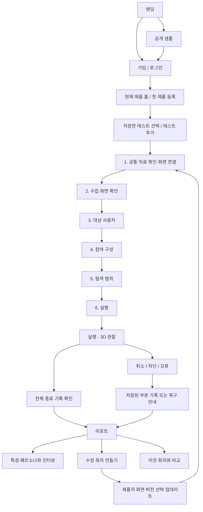

# PersonaLab — 전체 화면 구성과 사용자 흐름

> **상세 구성 기획(2026-11-07): [PRODUCT_MASTER_PLAN.md](PRODUCT_MASTER_PLAN.md)** — 화면별 배치·버튼·상태·이동·미해결 질문. [추가 아이디어 80개](PRODUCT_IDEA_BACKLOG.md)는 우선순위와 선행 조건을 별도로 정리했습니다. 권장 구성과 현재 구현을 구분해 읽습니다.

작성일: 2026-11-07  
범위: 공개 랜딩 → 가입·로그인 → 워크스페이스 → 테스트 설정 → 실행 → 리포트 → 1대1 인터뷰 → 수정 회차·비교

이 문서는 **우리 웹에 무엇을 넣고, 어디에 배치하고, 어떤 순서로 사용하게 할지** 정리한 화면 요구사항이다. 모든 항목이 현재 구현됐다는 뜻은 아니다. 최근 사용자 피드백을 반영한 목표 구성이며, 현재 구현과의 차이는 마지막에 정리한다. 화면을 새로 만들거나 수정할 때 이 문서의 화면 목적·정보 우선순위·이동 조건을 함께 확인한다.

기술 명세와 변경 금지 규칙은 [DEVELOPMENT_PLAN.md](DEVELOPMENT_PLAN.md)를 따른다. 이전 논의·개발 이력은 [UX_WORKFLOW.md](UX_WORKFLOW.md)에 남긴다. 이 문서를 작성하면서 앱 코드나 DB를 변경하지 않는다.

> **제품 중심 방향(2026-11-07): [한 앱의 다양한·반복 테스트](PRODUCT_CONTINUOUS_TESTING.md)** — 제품 → 테스트 → 회차/실행을 기본으로 합니다. 앱 자료를 공통으로 연결하고, 여러 UX 테스트를 저장해 변경 후 필요한 테스트를 다시 돌립니다. 아래의 홈·용어·이동 기준도 이 방향으로 수정했습니다.

## 목차

1. [제품 정의와 용어](#1-제품-정의와-용어)
2. [전체 이용 흐름](#2-전체-이용-흐름)
3. [공통 디자인·동작 원칙](#3-공통-디자인동작-원칙)
4. [랜딩 페이지와 공개 샘플](#4-랜딩-페이지와-공개-샘플)
5. [가입·로그인](#5-가입로그인)
6. [워크스페이스 홈](#6-워크스페이스-홈)
7. [보관함·전체 실행 기록·계정](#7-보관함전체-실행-기록계정)
8. [새 테스트 설정](#8-새-테스트-설정)
9. [실행과 3D 관찰](#9-실행과-3d-관찰)
10. [리포트](#10-리포트)
11. [1대1 인터뷰](#11-1대1-인터뷰)
12. [수정 회차와 비교](#12-수정-회차와-비교)
13. [저장·오류·접근 권한](#13-저장오류접근-권한)
14. [사용량·결제와 후속 기능](#14-사용량결제와-후속-기능)
15. [현재 구현과 정리할 부분](#15-현재-구현과-정리할-부분)
16. [구현 순서와 완료 기준](#16-구현-순서와-완료-기준)

## 1. 제품 정의와 용어

> **다양한 AI 페르소나가 웹·앱 프로토타입을 탐색하고, 화면별 행동과 불편의 근거를 확인한 뒤, 같은 페르소나와 인터뷰하는 UI·UX 검토 도구.**

사용자는 제품을 연결하고 대상 사용자를 구성한다. 에이전트가 지원되는 범위에서 화면을 탐색하면, 사용자는 관찰 기록과 리포트를 보고 수정할 부분을 결정한다.

### 다루는 내용

- 첫 화면에서 제품과 다음 행동을 이해하는지.
- 필요한 메뉴와 기능을 찾을 수 있는지.
- 화면 이동·입력·안내·오류 상태에서 무엇이 막히는지.
- 같은 화면을 서로 다른 특성의 페르소나가 어떻게 탐색하는지.
- 어떤 판단이 실제로 관찰한 화면과 행동에 근거하는지.
- 수정 전후에 같은 문제가 다시 관찰되는지.

기획 아이디어 평가, 시장성, 구매 의향, 기능 선호, 가격 설문은 현재 제품 범위에 넣지 않는다. AI 기록을 실제 사용자 응답이나 서비스 전체의 품질 보증으로 표현하지 않는다.

### 고객에게 보여줄 용어

| 용어 | 의미 |
| --- | --- |
| 워크스페이스 | 제품들과 그 안의 테스트·기록을 관리하는 공간 |
| 제품 | 계속 개선하는 하나의 앱·웹. 여러 독립 테스트의 상위 맥락 |
| 화면 버전 | 제품의 특정 시점 연결·수집 자료. 테스트 회차와 별개 |
| 테스트 | 같은 제품에서 반복해 확인할 UX 질문·흐름·관점 |
| 회차 | 입력 화면·참여자·범위를 고정한 한 번의 검토 버전 |
| 실행 | 해당 회차의 에이전트 탐색 작업 |
| 대상 사용자 | 이번에 어떤 사용자의 관점으로 볼지 적는 설명 |
| 참여 페르소나 | 실제로 이번 실행에 선택된 AI 프로필 |
| 화면 수집 | 연결 가능한 페이지의 구조와 이미지를 가져오는 사전 작업 |
| 탐색 | 에이전트가 실제로 화면을 관찰하고 행동하는 과정 |
| 리포트 | 실행 기록을 정리한 결과 문서 |
| 인터뷰 | 같은 실행의 특정 페르소나에게 기록을 바탕으로 묻는 대화 |

고객 화면에서는 ‘스터디’, 내부 패널 이름, seed, 원천 식별자, 시스템 프롬프트를 기본 용어로 쓰지 않는다. 최신 사용자 방향에 따라 제품을 기본 묶음으로 두고 그 안에 다양한 테스트와 반복 회차를 관리한다. 제품 위에 불필요한 별도 프로젝트/폴더 생성 단계를 더 강제하지 않는다. 현재 DB의 products 입력 모델과 새 제품 허브는 구분한다.

## 2. 전체 이용 흐름

부분 기록이 하나도 없으면 빈 리포트로 보내지 않는다. 인터뷰는 실행이 종료되고 해당 페르소나의 종료 기록이 있을 때만 연다.

### 사용 상황별 첫 진입

| 상황 | 보여줄 화면 | 가장 중요한 행동 |
| --- | --- | --- |
| 제품이 없는 첫 가입 | 첫 제품 등록 | 앱·웹 등록 |
| 기존 제품 있음 | 마지막 제품 홈 | 저장한 테스트 이어서 보기 |
| 작성하던 테스트 있음 | 목록의 마지막 작성 단계 | 이어서 설정 |
| 서버에서 실행 중 | 현재 실행 상태 | 실행 보기 |
| 종료 기록 있음 | 최신 회차의 결과 | 결과 보기 |
| 일부만 저장하고 중단 | 중단 이유와 저장 범위 | 부분 기록 보기 / 설정 수정 |
| 결과 보고 개선함 | 제품의 화면 업데이트·기존 테스트 | 필요한 테스트를 같은 조건으로 재검토 |

로그인 후 대시보드를 거쳐 또 개요를 지나 실행으로 가는 불필요한 경유 화면을 만들지 않는다.

## 3. 공통 디자인·동작 원칙

### 정보 우선순위

모든 내부 화면은 **현재 위치 → 지금 필요한 정보 → 다음 행동** 순서로 읽혀야 한다.

- 제목 하나, 주요 행동 버튼 하나를 먼저 보이게 한다.
- 중요한 내용과 기본 조작은 일반적인 데스크톱에서 첫 화면에 모은다.
- 긴 원문·프로필·전체 경로·인식 정보는 상세 창이나 별도 탭으로 연다.
- 설정은 짧은 페이지로 나누고, 결과 목록은 페이지를 나눠 보여준다.
- 인터뷰는 대화 영역만 스크롤한다. 작은 화면에서는 내용을 자르지 않고 정상 스크롤을 허용한다.
- 긴 설명을 작은 글씨로 밀어 넣지 않는다. 본문은 대체로 14~16px, 보조 정보는 12~13px를 기준으로 검토한다.
- 기존 랜딩의 글꼴과 따뜻한 밝은 배경을 유지한다. 제목의 세리프와 본문·조작의 산세리프 역할을 구분한다.
- 강한 색은 현재 선택, 주요 행동, 실제 오류에 한정한다. 수치 위젯·차트는 다음 판단에 도움이 될 때만 넣는다.
- 애니메이션은 선택 전환·실제 행동·상태 변화에 사용한다. 수신되지 않은 행동을 만들어 재생하지 않는다.

### 내비게이션

| 위치 | 메뉴 / 이동 규칙 |
| --- | --- |
| 공개 랜딩 로고 | 랜딩 맨 위 |
| 로그인 화면 로고 | 랜딩 |
| 로그인한 내부 로고 | 현재 제품 홈. 제품 맥락이 없으면 전체 제품 |
| 제품 홈 메뉴 | 테스트 / 발견 모음 / 실행 기록, 공통 자료·참여 구성 접근 |
| 테스트 내부 메뉴 | 테스트 설정 / 실행 / 리포트 / 1대1 인터뷰 |
| 설정 내부 진행 표시 | 화면 연결 / 수집 화면 확인 / 대상 사용자 / 참여 구성 / 탐색 범위 / 실행 확인 |

테스트 내부 메뉴는 같은 위치를 유지하고 접근 가능한 상태만 바꾼다. 불가능한 메뉴는 잠금 이유를 짧게 설명한다. 사이드바 클릭, 이전·다음, 주소 직접 입력, 새로고침에도 같은 조건을 적용한다.

**‘이전·다음’은 작성 단계에 사용한다.** 실행 이후에는 ‘결과 보기’, ‘이 사람과 인터뷰’, ‘수정 회차 만들기’처럼 목적이 분명한 행동으로 전환한다. 개요는 필요할 때 설정 요약을 확인하는 보조 화면으로 둔다.

### 알림

일시적인 성공·오류 알림은 화면 최상단 중앙에 표시한다. 저장 실패나 실행 차단처럼 해결이 필요한 상태는 해당 화면에도 남긴다. 알림이 사라져도 사용자가 문제를 놓치지 않아야 한다. 로컬 연결 점검·데모 둘러보기는 내부 기본 메뉴에 넣지 않는다.

## 4. 랜딩 페이지와 공개 샘플

목적: 무엇을 하는 서비스인지 빠르게 이해하고, 실제 결과 형식을 확인한 뒤 시작하게 한다.

### 상단 메뉴

- PersonaLab 로고.
- 어떻게 살펴보나요: 사용 방식 구역으로 이동.
- 결과 미리보기: 공개 샘플로 이동.
- 로그인: 기존 계정 로그인.
- 시작하기: 신규 사용자 가입.
- 로그인한 방문자에게는 ‘워크스페이스로’를 표시한다.

### 본문은 네 구역

| 구역 | 반드시 들어갈 내용 | 행동 |
| --- | --- | --- |
| ① 첫 화면 | 중앙 정렬 제목, 짧은 서비스 설명, 시작 버튼, 사람 이미지 표현 | 시작하기 / 결과 미리보기 |
| ② 어떻게 사용하는지 | 화면 연결 → AI 페르소나 탐색 → 결과와 인터뷰의 세 장면 | 장면 전환 |
| ③ 어떤 결과를 받는지 | 실제 샘플의 화면, 행동, 판단 근거, 후속 질문 예시 | 샘플 결과 열기 |
| ④ FAQ와 마지막 시작 안내 | 짧은 질문 목록과 시작 버튼, 푸터 | 질문 펼치기 / 시작하기 |

히어로의 예시 문구:

> **화면은 같아도, 경험은 다르니까.**  
> AI 페르소나가 화면을 탐색하고, 어디서 막혔는지 기록합니다.  
> 결과를 확인하고, 같은 페르소나에게 이유를 물어보세요.

기존 사람 사진 표현을 유지하되 제목 옆에 큰 결과 카드를 추가하지 않는다. 사진을 누르면 그 자리 부근에 작은 프로필 팝오버를 연다. 공개용 요약·행동 특성·AI 이미지 표시를 넣고, 원본 카드 전문이나 내부 프롬프트 복사 기능은 넣지 않는다. 실제 인물의 사진으로 오인시키지 않는다.

### FAQ에 넣을 질문

| 질문 | 답변의 핵심 |
| --- | --- |
| 실제 사용자가 테스트하나요? | AI 페르소나의 탐색이며 실제 사용자 조사와 구분한다. |
| 어떤 화면을 연결할 수 있나요? | 지원되는 웹 링크·HTML·Figma·직접 등록 시안의 차이를 설명한다. |
| 모바일 앱도 가능한가요? | 모바일 프로토타입과 설치 앱의 직접 실행을 구분한다. |
| 사이트 전체를 다 살펴보나요? | 발견·접근·실제 탐색한 범위를 보여주며 전체 검증을 보장하지 않는다. |
| 어떤 페르소나를 사용하나요? | 보유 프로필에서 조건과 인원으로 구성하고 교체할 수 있다. |
| 결과를 보고 추가 질문할 수 있나요? | 해당 실행을 마친 페르소나와 기록을 근거로 대화한다. |
| 실행과 인터뷰는 어떻게 과금되나요? | 실제 제공 중인 요금·사용량 정책만 안내한다. 정책 확정 전 금액을 만들어 넣지 않는다. |

FAQ는 가로로 넓은 질문 행과 오른쪽 펼침 버튼을 사용한다. 버튼 모양은 승인한 기존 랜딩 스타일을 유지한다. 답변은 필요할 때 펼친다.

푸터에는 서비스명, 문의, 이용약관, 개인정보 안내를 둔다. 운영자 정보·링크는 실제 확정된 것만 넣는다.

### 공개 샘플

로그인 없이 샘플의 실행 기록·리포트·인터뷰 예시를 볼 수 있다. 저장된 AI 기록 또는 가상 예시라는 출처를 표시한다. 공개 샘플 조작으로 유료 실행이 시작되거나 개인 테스트가 변경되지 않아야 한다.

고객 로고, 성공률, 실제 사용자 수, 개선 효과를 근거 없이 추가하지 않는다. 제품 설명에 ‘준비 중’ 배지를 반복하지 않되 미구현 기능이 작동하는 것처럼 보이게 하지 않는다.

## 5. 가입·로그인

목적: 기존 사용자와 신규 사용자가 자기 흐름으로 진입하게 한다.

| 화면 | 내용 | 주요 버튼 | 완료 후 |
| --- | --- | --- | --- |
| 로그인 | 이메일, 비밀번호, 비밀번호 표시, 오류 안내, 가입 전환 | 로그인 | 마지막 제품 홈 |
| 회원가입 | 이메일, 비밀번호, 입력 조건, 필요한 약관 안내, 로그인 전환 | 계정 만들기 | 첫 제품 등록 |
| 세션 복원 | 계정 확인 상태, 실패 시 재시도 | 다시 연결 | 확인된 기존 화면 또는 워크스페이스 |
| 비밀번호 복구 | 복구 이메일 입력·발송 결과 | 복구 안내 받기 | 별도 구현 후 제공 |

- 현재 프로젝트의 비밀번호 최소 길이는 사용자 요청에 따른 4자다. UI 안내와 서버 검증을 일치시킨다.
- 가입과 로그인 버튼이 같은 입력 모드를 열지 않게 한다.
- 오류는 입력란 가까이에 짧게 표시하고 해당 필드로 이동한다.
- 전송 중 중복 제출을 막고 실패하면 입력을 유지한다. 비밀번호는 로컬 초안에 저장하지 않는다.
- 새 로그인은 마지막 제품 홈으로 이동한다. 제품이 없으면 첫 제품 등록, 기존 세션 새로고침은 소유권 확인 후 같은 작업을 복원한다.
- 없는 비밀번호 복구·소셜 로그인 버튼을 장식으로 붙이지 않는다. 고객 공개 전 필요한 계정 복구 경로를 별도로 완성한다.

## 6. 워크스페이스 홈

목적: **같은 제품에서 여러 테스트를 관리하고, 화면이 바뀌면 필요한 테스트를 다시 실행하는 것.** 상세 구조는 [제품 중심 기획](PRODUCT_CONTINUOUS_TESTING.md)을 따른다.

### 전체 제품과 제품 홈

| 위치 | 내용 |
| --- | --- |
| 전체 제품 | 앱·웹 카드와 제품 등록. 제품이 하나면 매번 경유하지 않음 |
| 제품 홈 사이드바 | 제품 선택기, 테스트 / 발견 모음 / 실행 기록, 공통 자료·구성 접근 |
| 제품 홈 상단 | 제품명·현재 화면 버전·화면 업데이트 |
| 목록 도구 | 이름 검색·상태/최신성 필터·테스트 추가 |
| 본문 | 가입·검색·전반 탐색 등 저장한 테스트. 각 테스트의 최근 회차를 대표로 표시 |
| 테스트 행 | UX 질문, 마지막 검토 화면 버전, 회차, 상태, 한 줄 요약, 다음 행동 |

### 상태별 다음 행동

| 상태 | 주 버튼 |
| --- | --- |
| 작성 중 | 이어서 설정 |
| 실행 중 | 실행 보기 |
| 현재 화면에서 종료 | 결과 보기 |
| 이전 화면 버전에서만 검토 | 최신 화면으로 재검토 |
| 중단·부분 기록 | 부분 기록 보기 |
| 기록 없음·오류 | 연결/설정 확인 |

현재 자료가 v1.4, 마지막 가입 테스트가 v1.3이면 이 차이를 표시한다. 종료된 테스트라고 최신 자료를 검토한 것은 아니다. 재검토는 새 버전·조건·사용 상한 확인 후 실행한다.

### 공통 자료와 반복

제품의 연결·화면 버전·대상 설명·저장 참여 구성을 재사용한다. 각 회차는 실행 당시의 자료와 조건을 고정한다. 화면 업데이트가 과거 결과·실행 중 자료·인터뷰를 바꾸지 않아야 한다.

제품 홈에서는 여러 테스트를 선택해 실행 준비할 수 있도록 확장한다. 먼저 단일 재실행을 안정화하고 묶음 실행에는 작업 큐·전체 상한·개별 실패 처리를 갖춘다. 자료 업데이트만으로 자동 유료 실행하지 않는다.

### 관리 범위

제품 관리와 테스트 관리를 구분한다. 테스트 복제는 같은 제품 안의 별도 질문/초안으로 생성하며 결과·인터뷰를 복사하지 않는다. 같은 질문의 반복은 새 회차다. 제품 이동·삭제와 테스트의 휴지통/복원/회차 보존은 영향 범위를 명시한다. 이름·URL이 같다는 이유로 기존 테스트를 자동 병합하지 않는다.

## 7. 보관함·전체 실행 기록·계정

### 페르소나 보관함

조건 검색, 프로필 요약, 해당 조건의 후보 수, 페이지 이동을 제공한다. 이름·사진보다 이번 테스트와 관련 있는 특성이 먼저 읽혀야 한다. 보관함 전체를 둘러보는 것은 선택 사항이며 신규 테스트 생성의 필수 경유 단계가 아니다.

고객에게 보여줄 정보는 표시용 ID, 연령, 직무·생활 유형, 지역, 거친 디지털 사용 특성, 요약 소개다. 원본 카드 전문, 원천 응답자 식별자, 내부 매칭 정보, 엔진 프롬프트는 숨긴다. AI 대표 이미지가 여러 프로필에 재사용될 수 있음을 오인 없이 설명한다.

### 전체 실행 기록

테스트명, 회차, 실행 시각, 상태, 참여 인원, 결과 접근을 제공한다. 특정 실행을 누르면 그 실행을 연다. 임의로 최신 회차로 바꾸지 않는다. 테스트·상태·기간 필터는 실제 저장 데이터가 지원하는 범위에서 제공한다.

### 계정 메뉴

계정 이메일, 로그아웃, 계정 설정 접근을 둔다. 사용량·결제는 실제 원장과 연결한 뒤 추가한다. 팀 이름 선택기·멤버 초대·권한 설정은 팀 기능을 구현한 뒤 노출한다.

## 8. 새 테스트 설정

제품에 공통 자료·대상·참여 구성이 있으면 상속하고 필요한 변경만 확인한다. 아래 여섯 페이지는 세부 설정 경로이며 매번 모든 입력을 비운 채 다시 작성시키지 않는다.

설정은 여섯 개의 짧은 페이지로 나눈다. 단계 이름과 현재 위치를 상단에 고정하고, 하단에는 이전·다음을 둔다. 단계를 바꿔도 작성 내용은 유지한다. 미완료 항목은 구체적으로 알려주며 다음 단계로 조용히 넘어가지 않는다.

### 8-1. 화면 연결

목적: 자료를 넣고 **시작 화면이 제대로 연결됐는지** 확인한다.

- 제품 유형: 웹 서비스 / iOS 앱 / Android 앱.
- 자료 종류: 웹·프로토타입 링크 / HTML·ZIP / Figma·직접 등록.
- 주소 입력 또는 파일 업로드, 연결 버튼.
- 데스크톱·모바일 보기 크기. 앱 프로토타입은 모바일 기준.
- 테스트 이름: 화면 제목으로 제안하되 사용자가 쓴 이름은 유지.
- 오른쪽: 연결한 시작 캡처, 원본 주소, 새로고침, 확대.
- 배경 설명 보완: 선택 입력으로 접어 둠.

이 페이지에 전체 페이지 목록, 세부 DOM 목록, 과제 입력, 대상 사용자 설정까지 쌓지 않는다.

자료별 지원 차이:

| 자료 | 가능한 경험 | 반드시 구분할 점 |
| --- | --- | --- |
| 웹 URL | 격리 브라우저의 실제 화면·클릭·가상 입력·스크롤 | 로그인·다른 출처·서버 변경 동작의 제한 |
| 정적 HTML 묶음 | 업로드한 화면과 내부 연결 탐색 | 별도 서버 빌드나 실제 앱 백엔드를 자동 재현하지 않음 |
| Figma·직접 연결 시안 | 제공된 화면 이미지·문구·이동 연결 탐색 | 실제 서비스 실행과 구분 |
| iOS·Android 프로토타입 | 모바일 화면과 연결 흐름 검토 | APK·IPA 설치 및 OS 기능 직접 조작은 현재 경로에 포함되지 않음 |

실패한 연결은 기존에 확인한 자료를 덮어쓰지 않는다. 새 주소를 넣었는데 이전 사이트 제목·캡처가 새 연결 결과처럼 남지 않아야 한다.

### 8-2. 수집 화면 확인

목적: 가져온 화면과 누락 범위를 확인한다. **사용성 결과를 미리 판정하는 페이지가 아니다.**

- 수집된 이미지 카드와 페이지 이름·주소.
- 수집 중 / 수집 완료 / 일부 확인 필요 상태.
- 발견 수, 이미지 확보 수, 미수집 수를 서로 구분.
- 이미지 확대, 목록 페이지 이동, 필요한 경우 더 수집.
- 확인할 부분: 접근 불가·이미지 실패·지원하지 않는 영역을 짧게 요약.
- DOM·요소 개수·요청 차단 등의 기술 정보는 상세 탭 안에 배치.

URL/HTML 사전 수집은 구조와 이미지를 가져오는 빠른 단계로 유지한다. 여기서 유료 페르소나 탐색을 시작하거나 버튼을 전부 실행하지 않는다.

진행률은 실제 발견 목록 기준이라는 뜻을 명시한다. 분모가 확정되지 않으면 가짜 백분율 대신 ‘12개 수집 중’처럼 표시한다. 수집 완료는 사이트 전체 검증 완료가 아니다.

진행 중에는 대상 사용자 단계로 넘어가지 않는다. 종료한 수집 묶음에 사용할 캡처가 있으면 확인 후 진행한다. 일시정지·오류로 일부만 확보한 경우에는 확인된 범위와 남은 범위를 보고 진행 여부를 선택한다. 확보 자료가 전혀 없으면 연결을 다시 해결한다.

### 8-3. 대상 사용자

목적: 누구의 관점으로 살펴볼지 짧게 정의한다.

- 대상 사용자 설명: 필수, 한두 문장.
- 사용 상황: 선택.
- 이전: 수집 화면 확인.
- 다음: 참여 구성.

예시: ‘예약과 고객 응대를 혼자 처리하는 소규모 매장 운영자’. 사용자가 제품 기획서를 다시 작성하도록 요구하지 않는다. 이 설명을 특정 실제 프로필의 경력·특성으로 덮어쓰지 않는다.

### 8-4. 참여 구성

목적: 보유 페르소나에서 조건에 맞는 인원을 구성하고 확인한다.

왼쪽에는 조건과 인원, 오른쪽에는 이번 참여 명단을 둔다.

- 참여 인원과 조건은 기본으로 열린 상태.
- 연령 범위, 직무·생활 유형, 지역, 디지털 친숙도 등 실제 자료에 존재하는 조건.
- 구성 추천받기.
- 추천 구성 요약: 연령대·직무·친숙도별 구성.
- 짧은 인물 행: AI 대표 이미지, 표시 ID, 프로필 핵심, 교체·제외.
- 필요할 때 직접 선택하기와 프로필 상세.
- 선택한 구성 저장, 이전·다음.

전체 수백 명을 처음부터 펼쳐 놓지 않는다. 후보가 부족하면 가능한 수를 설명하고 조건 변경 또는 적은 인원 사용을 선택하게 한다. 조건을 몰래 완화하거나 존재하지 않는 인물을 만들어 채우지 않는다. 동일 원천의 중복 프로필을 같은 구성에 반복 배치하지 않는다.

조건 변경 후에는 구성의 재확인·저장이 필요하다. 교체 취소·추천 실패는 기존 선택을 보존한다. 추천을 실제 시장의 대표 표본이라고 설명하지 않는다.

### 8-5. 탐색 범위

목적: **기본은 전반 탐색**, 추가로 집중할 부분을 선택한다.

- 전체적으로 살펴보기: 기본.
- 특히 살펴볼 화면·기능: 선택.
- 특정 흐름만 확인: 선택 모드. 이때 시작점·사용 목적·완료 기준 입력.
- 포함된 페이지와 접근 제한 요약.
- 실행 규모·행동 상한 확인. 내부 용어보다 영향이 이해되게 설명.

처음부터 사용자에게 과제 하나를 반드시 쓰게 하지 않는다. 다만 ‘전반 탐색’이 모든 URL·모든 탭·모든 상태를 검사한다는 뜻은 아니다. 여러 목적의 자동 생성·배분은 현재 구현 범위를 확인하며 확장한다. 특정 흐름 모드의 완료율을 전체 서비스 성공률로 섞지 않는다.

### 8-6. 실행 확인

목적: 실행 전에 필요한 조건만 마지막으로 확인한다.

| 요약 | 수정 이동 |
| --- | --- |
| 대상 이름·자료 종류·화면 크기 | 화면 연결 |
| 확보한 화면·남은 범위 | 수집 화면 확인 |
| 대상 사용자·참여 인원·대표 구성 | 대상 사용자 / 참여 구성 |
| 전반 탐색 또는 특정 흐름·집중 항목 | 탐색 범위 |
| 실행 제한·외부 모델 사용 안내 | 관련 설정 / 안내 |

주요 버튼은 ‘탐색 시작’. 연결 실패, 미저장 구성, 실행 불가 상태면 이유와 해결 행동을 먼저 보여준다. 실제 과금 시스템이 생기면 실행 전 예상 또는 최대 사용량을 표시하되 아직 계산하지 않은 금액은 넣지 않는다. 버튼 연타로 실행이 중복 생성되지 않게 한다.

## 9. 실행과 3D 관찰

목적: **누가 어느 화면에서 무엇을 했고, 현재 실행이 어떤 상태인지** 보여준다.

### 3D와 경로의 역할

- 중앙: 선택한 한 페르소나의 실제 관찰 화면.
- 좌우: 다른 페르소나의 관찰 화면. 누르면 그 사람으로 전환.
- 아래 경로: 선택한 사람의 화면 이동. 예: `홈 → 로그인 → 회원가입`.
- 행동 기록: 경로에서 고른 화면의 클릭·입력·스크롤·종료 기록.

**3D 좌우 화면은 이전·다음 페이지가 아니다.** 사람 전환과 화면 이동을 별도 조작으로 제공한다. 내부 화면 ID보다 사람이 이해할 수 있는 화면 이름을 먼저 쓴다.

### 첫 화면의 정보 구성

| 위치 | 내용 |
| --- | --- |
| 상단 | 실행 중 / 중단 / 종료 / 기록 재생 상태, 전체 참여 인원과 종료 기록 수 |
| 사람 선택 | 표시용 ID·짧은 프로필·진행 상태 |
| 중앙 | 큰 3D 캡처, 실제 좌표의 행동 표시, 확대 |
| 화면 아래 | 현재 행동과 대상, 짧은 판단 한두 줄, 자세히 |
| 하단 도구 | 선택한 사람의 이동 경로, 이전·다음 행동, 기록 재생, 최신 기록으로 |
| 상태별 주요 행동 | 실행 취소 / 결과 보기 / 중단 위치 확인 |

총 인원, 화면 수, 행동 순서를 모두 ‘진행률’처럼 나열하지 않는다. ‘3명 중 1명 종료’와 ‘이 사람의 2번째 행동’을 구분한다. 사용자가 수동으로 고른 사람·기록은 새 이벤트가 와도 바꾸지 않는다.

### 상태별 내용과 버튼

| 상태 | 제목·안내 | 주요 행동 | 하지 않을 것 |
| --- | --- | --- | --- |
| 실행 대기 | 탐색을 준비하고 있어요 | 실행 취소 | 가짜 클릭·회전 반복 |
| 실행 중 | 페르소나 탐색 중 | 관찰 / 실행 취소 | 결과를 최종 완료로 표시 |
| 새 캡처 수신 중 | 다음 화면을 불러오는 중 | 기존 장면 유지 | 이전 이미지 위에 새 판단 표시 |
| 사용자가 과거 기록 선택 | 저장된 기록을 보고 있어요 | 최신 기록으로 | 서버 실행까지 멈췄다고 표시 |
| 중단·차단·오류 | 탐색이 중단됐어요 + 위치·이유 | 부분 기록 보기 / 설정 수정 | LIVE 표시, 자동 유료 재시도 |
| 모두 종료 | 탐색 기록이 저장됐어요 | 결과 보기 | 모든 사용성이 검증됐다고 표시 |
| 저장된 실행 다시 열기 | 실행 기록 | 재생 / 결과 보기 | 현재 에이전트가 실행 중인 것처럼 표시 |
| 종료됐지만 기록 없음 | 확인할 기록이 없어요 + 원인 | 설정 확인 | 빈 리포트로 이동 |

실행 이후 하단에 작성 단계용 ‘이전·설정 확인 → 다음’ 막대를 그대로 유지하지 않는다. 상태별 주요 행동을 보여준다. 중단됐다는 사실을 일시적인 알림 하나에만 맡기지 않는다.

### 빈 캡처·대기 화면

- 기록이 없는 사람: ‘탐색 기록 없음’ 또는 ‘실행 대기’로 표시. 연결 당시 이미지를 쓰면 ‘시작 화면 미리보기’라고 명시.
- 이미지 로드 실패: 확인된 이전 캡처를 유지하고 재시도. 현재 행동 위치 표시는 중지.
- 로딩 중 저장된 캡처: 불완전한 캡처임을 표시. 정상 화면처럼 클릭 애니메이션을 강조하지 않는 방향으로 보완.
- 조작 실패: 시도 전 화면과 차단 이유를 표시. 성공한 이동으로 경로에 넣지 않음.
- 과거에 흰 화면으로 저장된 이미지: 복원한 것처럼 만들지 않음. 새 실행이 필요함을 해당 상태에서 설명.

### 실제 연동 기준

캡처·페르소나·화면 이름·행동 대상·좌표·판단은 같은 기록 ID에 연결한다. 새 이미지의 로드·디코드가 끝나기 전에는 새 설명만 먼저 표시하지 않는다. 묶음으로 도착한 기록은 순서대로 보여주며, 지연된 재생과 현재 서버 상태를 구분한다.

‘기록 재생 멈춤’은 뷰어만 멈춘다. ‘실행 취소’는 서버 작업을 취소한다. 연속 영상이 아닌 행동별 캡처 갱신이라는 점을 짧게 밝힌다. 모션 감소 설정에서는 회전·터치 파동을 줄여도 선택과 상태가 분명해야 한다.

## 10. 리포트

목적: **먼저 볼 문제와 그 근거를 확인하고, 다음 수정 또는 인터뷰를 선택한다.**

### 상단과 탭

- 테스트명·회차.
- 최종 결과 / 부분 실행 기록 구분.
- 종료 기록 인원, 실제 방문 범위, 기록 누락 또는 한도 종료 요약.
- 핵심 발견 / 페르소나별 기록 / 확인 범위 탭.
- 기록 재생, 내보내기, 수정 회차 만들기.

큰 성적표, 종합 점수, 실측하지 않은 만족도·체류 시간·시선 수치를 넣지 않는다. 사전 수집 페이지와 실제 방문 페이지를 하나의 수치로 합치지 않는다.

### 핵심 발견

왼쪽은 짧은 발견 목록, 오른쪽은 선택한 발견의 근거 화면을 보여준다. 목록은 페이지를 나눠 긴 스크롤을 막는다.

발견 하나에 필요한 내용:

- 무엇을 확인해야 하는지 알 수 있는 짧은 제목.
- 어느 화면·흐름인지.
- 관련 페르소나 수와 집계 대상 수.
- 실제 캡처와 행동·판단 원문.
- 해당 기록의 출처와 종료 상태.
- 다음 확인 제안: 관찰된 사실과 구분한 수정 가설.
- 원문·경로 보기 / 이 페르소나와 인터뷰.

심각도·우선순위는 판단 근거가 있을 때만 추가한다. 현재의 중단 이유 묶음을 모든 UX 문제를 자동 발견한 결과로 확대 해석하지 않는다.

### 페르소나별 기록

인물 목록·종료 상태 필터와 선택한 사람의 화면·경로를 제공한다. 목표 도달, 자발적 중단, 탐색 한도, 시스템 실패, 종료 기록 없음은 구분한다. 읽지 못한 사람의 결과를 임의로 채우지 않는다.

### 확인 범위

페이지별로 사전 수집 여부, 실제 방문 여부, 미확인 이유를 보여준다. 발견 목록 기준이라는 분모를 설명한다. 한 번 방문했다고 그 페이지의 모든 요소·접근성·기능을 검증한 것은 아니다.

### 내보내기

보고서 문서, 원본 기록, 인쇄/PDF 저장을 제공한다. 회차·실행·출처·부분 상태·미확인 범위가 함께 나가야 한다. 보호된 이미지 링크와 누구나 열 수 있는 공개 공유 링크는 구분한다. 공개 링크·권한 공유는 후속 구현 전까지 약속하지 않는다.

## 11. 1대1 인터뷰

목적: 결과에서 궁금한 점을 **그 기록을 남긴 페르소나에게** 묻는다.

- 리포트에서 인물을 선택해 들어오면 해당 사람과 실행 맥락 유지.
- 왼쪽: 대상 선택, 요약 프로필, 마지막 탐색 화면, 경로·근거 보기.
- 본문: 질문·답변·근거 이벤트.
- 하단: 질문 입력과 보내기. 대화만 내부 스크롤.
- 빈 대화에는 관련 질문 예시 두 개 정도.
- 문답 저장·재접속 복원·대화 내보내기.

### 답변 방식

| 방식 | 의미 | 안내 |
| --- | --- | --- |
| 기록에서 답 찾기 | 저장된 로그를 조회·정리 | 새 모델 호출 없음 |
| AI와 대화 | 카드·해당 실행 기록·최근 문답으로 새 답변 생성 | 토큰 사용과 전송 범위를 짧게 표시 |

두 방식을 명확히 구분한다. 기본 모드 변경이나 자동 유료 전환은 별도 결정 없이 적용하지 않는다. 현재는 기록 기반으로 시작하고 사용자가 AI 대화를 선택한다.

질문 예시:

- ‘이 화면에서 어떤 안내를 보고 다음 행동을 골랐나요?’
- ‘어디에서 멈췄고, 당시 어떤 점이 불분명했나요?’

답변은 근거 화면이나 로그를 열 수 있어야 한다. 방문하지 않은 화면은 확인하지 못했다고 답한다. 추가 추론은 원문과 구분한다. 인터뷰 답변으로 원래 행동·중단 이유를 수정하지 않는다. 다른 테스트나 다른 사람의 대화를 섞지 않는다.

실행 중에는 진입을 막고, 종료된 실행에서도 종료 기록이 없는 사람은 선택할 수 없게 한다. 답변 생성 중 중복 전송을 막고 실패하면 질문 초안을 보존한다.

## 12. 수정 회차와 비교

목적: 같은 제품을 개선하며 반복해서 검토할 수 있게 한다.

### 수정 회차

이전 연결 자료, 대상 사용자, 페르소나 구성, 범위를 복사한다. 새 결과와 인터뷰는 비워 둔다. 사용자는 수정된 URL·HTML·시안을 연결하고 다시 확인한다. 실행한 과거 회차의 입력·기록은 덮어쓰지 않는다.

제품 홈에는 여러 테스트를 두고, 각 테스트의 최신 회차를 대표로 보여준다. 앱 화면 버전과 테스트 회차를 구분한다. 과거 회차는 이력에서 연다. 별도 독립 작업을 원할 때는 복제를 사용한다.

### 비교 화면

- 비교할 두 회차 선택.
- 입력·참여 구성·범위의 변경 여부.
- 같은 화면·흐름에서 반복되거나 새로 나타난 발견.
- 각 회차의 실제 근거 화면·기록.
- 방문하지 않은 영역과 비교 불가능한 조건.

‘이번에 관찰되지 않음’을 ‘해결됨’으로 자동 단정하지 않는다. 조건이 다른 실행을 개선률 하나로 비교하지 않는다. 최종 비교는 종료가 확인된 회차를 사용한다.

## 13. 저장·오류·접근 권한

### 필수 상태 처리

| 상황 | 필요한 처리 |
| --- | --- |
| 입력 저장 중 | 저장 중 표시, 중복 제출 방지 |
| 저장 실패 | 값 유지, 실패 위치, 재시도 |
| 이전 단계로 이동 | 입력 유지, 이미 바꾼 조건과 저장 상태 구분 |
| 새로고침 | 계정·서버 상태 확인 후 동일 테스트·회차 복원 |
| 오래된 완료 캐시 | 서버 종료 확인 전 결과 잠금 |
| 계정 전환·로그아웃 | 개인 초안·팝업·이미지·채팅 초기화 |
| 늦게 도착한 요청 | 현재 계정·테스트·실행과 다르면 적용하지 않음 |
| 세션 만료 | 재로그인 안내, 타 계정에 자료 노출 금지 |
| 실행 중 페이지 이탈 | 서버 실행과 기록 보존, 재접속 후 복원 |
| 결과 일부만 있음 | 부분 기록으로 표시, 없는 결과 생성 금지 |
| 기록 삭제 | 적용 범위 안내, 되돌릴 수 있는 휴지통 우선 |

### 데이터와 비용에 관한 표시

- 고객에게 보이는 프로필 요약과 엔진 원본을 분리한다.
- 서비스의 실제 모델 전송 정책과 실행 가능 상태를 따른다.
- 실행 전 사용 목적·전송 범위·과금 여부를 이해할 수 있게 안내한다.
- 모델 호출 실패를 자동으로 무한 재시도하지 않는다.
- 사진의 현실감과 실제 응답자 여부를 혼동시키지 않는다.
- 데이터 이용 조건·상업적 사용 범위는 출시 전 확인 항목으로 관리한다. 사진을 가상 이미지로 바꾸는 것만으로 원자료 이용 조건이 해결되지는 않는다.

## 14. 사용량·결제와 후속 기능

수익 구조는 실행과 인터뷰의 사용량에 연결하되, 고객 화면에 모델 내부 토큰 구조를 과도하게 노출하지 않는다.

### 과금 기능을 넣을 때 필요한 것

- 실제 사용량 원장과 실행·인터뷰별 차감 내역.
- 실행 전 예상 또는 최대 사용량과 실행 후 실제 사용량.
- 잔액 부족 시 실행 전 안내.
- 중복 실행·재시도·취소·실패 시 차감 규칙.
- 청구·충전·구독을 제공한다면 실제 결제와 영수증·이력.
- 모델 호출량과 고객에게 청구하는 단위를 구분한 정책.

가격, 무료 제공량, 크레딧 환산, 실패 환급, 보관 기간은 아직 별도 확정이 필요한 제품 정책이다. 이 문서는 특정 금액을 확정하지 않는다.

### 후속 확장으로 분리할 것

| 기능 | 필요한 이유 / 선행 조건 |
| --- | --- |
| 이메일 확인·비밀번호 복구 | 운영 계정의 복구 경로 |
| 팀 워크스페이스·초대·역할 | 실제 공유 권한과 계정 격리 구현 |
| 리포트 공유 링크 | 공개 범위·만료·취소·이미지 접근 정책 |
| 로그인된 서비스 탐색 | 인증 상태 전달·보관·대상 서비스 권한 설계 |
| APK·IPA 직접 실행 | 별도 기기·에뮬레이터·OS 조작 엔진 |
| 다중 흐름 자동 계획 | 시나리오 배분·중복 탐색·예산·누락 검증 |
| 페르소나별 재시도 | 새 실행 기록과 비용·기존 결과의 연결 |
| 실제 사용자와 대조 | 모집·동의·측정·비교 기준을 갖춘 별도 흐름 |

## 15. 현재 구현과 정리할 부분

아래는 2026-11-07까지의 코드·검증 기록을 기준으로 한 요약이다. 모든 사이트·기기에서 품질을 검증했다는 의미는 아니다.

| 영역 | 현재 기반 | 앞으로 맞춰야 할 내용 |
| --- | --- | --- |
| 랜딩 | 사람 이미지·프로필 표현·샘플·FAQ 기반 | 기능 범위와 문구의 일치 유지 |
| 인증 | 실제 이메일 가입·로그인·세션·소유권 | 계정 복구·운영 인증 정책 |
| 워크스페이스 | 현행 테스트 목록·검색·회차·관리 기반 | 제품 허브·공통 자료·화면 버전·여러 테스트의 소속과 재실행 경로는 새 기획 |
| 설정 | 연결·화면 확인·대상·구성·범위·실행 확인 분리 | 오래된 안내·과도한 기술 정보 정리 |
| 화면 수집 | 링크·HTML 구조와 이미지의 빠른 수집 | 모든 앱 상태 인식으로 오인시키지 않기 |
| 페르소나 | 보유 카드 검색·추천·선택·표시용 프로필 | 표현 품질·이용 조건·고객 노출 범위 검증 |
| 실행 엔진 | 실제 캡처·클릭·입력·스크롤·종료·실패 기록 | 다양한 사이트의 접근 제한과 동적 화면 검증 |
| 3D 뷰어 | 사람 전환·좌표 표시·순차 재생·확대·원문 | **중단/LIVE/저장 기록 표시 분리, 화면 이름 경로, 대기 이미지 구분** |
| 실행 후 이동 | 서버 종료·부분 결과·인터뷰 잠금 | **작성 단계용 하단 이전/다음을 상태별 행동으로 교체** |
| 리포트 | 발견·개인 기록·범위·원문·내보내기 | 실제 관찰과 시스템 종료의 이해도 개선 |
| 인터뷰 | 기록 모드·실제 LLM 모드·문답 저장·근거 | 비용/답변 범위의 간결한 안내와 품질 검증 |
| 반복 테스트 | 수정 회차·두 회차 비교 | 조건 변경·미관찰 상태의 일관된 표시 |
| 과금·팀·설치 앱 | 별도 확장이 필요한 영역 | 완성 기능처럼 노출하지 않기 |

최근 자체 가상 인물·HTML의 실제 모델 검증에서는 클릭→완료 화면→근거 인용 인터뷰를 확인했다. 이것은 제한된 연결 검증이다. UI 화면의 접근성 트리와 회귀 검사는 확인했으나 도구 오류로 최종 픽셀 검수는 미완료다. 기록은 [실행 스튜디오 검증](../scratch/execution-studio/VERIFICATION.json)을 참고한다.

사용자가 마지막에 지적한 핵심은 ‘3D가 있느냐’만이 아니다. **지금 진행 중인지, 왜 멈췄는지, 어떤 화면 이동을 보고 있는지, 다음 행동이 무엇인지**가 분명해야 한다. 위 표의 굵은 항목은 그 피드백을 반영한 다음 수정 요구사항이며, 이 문서 작성만으로 구현 완료된 것으로 간주하지 않는다.

## 16. 구현 순서와 완료 기준

### 선행 — 제품 안에 여러 테스트를 쌓는 구조

- 제품 소속·공통 자료·화면 버전과 기존 테스트/회차의 관계 설계.
- 제품 홈에서 여러 UX 테스트를 저장하고 필요한 테스트만 새 자료로 재실행.
- 제품이 하나인 사용자의 바로 진입과 최신 버전 미검토 표시.
- 구체 순서는 [제품 중심 구현 순서](PRODUCT_CONTINUOUS_TESTING.md#12-구현-순서)를 따른다.

### 함께 지킬 1순위 — 흐름의 모호함 해결

- 실행 중·기록 재생·중단·완료의 제목과 행동을 분리.
- 3D의 사람 전환과 개인 이동 경로를 분리.
- 빈 캡처와 대기 미리보기를 실제 탐색 결과처럼 보이지 않게 처리.
- 실행 이후 하단 행동을 결과·복구 중심으로 교체.
- 목록에서 현재 상태에 맞는 화면으로 바로 이어지게 점검.

### 2순위 — 끝까지 사용하는 경험

- 결과에서 화면·판단·관련 인물을 바로 확인.
- 결과의 특정 인물에서 인터뷰로 맥락을 유지.
- 수정 회차와 비교를 연결.
- 삭제·복원·재접속·오류 복구를 실제 계정으로 확인.

### 3순위 — 고객 공개를 위한 운영

- 계정 복구, 배포 환경, 데이터 이용 범위 확인.
- 사용량·요금·실패 정산 정책과 실제 원장 구현.
- 대표적인 웹·모바일 프로토타입별 지원성 검증.
- 추가 기능은 작동 가능한 범위에서 단계적으로 노출.

### 화면·기능 완료 체크리스트

- [ ] 랜딩만 보고 UI·UX 탐색과 페르소나 인터뷰 서비스임을 이해할 수 있다.
- [ ] 로그인과 시작하기가 각자의 올바른 화면으로 연결된다.
- [ ] 로그인 후 마지막 제품 홈/첫 제품 등록이 열리고 내부 로고는 현재 제품 홈으로 간다.
- [ ] 제품 하나에 서로 다른 테스트를 저장하고 공통 자료를 재사용한다.
- [ ] 새 화면 버전에서 필요한 테스트만 다시 돌리고 과거 결과·인터뷰를 보존한다.
- [ ] 새 사용자는 빈 상태에서 막힘 없이 첫 테스트를 만든다.
- [ ] 설정마다 한 가지 주된 일을 하고 이전·다음에서 입력이 유지된다.
- [ ] 수집 중·미저장·실행 중인 상태를 건너뛰어 결과를 열 수 없다.
- [ ] 3D를 보고 누가 어느 화면을 관찰하는지 알 수 있다.
- [ ] 이미지·행동 위치·판단이 같은 기록이며 실패를 성공처럼 재생하지 않는다.
- [ ] 중단 화면은 중단 이유와 가능한 다음 행동을 보여준다.
- [ ] 완료는 서버 상태와 참여자의 종료 기록으로 판정한다.
- [ ] 결과가 없거나 한도에 도달한 것을 사용자 불편·문제없음으로 단정하지 않는다.
- [ ] 리포트의 발견에서 근거와 해당 페르소나 인터뷰까지 이어진다.
- [ ] 인터뷰는 현재 테스트·실행·인물의 기록을 유지하고 다른 맥락을 섞지 않는다.
- [ ] 수정 회차가 이전 기록을 바꾸지 않고 비교 가능하게 남는다.
- [ ] 과거·미수신·미확인·가상 예시·실제 캡처가 구분된다.
- [ ] 긴 목록과 대화 때문에 기본 작업 화면 전체가 불필요하게 길어지지 않는다.
- [ ] 키보드·모바일·확대 보기·모션 감소에서도 주요 행동이 가능하다.
- [ ] 실제 렌더링과 대표 상호작용을 확인한 뒤 시각 검수 완료로 기록한다.

이 체크리스트는 본 문서의 목표 구성에 대한 검수 목록이며, 현재 기능이 전부 미구현이라는 뜻은 아니다.
