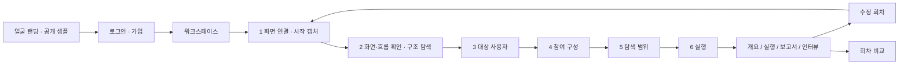

# PersonaLab UI UX 서비스 정의와 개발 기준

> **최신 제품 방향(2026-11-07): [한 앱의 다양한·반복 테스트](PRODUCT_CONTINUOUS_TESTING.md)** — 제품을 기본 맥락으로 두고, 여러 테스트·자료 버전·반복 회차를 관리합니다. 이전의 테스트 중심 홈/제품 계층 후순위 제안은 대체됐습니다. 아래 기존 구현과 날짜별 이력은 그대로 보존하며 새 제품 허브가 이미 구현됐다는 뜻은 아닙니다.

> **상세 구성 기획(2026-11-07): [PRODUCT_MASTER_PLAN.md](PRODUCT_MASTER_PLAN.md)** — 화면별 배치·버튼·상태·이동·미해결 질문. [추가 아이디어 80개](PRODUCT_IDEA_BACKLOG.md)는 우선순위와 선행 조건을 별도로 정리했습니다. 권장 구성과 현재 구현을 구분해 읽습니다.

> **화면별 통합 요구사항(2026-11-07): [전체 화면 구성과 사용자 흐름](PRODUCT_SCREEN_SPEC.md)** — 랜딩부터 인터뷰·회차 비교까지의 포함 내용, 이동 조건, 현재 구현과 후속 요구사항을 한곳에 정리했습니다. 아래 본문에는 이전 설계와 날짜별 이력이 함께 있습니다.


2026년 11월 6일 갱신. 제품 범위는 **UI·UX 탐색과 같은 실행의 페르소나 인터뷰**다. 1~3장은 현재 방향과 구현 기준이며, 4~12장의 확장 설계와 13장 이후 날짜별 작업 이력은 구분해서 읽는다. 과거 이력에 있는 Figma 우선·여섯 단계 상시 메뉴·새 테스트 예시 자동 삽입은 이번 개편으로 대체했다. 실제 카드 외부 전송은 별도 승인을 따른다. 11월 6일 사용자 승인으로 P082 1명·최대 3행동·후속 인터뷰 1회 소량 검증을 완료했으며, 이번 캡처/프로필 작업에서 추가 전송은 하지 않았다.

## 1 제품 정의와 확정한 방향

**PersonaLab은 다양한 AI 페르소나의 시선으로 프로토타입의 UI·UX를 탐색하고, 발견한 불편의 근거를 확인하며, 같은 페르소나와의 1대1 인터뷰로 그 이유를 더 살펴보는 도구다.**

사용자는 “이 아이디어가 팔릴까?”보다 “이 화면을 이해할 수 있을까?”, “주요 기능을 찾을 수 있을까?”, “입력과 이동 과정에서 어디가 불편할까?”를 확인한다. 제품 설명은 서비스의 목적과 맥락을 알려주는 짧은 입력으로 사용한다.

| 항목 | 확정한 기준 |
| --- | --- |
| 주요 사용자 | 프로토타입을 검토하는 디자이너, 기획자, 개발팀과 초기 제품팀 |
| 핵심 범위 | 화면 이해, 기능 발견, 이동, 입력, 상태와 오류 안내, 탐색 중 불편 |
| 기본 이용 방식 | 주요 사용 흐름을 여러 방향으로 탐색. 사용자가 처음부터 과제 하나를 작성할 필요가 없어야 함 |
| 선택 입력 | 특히 확인하고 싶은 화면이나 문제. 기본 탐색 위에 집중 확인을 추가 |
| 핵심 산출물 | 문제 지점, 관련 화면, 탐색 경로, 당시 남긴 이유, 확인한 범위와 미확인 범위 |
| 다음 경험 | 결과에서 특정 페르소나를 선택해 그 테스트에 대한 1대1 인터뷰 |
| 페르소나 | 이미 만든 카드 데이터를 우선 활용하고, 고유한 프로필을 보관·재사용 |
| 제외 | 기획 평가, 구매·사용 의향 조사, 기능 선호 조사, 지불 의향과 시장성 평가 |
| 후속 검증 | 실제 사용자와의 대조는 품질 검증 단계에서 수행. 현재 랜딩의 완성 기능으로 홍보하지 않음 |

가치 제안은 **“어느 화면에서 무엇을 고쳐볼지, 근거를 보며 결정하게 한다”**다. 페르소나 수, 채팅량, 토큰 사용량을 늘리는 것은 제품 목표가 아니다.

## 2 현재 구현 상태

로컬 앱 `http://127.0.0.1:5173/#landing` 기준이다. 승인한 얼굴 랜딩과 4번 Editorial 스타일을 유지한다. 기존 네 패널·400개의 카드 원문은 그대로 보관한다. 고객 설정 화면은 대상 사용자 설명 후 참여 조건·인원으로 구성을 추천받고 검토하는 흐름이다. 전체 보관함의 조건 검색·개별 선택은 필요할 때 열어 사용한다.

| 영역 | 현재 구현 | 남은 검증·확장 |
| --- | --- | --- |
| 로그인 | 실제 이메일 가입·로그인·쿠키 세션, 계정별 소유권 검사 | 이메일 확인·비밀번호 복구와 외부 운영 환경 |
| 워크스페이스 | 테스트 목록·검색·상태 필터·실행 이력, 회차 묶음, 이름 변경·복제·보관·휴지통·복원·영구 삭제 | 팀 공유 권한과 대규모 목록 |
| 신규 생성 | 빈 입력으로 시작. 화면 연결 → 화면·흐름 확인 → 대상 사용자 → 참여 구성 → 탐색 범위 → 실행 확인 | 자동 다중 흐름 계획 |
| 대상 연결 | 웹/모바일 웹·iOS·Android 유형, URL·정적 HTML, Figma·이미지와 화면 연결 | 로그인 웹·앱 소스 빌드·설치 앱/OS 직접 조작 |
| 화면 확인 | 시작 캡처 복원·재촬영, 백그라운드 페이지·메뉴 탐색, 발견한 범위 기준 진행률, 중단·재개·재시작 복구. 진행 중 다음 단계 차단, 부분 범위는 명시적 확인 | 동적·복잡한 서비스별 지원성 검증, 다중 서버 실행기 |
| 탐색 범위 | 관찰한 링크에서 흐름 제안, 완료 주소/문구, 선택적 집중 항목 | 여러 시나리오의 자동 생성·할당은 미구현 |
| 페르소나 | 전체 400개 원본에서 조건 검색, 중복 원천 제외 351명 후보. 고객 화면은 요약 프로필·거친 행동 특성과 AI 대표 사진 8종. 원본/내부 프롬프트는 서버에 보존 | 보유 범위 밖 신규 프로필 생성과 사용자 자료 가져오기 |
| 실행 엔진 | URL/HTML은 격리 브라우저의 캡처·요소를 사용. 클릭·가상 입력·스크롤·중단, 네 종료 보호 유지 | P082 1명의 소량 실제 검증 완료. 다양한 제품·페르소나의 품질/비용 검증 필요 |
| 진행·취소 | 화면 및 행동 근거 저장, 저장된 단계 표시, 사용자 취소, 오류 기록. 재시작 시 끊긴 실행 복구 | 작업 큐와 다중 서버 실행 |
| 보고서 | 발견 → 관찰 화면 → 행동·원문 → 해당 인물 인터뷰. 시스템 한도와 사용자 중단 구분 | 자동 수정안의 실제 개선 효과 검증 |
| 내보내기 | Markdown·JSON·인쇄/PDF 저장. 브라우저 관찰 근거와 회차·범위 정보 명시 | JSON의 보호된 이미지 URL은 소유 계정 로그인 필요 |
| 인터뷰 | 실행·페르소나별 기록 조회와 문답 저장·복원. 새 LLM 답변 경로도 구현 | P082 소량 인터뷰 검증 완료. 일반 고객 유료 운영·품질 검증은 별도 |
| 수정 회차 | 입력·패널을 복사하고 결과·문답은 복사하지 않음. 실행 후 입력 잠금 | 사이트 외부 원본이 바뀌지 않는 것까지 보장하지 않음 |
| 비교 | 완료된 두 회차의 조건과 발견 건수 비교. 조건 변경·미관찰 표시 | 동일 모델 조건 고정 및 통계적 개선 효과 평가 |
| 검증 | 백엔드 전체 113개 및 최종 대상/이미지 7개, 프론트 연결 31개·이미지 입력 1개·보고서 8개와 빌드 통과. 실제 HTTP 저장·재접속·회차 복원 검사 통과 | 실제 모델·Figma 계정 호출·외부 배포·완전한 시각 QA는 별도 |

**동작 구분:** URL/HTML 실행은 실제 브라우저 기록을 남긴다. Figma·직접 등록은 화면 설명과 클릭 연결을 탐색하며, 직접 추가한 이미지가 있으면 현재 시안만 모델 입력에 포함한다. 설치 앱의 OS 동작을 재현하지 않는다. 공개 샘플과 연결 점검 예시는 기존처럼 예시 출처를 표시한다. 어느 경로에서도 체류 시간·시선·만족도 수치를 만들어 넣지 않는다.

**실제 모델 검증 범위:** 사용자 승인으로 P082 1명·최대 3행동·후속 인터뷰 1회의 소량 실제 검증을 완료했다(총 3회 모델 호출, 기록 비용 $0.004245). 모든 제품/페르소나의 품질 검증이나 상업 배포 권한 확인을 의미하지 않는다. 이번 캡처·진행률·고객 프로필 보호 작업은 추가 유료 탐색이나 원본 카드 외부 전송 없이 검증했다.

근거 코드: [브라우저 관찰/행동](../backend/app/services/browser.py), [실행기](../backend/app/services/runner.py), [워크플로우 API](../backend/app/api/workflow.py), [내부 화면](../frontend/src/mockup/MockupApp.ts), [개요·비교](../frontend/src/mockup/WorkflowView.ts).

## 3 확정한 웹 내부 흐름



새 테스트 작성 중에는 상단 **화면 연결 → 화면·흐름 확인 → 대상 사용자 → 참여 구성 → 탐색 범위 → 실행 확인**의6개 단계를 표시한다. 각 단계는 독립된 페이지이며 중복된 내부3단계 탭은 표시하지 않는다. 좌측 작업 메뉴·테스트 설정 링크·수정 회차 버튼은 실행 전에는 숨긴다. 실행한 회차에서는 **개요 / 실행**을 표시하고, 실제 Act 탐색 기록이 저장되면 **보고서 / 인터뷰**를 추가한다. 입력은 별도 설정 진입으로 확인한다. 개요에서 현재 대상, 이번 회차의 패널·범위, 다음 작업, 과거 회차로 접근한다. 새 테스트에 일정메이트 예시 화면이나 결과를 자동 삽입하지 않는다.

### 랜딩과 공개 샘플

랜딩은 첫 화면, 사용 흐름 미리보기, 결과 사례, FAQ와 시작 버튼의 4개 구역을 유지한다. 첫 화면은 제목·설명·시작 버튼을 중앙에 모으고 옆에 제품 화면이나 결과 카드를 배치하지 않는다. 기존 글꼴과 밑줄 강조를 유지하며, 제품 미리보기와 저장된 탐색 기록은 아래 구역에서 보여준다. 공개 샘플은 로그인 없이 확인한다. 사용자 요청에 따라 공개 랜딩에는 ‘준비 중’ 배지를 붙이지 않고 목표 제품 경험을 설명한다. 구현 현황과 남은 작업은 이 문서의 2·10장에서 관리하며, 실제로 없는 실행 결과나 인터뷰 답변은 만들지 않는다.

### 로그인과 워크스페이스

로그인 성공 시 워크스페이스로 이동한다. 메뉴는 `내 테스트`, `페르소나 보관함`, `전체 실행 기록`이다. 서버에 없는 사용량·수정 시각을 만들지 않는다. 같은 테스트의 최신 회차를 목록에 보여주고 개요에서 이전 회차를 연다. 설정 중이면 마지막 작성 단계, 실행된 테스트는 개요로 이어진다. 카드의 `⋯`에서 이름 변경·복제·보관·휴지통 이동을 제공한다. 목록 위에서 내 테스트·보관한 테스트·휴지통을 전환하고 상태를 필터링한다. 관리 단위는 같은 테스트의 모든 회차이며, 복제만 선택 회차의 입력을 새 독립 테스트로 만든다.

### 프로토타입 등록

기본은 웹 URL이다. HTML·CSS·JS·이미지를 포함한 정적 ZIP/폴더/파일 묶음도 받는다(100개 파일·압축 해제 후 8MB). Figma와 수동 화면 등록은 별도 보조 경로다. HTML은 독립된 origin에서 제공하며 앱/API origin에서 업로드 코드를 실행하지 않는다.

첫 단계 #product는 대상 화면을 연결하고 시작 캡처만 확인하는 과정이다. 먼저 살펴본 화면과 흐름·진행률·페이지 목록·확인할 부분은 두 번째 #source-review에서 본다. 탐색 진행 중에도1→2 이동은 허용하고2→3 이동은 완료 또는 부분 범위 명시 확인 후 허용한다. 시작 캡처는 서버에서 복원하고 이전 준비 확인이 없는 캡처는 재접속 시 한 번 재촬영한다. 수동 캡처 새로고침도 구조 탐색 기록을 보존한다. 구조 탐색 queued/running/pausing 중에는 대상 사용자 등 다음 단계로 이동하지 않는다. 완료 후 진행하거나, 일시정지/한도/실패로 남은 범위를 확인하고 ‘확인한 범위로 진행’을 명시적으로 선택한다. 진행률은 현재 발견한 주소 또는 조작 경로 기준이며 새 경로가 발견되면 분모가 늘어날 수 있다. 테스트 이름은 화면 제목으로, 배경 설명은 읽어온 문구로 기본 채워진다. 사용자가 작성한 값은 보존하며 배경 설명 보완은 선택 입력으로 접어 둔다. 사용 목적과 완료 지점은 이후 탐색 범위에서 정한다. 수동 등록에서는 화면과 연결 정보를 작성한다. 화면을 가져온 후 시작 화면, 화면 목록, 연결 누락, 미지원 동작을 먼저 확인한다. 시각 평가를 위한 이미지가 없으면 `흐름·문구 탐색 가능 / 시각 평가 자료 필요`로 표시한다. 사용자가 원본과 추출 결과를 대조할 수 있어야 한다.

### 대상 사용자와 페르소나 구성

고객에게 연구용 패널 이름이나 seed를 고르게 하지 않는다. 대상 사용자 설명과 사용 상황을 직접 작성하고, 전체 보관함에서 나이 범위·직무/생활·지역·디지털 친숙도를 필요한 만큼 좁힌다. 이 값은 실제 원본 카드의 필드에서 가져온다. 카드 단어 검색은 입력한 단어를 모두 포함하는 카드만 반환하며 의미 검색으로 표시하지 않는다. 대상 사용자 설명은 테스트 맥락이고, 보유하지 않은 특성의 적합성을 증명하지 않는다.

고객 화면과 응답에는 연령·성별·직무군·지역, 거친 행동 특성과 새로 작성한 요약만 제공한다. 원본 카드 전문·응답자/원천 식별자·매칭 점수·엔진 시스템 프롬프트는 고객 API에서 제외한다. DB 원본은 엔진 입력에 보존한다. 이전 브라우저 초안도 같은 표시용 정보로 정리한다. 실사 느낌 사진 8종은 가상 한국 성인의 AI 대표 이미지이며 여러 페르소나가 공유할 수 있다. 실제 응답자 사진이나 1인 1고유 얼굴로 표시하지 않는다. 제공자 출처 표시는 유지하며 화면 요약과 데이터 이용 권한 확인을 별개로 관리한다.

기본은 참여 조건과 인원을 정한 뒤 ‘구성 추천받기’를 누르는 방식이다. 보유 카드 중 명시 조건에 맞고 원천이 겹치지 않는 후보에서 연령대·디지털 친숙도·직무의 다양성을 고려해 결정적으로 구성한다. 자유 설명의 의미 적합성을 자동으로 판단하지 않고 실제 사용자 분포의 대표성을 보장하지 않는다. 추천 인물은 6명 단위로 더 펼쳐 보며 연령 범위·직무 유형·디지털 친숙도별 인원을 함께 확인한다. 데스크톱에서는 조건과 참여 명단을 좌우로 두고, 프로필은 사진·특성·교체/제외가 있는 짧은 행으로 표시한다. 조건 이름과 현재 값은 항상 보이며 직무·지역의 긴 선택지만 드롭다운으로 연다.

필요할 때 ‘직접 선택하기’로 후보를 4명씩 탐색한다. 개별 교체는 이미 참여 중인 사람을 제외한 대체 후보를 명시적으로 눌러야 적용된다. 교체 취소는 기존 선택을 유지한다. 후보 부족이나 추천 실패도 기존 선택을 유지하며, 가능한 소수 인원으로 구성할지는 별도 버튼으로 수락한다. 참여 조건 변경 후에는 다시 추천받거나 새 조건의 후보를 확인해야 저장할 수 있다. 동일 카드 해시·NVIDIA 원천 프로필·조사 donor가 겹치면 같은 구성에 중복 선택하지 않는다.

검색 결과가 부족하면 실제 수를 보여주며 조건을 조용히 완화하거나 카드를 만들어 채우지 않는다. 조건 변경과 선택은 저장 전 초안이고, 적용하면 카드 스냅샷·대상 설명·사용 상황을 서버에 저장한다. 실행한 회차는 잠그고 수정 회차에서 바꾼다. 재로그인과 회차/독립 복제에서도 같은 조건을 확인할 수 있다. 사용 상황은 탐색 과제의 맥락으로 전달하되 원본 인물의 경력/특성을 덮어쓰지 않는다.

### 탐색 범위 확인

현재 구현은 **선택한 흐름 하나를 여러 페르소나가 탐색**하는 방식이다. 시작 화면에서 관찰한 링크로 제안하며, 없는 화면이나 시나리오를 추정하지 않는다. 완료 URL 또는 화면에 나타날 문구를 지정한다. 특히 확인할 부분은 선택 입력이다. 전체 사이트를 빠짐없이 평가했다고 설명하지 않는다.

다중 흐름 자동 계획·페르소나 배분은 4장의 확장 설계다. 현재 선택한 흐름의 결과를 서비스 전체 성공률로 표시하지 않는다. 로그인 전 조회·같은 출처 화면 전환·가상 입력·스크롤을 지원하며 서버 변경 요청, 결제·삭제·발송, 외부 사이트 이동은 차단한다. 이 제한으로 실제 가입 완료나 결제 완료가 필요한 흐름은 현재 범위에 포함하지 않는다.

페르소나에게 주는 시나리오는 현실적인 목적을 설명하되 특정 버튼을 누르도록 정답을 알려주지 않는다. 이는 NN/g의 과제 작성 원칙과 맞닿아 있다. [과제 시나리오 작성 원칙](https://www.nngroup.com/articles/task-scenarios-usability-testing/)

실행 전에는 대상·선택 패널·완료 지점·집중 항목·실행 가능 여부와 턴 상한을 확인한다. 금액 계산과 사용량 원장은 아직 없으며 임의 비용을 표시하지 않는다. 현재 흐름 제안은 관찰한 링크에 기반하고 유료 모델을 호출하지 않는다.

### 실행

상단에 전체 진행과 완료·실패·대기 수를 표시한다. 가운데에 선택한 페르소나의 현재 화면, 오른쪽에 행동·이유 기록을 둔다. 사용자가 선호한 회전형 휴대폰 표현은 이 실행 화면에서 여러 페르소나를 전환하는 데 사용한다. 실제로 수신된 단계만 표시하고, 정지된 화면이나 아직 도착하지 않은 이벤트를 가짜 진행으로 연출하지 않는다.

애니메이션 일시정지는 화면 재생만 멈춘다. 서버 실행 취소는 별도 버튼과 확인 상태로 제공한다. 페이지를 닫거나 새로고침해도 서버 실행 상태를 다시 불러온다. 취소·오류 시 이미 저장한 기록을 보존한다. 현재 DB의 실행 상태는 failed와 run_controls의 취소/오류 이유로 구분한다. 자동 유료 재시도는 하지 않는다. 개별 페르소나 재시도는 후속 확장이다.

### 결과

첫 화면에는 주요 문제 3~5개, 완료한 탐색 범위, 미확인 범위, 시스템 중단을 표시한다. 문제를 누르면 관련 화면 → 해당 페르소나들 → 실제 탐색 단계와 당시 이유로 내려간다.

문제 항목의 필수 정보는 제목, 화면·흐름, 근거 이벤트, 영향을 받은 실행 수와 분모, 심각도 판단 이유, 수정 가설이다. AI가 생성한 수정 가설은 관찰된 사실과 구분한다. 색상만으로 상태를 구별하지 않는다.

완료율은 목표가 있는 동일 흐름 안에서만 계산한다. 서로 다른 흐름을 섞은 하나의 숫자를 서비스 전체 성공률로 표현하지 않는다. 화면 도달률과 연결 탐색률은 등록·지원된 범위를 분모로 삼고, 미지원·도달 불가 화면은 별도로 설명한다. 화면 방문만으로 모든 UI 요소를 검증한 것으로 처리하지 않는다.

### 같은 페르소나와 1대1 인터뷰

결과의 페르소나 상세에서 `이 기록에 대해 물어보기`로 진입한다. 왼쪽에는 프로필과 방문 경로, 가운데에는 대화, 오른쪽에는 답변이 참조한 화면·이벤트를 둔다.

첫 질문 예시는 “이 화면에서 다음으로 무엇이 나올 거라고 예상했나요?”, “멈추기 전에 어떤 안내가 필요했나요?”다. 답변은 해당 실행의 기록을 인용할 수 있어야 한다. 보지 않은 화면은 보지 않았다고 답하고, 기록에 없는 이유를 설명할 경우 추가 해석으로 표시한다. 인터뷰 답변으로 과거 로그나 원래 이탈 이유를 덮어쓰지 않는다.

같은 프로필로 다른 제품을 테스트할 수 있지만 대화 맥락은 테스트와 실행별로 분리한다. 다른 고객의 제품이나 이전 테스트의 정답이 새 실행에 섞이지 않게 한다.

### 수정 후 재실행

이전 화면 버전과 패널을 고정한 채 새 프로토타입 버전을 등록한다. 같은 흐름·조건으로 다시 실행한 결과를 나란히 비교한다. 비교를 위한 기본 실행에는 이전 정답이나 수정 의도를 주입하지 않는다. 조건이 바뀌면 무엇이 바뀌었는지 표시한다. 동일 페르소나라도 모델 응답이 변할 수 있으므로 동일한 결과를 보장한다고 설명하지 않는다.

## 4 후속 확장: 다중 흐름 탐색 설계

전반 탐색은 무제한 자유 이동이 아니다. 다음 세 층으로 구성한다.

| 층 | 수행 내용 | 결과의 성격 |
| --- | --- | --- |
| 구조 점검 | 시작점, 연결 누락, 도달 불가 화면, 미지원 상호작용 확인 | 입력 자료와 연결 구조의 확인 |
| 사용 흐름 탐색 | 여러 목표를 페르소나에게 할당해 주요 경로와 선택을 관찰 | AI 탐색 기록 |
| 화면 검토 | 실제 화면 이미지와 요소 정보로 가독성·위계·안내를 검토 | 이미지에 근거한 검토 의견과 측정 가능한 항목 |

권장 최초 실험값은 페르소나 5명, 주요 흐름 3개다. 전원×모든 흐름을 무조건 실행하기보다 각 흐름에 복수의 페르소나가 배정되게 하고 구성·호출 수를 확인한다. 이 숫자는 품질이 입증된 표본 규모가 아니라 비용과 오류를 점검할 내부 시작값이다.

시나리오 계획기는 전체 화면 그래프를 볼 수 있지만, 행동을 결정하는 에이전트는 현재 화면·사용자 목적·자신의 지난 행동만 받는다. 미래 화면과 정답 경로를 알려주면 기능 발견성을 평가하기 어렵다.

기존 목표 도달·이탈 선언·MAX_TURNS·중복 방문 차단은 유지한다. 각 시나리오를 독립된 실행으로 감싸며 현재 제한을 그대로 적용한다. 정상적인 뒤로 가기와 반복 탐색까지 차단할 수 있는 한계는 별도 설계 검토 항목이다. 그 경우를 사용자 불편으로 단정하지 않으며, 조건 변경은 개발계획서와 회귀 검증을 선행한다.

## 5 페르소나 보관함과 데이터 연결

### 기존 자산을 가져오는 순서

1. `panel_*.parquet`와 생성 보고서 또는 내보낸 JSON을 우선 확보한다.
2. 원본 패널을 얻기 어렵다면 데이터가 포함된 `viewer.html`의 `DATA`를 추출한다. HTML의 스크립트를 실행하지 않고 JSON 데이터만 읽는다.
3. 프로필·카드 문장·특성·출처·패널명·버전을 검증하고 누락 필드를 기록한다. 뷰어용 데이터에는 엔진 원본의 UUID·donor ID·일부 메타데이터가 없을 수 있다. 이를 추정해서 채우지 않는다.
4. 카드뷰어와 가져온 결과의 인원·샘플 카드 문장·분포가 일치하는지 대조한다.
5. 가져오기 배치와 안정적인 내부 ID를 발급하고 보관한다. 원본 `P023` 같은 표시 ID만 전역 고유 키로 쓰지 않는다.

이미 생성된 패널을 가져오는 데 원본 조사 파일은 필수가 아니다. 새 조건으로 다시 샘플링할 때 필요한 입력과 기존 패널 재사용을 구분한다. 기존 뷰어 템플릿과 프론트 데모 5명을 전체 카드 데이터로 취급하지 않는다.

### 저장 구조 제안

현재 `personas`는 테스트에 종속되어 있고 재생성 시 이전 행이 삭제된다. 2026-11-02 기존 패널 가져오기를 위해 `persona_library_panels`와 `persona_library_entries`를 Alembic 0003으로 추가했다. 기존 테이블은 변경하지 않았고, 4개 패널 버전과 카드 400개를 저장했다. 테스트로 복사한 카드는 독립 스냅샷이며 실행 이력이 있는 테스트의 가져오기는 거부한다. 아래 나머지 인터뷰·비교·실행 확장 구조는 후속 설계다.

| 개념 | 저장할 핵심 | 이유 |
| --- | --- | --- |
| 페르소나 보관함 | 내부 ID, 출처 배치, 원본 ID, 프로필, 소유·사용 범위 | 테스트를 넘어 동일 프로필을 선택 |
| 프로필 버전 | 카드 본문, 특성, 출처, 스키마 버전, 해시 | 수정된 카드로 과거 결과가 바뀌지 않게 함 |
| 테스트 패널 스냅샷 | 기존 personas와 보관함 버전의 연결 | 실행 당시 프로필을 복원 |
| 프로토타입 버전 | 화면·연결·이미지·버전 해시 | 인터뷰와 비교에서 당시 화면 참조 |
| 탐색 계획 | 흐름별 시작·목표·범위·패널 할당 | 전반 탐색 범위와 분모 관리 |
| 실행 작업 | 페르소나×흐름, 상태, 재시도, 모델·프롬프트 버전 | 중복 실행·부분 실패·비용 관리 |
| 인터뷰와 메시지 | 사용자, 테스트·실행·프로필 버전, 메시지, 근거 이벤트 | 동일 인물의 해당 테스트에 대한 대화 |
| 사용량 원장 | 요청 ID, 실제 모델 사용량, 예약·정산·취소 | 중복 차감 방지와 비용 확인 |

고유성을 판단할 때 원본 페르소나 UUID가 같아도 매칭된 조사 응답이나 생성 버전이 다르면 동일한 카드라고 합치지 않는다. 프로필 데이터와 제품별 활동 기록은 분리하고 계정 권한을 서버에서 검증한다.

현재 `act_logs`의 AI·실제 참가자 통합 구조와 이탈 코드 8개는 그대로 유지한다. 다중 흐름과 인터뷰 테이블은 기존 기록에 명시적으로 연결한다. 기존 기획 Ask 응답은 이력으로 보존하되 UI·UX 인터뷰로 이름만 바꾸지 않는다.

## 6 주요 의문과 해결 방안

| 의문 | 결정 또는 권장 해결책 | 확인할 증거 |
| --- | --- | --- |
| 과제 없이도 전반을 볼 수 있나? | 사용자는 범위를 고르고 시스템이 여러 사용 시나리오를 구성. 목표는 실행 내부에서 관리 | 추천 흐름을 사용자가 이해·수정할 수 있는지, 누락된 핵심 경로 |
| 모든 화면을 봤다고 할 수 있나? | 등록·지원·도달·미확인 범위를 각각 표시. “전체 검증 완료” 같은 포괄적 표현 금지 | 화면·연결·상태별 커버리지와 미지원 목록 |
| 지금 UI 디자인을 평가할 수 있나? | 현재 텍스트 관찰에 화면 이미지·요소 위치·상태를 추가해야 함 | 동일 문구에 레이아웃만 다른 화면을 구별하는지 |
| 이미지가 있으면 모든 접근성을 알 수 있나? | 시각 점검, 노드 속성 측정, 실제 키보드·보조기기 검증을 구분 | 측정 출처와 자동 검사 불가 항목 |
| Figma 링크만 붙이면 되나? | 인증·공유 권한·연결 정보·지원 동작 확인. 실패 시 직접 등록 | 권한 없음, 만료, 연결 없음, 일부 파싱, 호출 제한 사례 |
| 페르소나 이름만 다른 답이 나오지 않나? | 동일 화면에서 특성이 다른 패널과 중립 기준 모델을 비교. 표현 차이와 행동 차이를 별도 분석 | 반복 실행, 실제 사용자 대조, 효과 없는 특성 제거 |
| 나이로 행동을 과장하지 않나? | 실제 카드의 특성을 사용하고 인구통계만으로 숙련도·장애를 추정하지 않음 | 동일 행동 특성·다른 연령 조건의 편향 점검 |
| 카드뷰어 데이터는 DB에 넣을 수 있나? | 원본 패널 또는 HTML 내 데이터를 검증해 가져오기. 원본 생성 과정을 다시 돌릴 필요 없음 | 인원·문장·출처 대조와 누락 메타데이터 목록 |
| 인터뷰가 당시 이유를 지어내지 않나? | 프로필·해당 실행 로그·방문 화면만 제공. 근거 링크와 추가 해석 표시 | 미방문 화면 질문, 원본과 모순되는 유도 질문, 무관한 테스트 내용 차단 |
| 수정하면 확실히 좋아졌다고 말할 수 있나? | 동일 패널·흐름·관찰 조건의 반복 실행으로 비교. 모델 변경을 기록 | 실행 편차, 전문가·실사용자의 개선 여부 확인 |
| 비용이 무한히 늘지 않나? | 작업·턴·재시도·동시 실행·인터뷰 한도와 사용자별 총예산 | 상한 도달 시 새 호출 중단, 중복 차감 없음 |
| 재생 일시정지가 과금을 멈추나? | 화면 재생과 서버 취소를 별도 제어 | 취소 이후 새 작업이 시작되지 않고 진행 중 호출이 정산되는지 |
| 실패를 이탈로 세지 않나? | 모델 오류·연결 오류·턴 제한·사용자 취소를 운영 상태로 분리 | 실패한 실행을 포함/제외한 집계의 분모 표시 |
| 서비스 화면의 악성 지시를 따르지 않나? | 화면·업로드 자료를 관찰 데이터로 취급. 허용된 행동 목록과 서버 권한 검사 | 시스템 규칙 변경·외부 정보 전송을 요구하는 테스트 화면 |
| 사용자에게 어떤 결과를 유료로 제공하나? | 테스트 실행과 근거 있는 후속 인터뷰, 비교·보관 경험에 사용량 정책 적용 | 실제 원가, 반복 사용 의사, 고객이 이해한 예상 비용 |

## 7 조사에서 확인한 사실과 제품에 적용할 해법

Figma REST API는 파일·노드의 JSON과 이미지를 제공하고, 노드에는 프로토타입 상호작용과 위치 정보가 있다. 따라서 **화면 이미지와 연결을 함께 가져오는 어댑터**가 기술적 출발점이다. 모든 프로토타입 동작이 정적인 화면 이동과 같다고 가정하지 않고 오버레이·상태 변경 등 지원 범위를 검증한다. [파일 API](https://developers.figma.com/docs/rest-api/file-endpoints/), [노드 속성](https://developers.figma.com/docs/rest-api/file-node-types/)

Figma의 호출 제한은 좌석, API 등급, 파일이 속한 요금제에 따라 달라진다. 가져오기 단계에서 파일 버전별로 결과를 저장하고 중복 호출을 줄이며, 429 응답에서는 서버가 안내한 재시도 정책을 따른다. 모든 고객에게 동일한 가져오기 속도를 약속하지 않는다. [호출 제한](https://developers.figma.com/docs/rest-api/rate-limits/)

NN/g의 합성 사용자 평가에서는 실제 사용자와 다른 행동, 피상적 의견, 과도하게 긍정적인 답변의 문제가 제시됐다. 그 평가 범위는 당시 텍스트 기반 인터뷰 중심이므로 현재 화면 조작 에이전트의 정확도를 직접 입증하거나 부정하는 자료로 확대하지 않는다. 우리 제품에서는 AI 결과를 **검증할 UI·UX 문제 후보와 근거**로 제공하고, 실제 사용자의 반응을 예측한다는 수치는 별도 검증 전 사용하지 않는다. [합성 사용자 평가](https://www.nngroup.com/articles/synthetic-users/)

접근성 항목은 WCAG 2.2의 검증 가능한 기준을 참조한다. 일반 텍스트 명도 대비 4.5:1, 큰 글자 3:1, 최소 포인터 대상 크기 24×24 CSS px에는 각각 예외가 있다. 실제 크기·색상·상태를 확보한 항목만 측정 결과로 제시하고, 전체 접근성 적합 판정을 자동으로 내리지 않는다. 우리 웹 자체도 키보드 사용, 초점, 명도 대비, 동작 감소 설정을 검증한다. [WCAG 2.2](https://www.w3.org/TR/WCAG22/)

위 원칙을 바탕으로 한 탐색 계획기·버전 저장·근거 연결·비용 상한 설계는 PersonaLab에 대한 구현 제안이다. 외부 문서가 우리 제품의 정확도나 완성도를 보장하는 것은 아니다.

## 8 결과와 인터뷰의 품질 기준

문제마다 `무엇을 관찰했는가`, `AI가 어떻게 해석했는가`, `어떤 수정안을 시험할 것인가`를 구분한다. 예를 들어 “5명 중 4명이 개인정보 요구를 이유로 중단”은 해당 AI 기록의 집계이고, “전화번호를 선택 입력으로 바꿔 비교”는 다음 테스트를 위한 수정 가설이다.

심각도는 근거가 있는 수행 차단 여부, 영향받은 흐름, 반복 발생을 기준으로 설명한다. 발생한 횟수만으로 심각도를 높이지 않으며 시스템 한계로 중단된 경우에는 판단을 유보한다. 근거가 없는 단일 종합 점수와 보편적인 UX 합격선을 만들지 않는다.

출시 전에는 알려진 문제가 있는 프로토타입, 의도적으로 문제를 수정한 버전, 일반적인 사용 흐름을 묶어 검증한다. 검토자는 가능하면 AI 결과를 보기 전에 문제를 표시한다. 확인된 문제 중 AI가 찾은 비율, AI가 제시한 문제 중 근거가 인정되는 비율, 반복 실행의 일관성, 특성별 편향을 확인한다. 정답이 공개된 흐름과 새 흐름을 구분해 과적합을 점검한다. 표본·적합성 기준은 실제 파일럿 규모에 맞춰 별도로 확정한다.

인터뷰는 원본 기록에 없는 내용을 경험 사실로 단정하지 않는지, 답변의 인용이 실제로 존재하는지, 동일 프로필의 다른 테스트가 섞이지 않는지를 검증한다. 대화가 길어지면 원본 이벤트와 참조를 유지하는 요약을 사용한다.

## 9 비용과 운영 설계

내부 원가는 모델 입력·출력·이미지 사용량, 호출 수, 재시도, 파일 처리와 저장 비용을 합산한다. 공급자 단가를 코드에 흩어 넣지 않고 날짜·모델별 설정으로 관리한다. 판매 가격은 파일럿의 실제 원가와 사용 의사를 측정한 뒤 정한다.

사용자에게는 테스트 규모에 따른 예상 크레딧 범위와 최대 사용량을 실행 전에 보여준다. 완료되지 않은 재시도가 어떻게 정산되는지 정책을 명시한다. 실행 예약 → 사용량 기록 → 성공분 정산 → 미사용분 해제 순서로 원장을 남기고 요청 ID로 중복 차감을 막는다. 비용을 늘리는 추가 인터뷰나 실행은 사용자의 명시적인 조작에서 시작한다.

실행은 웹 요청 프로세스의 수명과 분리된 작업 큐로 옮긴다. 작업 단위 상태, 재시도 상한, 타임아웃, 중단 플래그와 복구 절차를 갖춘다. 실패해도 이미 저장한 이벤트와 보고서를 유지한다. 운영 준비에는 계정 복구, 저장 데이터 삭제·보관 기간, 업로드 접근 권한, 백업 복원과 관측 로그가 포함된다.

## 10 단계별 개발 순서와 완료 조건

| 순서 | 작업 | 완료 조건 |
| --- | --- | --- |
| 0 | 방향과 문구 정리 | 이 문서·개발계획서·README·랜딩에 UI·UX 정의 반영. 공개 소개와 내부 구현 상태를 구분 |
| 1 | 기존 패널 확보와 가져오기 | 원본과 인원·카드·특성을 대조하고 DB에 저장. 재가져오기 중복 방지. 누락 출처를 명시 |
| 2 | 기존 실행의 UI·UX 전환 | 기획 Ask 강제 실행과 지불 의향 중심 UI 제거. 작은 패널로 Act 저장→재접속→결과까지 실제 실행 검증 |
| 3 | 화면 수집과 버전 | 수동 화면 이미지·연결을 지원하고 Figma 가져오기 검증. 권한·호출 제한·미지원 동작 안내 |
| 4 | 전반 탐색 계획과 실행 | 추천 흐름·선택 강조·할당·미확인 범위 표시. 상한·취소·부분 실패·재시도 작동 |
| 5 | 결과 리포트 | 문제→화면→개별 경로→원본 근거로 이동. 분모·시스템 중단·관찰 수준 표시 |
| 6 | 1대1 인터뷰 | 해당 실행과 프로필 버전 고정. 근거 참조·대화 저장·새로고침·권한 검증 |
| 7 | 수정 전후 비교 | 같은 조건의 새 실행, 프로토타입 버전 비교, 모델 변경과 편차 표시 |
| 8 | 파일럿과 유료화 | 실제 사용자 대조, 비용 원장·예산·복구·삭제 검증. 요금과 공개 범위 확정 |

일정은 카드 원본, API 설정, 모델 실행 결과를 확보한 후 추정한다. 현재로서는 1~2단계가 실제 서비스 흐름을 검증하는 첫 완료 지점이다. 모든 단계를 한꺼번에 외관만 구현해서 완료로 표시하지 않는다.

## 11 화면과 문구 기준

| 위치 | 권장 문구 |
| --- | --- |
| 서비스 설명 | AI 페르소나와 함께 살펴보는 UI·UX |
| 랜딩 제목 | 화면은 같아도, 경험은 다르니까. |
| 랜딩 설명 | 다양한 AI 페르소나가 화면을 어떻게 탐색하고, 어디서 막히는지 살펴보세요. |
| 새 테스트 | 어떤 화면을 살펴볼까요? |
| 기본 탐색 | 전반적으로 살펴보기 |
| 선택 입력 | 특히 확인하고 싶은 점이 있나요? |
| 실행 | 지금, 이 화면을 탐색하고 있어요. |
| 결과 | 어디서 막혔는지, 근거와 함께. |
| 인터뷰 | 이 기록에 대해 물어보기 |
| 미확인 | 이번 테스트에서 살펴보지 못한 화면 |
| 시스템 중단 | 탐색 한도에 도달했어요. 남은 흐름을 확인해 주세요. |

이미 선호한 목업의 글자 크기·여백·밝은 배경과 밑줄 강조를 유지한다. 작은 글씨에 설명을 몰아넣지 않는다. 성적표·점수·작은 사람 점 배열을 주요 시각 요소로 쓰지 않는다. 회전형 휴대폰은 실행 중 페르소나 전환에 쓰고, 랜딩은 짧은 실제 기록과 제품 미리보기를 중심으로 한다.

## 12 남은 의사결정과 기본 제안

| 남은 결정 | 기본 제안 | 결정에 필요한 정보 |
| --- | --- | --- |
| 기존 카드 원본 | 확보·DB 400명 보관 완료 | 원본 이용 조건 확인·추가 패널 갱신 |
| 지원 입력 확장 | URL·정적 HTML 우선, Figma·직접 등록 보조 | 인증된 서비스와 복잡한 상호작용 지원 요구 |
| 공개 페르소나와 고객별 패널 | 공용 원본 카탈로그와 고객별 선택·활동 기록 분리 | 데이터 이용 조건·프로필 수정 요구 |
| 패널 규모와 탐색 예산 | 소규모로 원가·변동성 측정 후 단계 확대 | 실제 호출량과 분석 품질 |
| 인터뷰 범위 | 완료·부분 완료한 실행의 페르소나부터 지원 | 미탐색 상태에서의 대화 수요 |
| 실제 사용자 검증 | 초기에는 내부 파일럿으로 운영 | 모집 가능한 대상, 동일 프로토타입 조건 |
| 유료화 기준 | 실행과 후속 인터뷰의 예산·정산을 먼저 구현 | 원가와 고객의 반복 사용 패턴 |

이 결정들은 개발을 막기 위한 승인 목록이 아니다. 기본 제안으로 설계를 진행하고, 데이터 확보·외부 서비스 설정·가격 확정처럼 실제 정보가 필요한 지점에서 선택을 확정한다.


## 13 과거 작업 이력과 데모 사용법 (2026-11-02)

이하 날짜별 기록은 당시 변경 이력이다. 현재 구현과 메뉴는 위 2·3장을 우선한다.

- 전체 데모: http://127.0.0.1:5173/#demo. 로그인 없이 제품 맥락 → 화면 연결 → 페르소나 선택 → 탐색 재생 → 결과·인터뷰 예시 순으로 체험한다. 원본은 기존 일정메이트 AI 기록 5명이며 실제 보관함의 카드 400명을 외부로 보내지 않는다.
- 데모의 화면 미리보기는 설명을 시각화한 예시다. 저장된 탐색은 이미지 평가 결과가 아니다. 화면의 버튼은 미리보기 연결을 따라 움직인다.
- 재생 일시정지·이어보기·바로 결과 확인이 가능하다. 선택한 사람만 결과에 포함하고 미확인 화면을 표시한다. 인터뷰 예시는 질문에 관련된 저장 기록을 인용하며 새 답변을 생성하지 않는다.
- 대화는 페르소나별로 구분하고 별도 personalab-public-demo-v1 키로 현재 브라우저에 저장한다. 개인 계정의 테스트 초안을 건드리지 않으며 처음부터 버튼으로 체험 상태를 초기화한다.
- 실제 테스트: http://127.0.0.1:5173/#workspace. 로그인·DB 보관함 400명 선택·화면 편집은 실제 기능이다. 실행은 ALLOW_PERSONA_TRANSMISSION=false 상태로 차단한다.
- 결과는 Markdown/JSON으로 내려받을 수 있다. 새 UI·UX 리포트에는 과거 Ask 기획·가격 응답을 내보내지 않는다.
- Figma 가져오기는 서버 FIGMA_ACCESS_TOKEN과 파일의 읽기 권한이 필요하다. 키 미등록·권한 없음·문서 과대·네트워크 오류를 안내하고 수동 편집을 계속 제공한다. 실제 Figma 계정 호출은 이번 검증에서 수행하지 않았다.
- 자동 검증: 백엔드 86개, 프런트엔드 26개와 프로덕션 빌드 통과. 브라우저 접근 호스트가 없어 실제 브라우저 시각 검수는 수행하지 못했다.

기본 랜딩 확정: 메인 / 및 #landing에도 인물 사진 5장·카드 움직임·넓은 FAQ를 적용했다. 별도 시안과 메인이 같은 PeopleHero 소스를 사용한다. 인물 사진은 공개 데모용 AI 초상 예시이며 DB 카드 400명의 실제 사진을 뜻하지 않는다.

### 페르소나 프롬프트 확인

메인 랜딩의 인물을 클릭하면 선택한 초상 옆에 공개 데모 프로필과 페르소나 프롬프트 예시가 열린다. 복사·TXT 내려받기·닫기를 지원한다. 공개 5명의 짧은 프로필로 구성한 예시이며 실제 실행 당시 전체 프롬프트나 보관함 400명의 원본 카드로 표시하지 않는다.

실제 테스트의 AI 패널에서 프롬프트 보기를 누르면 저장된 원본 카드·프로필·특성과 첫 화면의 Act 프롬프트를 표시한다. GET /studies/{study_id}/personas/{persona_id}/prompt는 로그인·소유권을 검사하고 실제 실행기와 같은 build_act_prompt를 사용한다. LLM 호출이나 카드 외부 전송 없이 로컬 서버에서 구성하며 복사와 TXT 내보내기가 가능하다. 실제 카드에 사진이 연결되지 않은 경우 사진 미등록을 표시한다. 공개 데모 얼굴을 실제 카드에 임의로 배정하지 않는다.

랜딩의 프롬프트는 인물 카드 위에 겹치는 작은 팝오버로 표시한다. 페이지 높이와 스크롤 위치를 바꾸지 않고 팝오버 내부에서 읽고 복사한다. 같은 카드 재클릭·바깥 클릭·닫기·Escape로 닫을 수 있다. 실제 패널의 상세 보기는 유지한다.


2026-11-03 랜딩 팝오버 정리: 복사·TXT 버튼과 입력창을 제거하고 작은 얼굴·나이/직업·읽기용 프롬프트·저장된 원문 한 문장을 보여주는 인물 소개 카드로 바꿨다. 원문은 탐색 기록으로 분리하며 성격을 추정해 덧붙이지 않는다. 카드 위치와 페이지 높이는 유지하고 실제 패널의 프롬프트 도구는 그대로 둔다.


## 2026-11-03 내부 리포트 통합

- 기본 확인 주소: http://127.0.0.1:5173/#sample. 상단에서 저장된 AI 5명 기록과 별도의 다양한 결과 목데이터를 전환한다. 원본 5명의 경로·문장은 바꾸지 않았다.
- `핵심 발견`은 같은 화면과 종료 이유로 묶어 인원순으로 보여준다. 선택하면 관련 페르소나, 등록 화면 설명·버튼, 해당 단계 원문이 함께 바뀐다. 분모는 결과가 있는 페르소나 수이며 시스템 종료와 미수신 결과는 사용자 이탈에 포함하지 않는다.
- `페르소나별 기록`은 목표 도달·탐색 중단·탐색 한도·결과 없음 필터를 제공한다. 해당 사람의 경로를 눌러 장면과 원문을 확인한다. 화면 구조 미리보기는 실제 스크린샷이 아니다.
- `후속 질문`은 선택한 페르소나의 이 테스트 기록만 조회한다. 새 LLM 응답이나 실제 사람의 발화로 표시하지 않는다. 실제 결과의 대화는 메모리에만 유지하고 테스트·계정 변경 시 비운다. 공개 데모의 기존 브라우저 저장은 유지한다.
- 샘플, 공개 데모 마지막 단계, 로그인 후 실제 결과가 `ReportView.ts`를 공유한다. 내보내기에도 출처, 분모, 시스템 종료, 미수신 결과와 검토 가설을 포함한다. 원본 패널·DB·실행 게이트는 변경하지 않았다.
- 전반 자동 탐색, 실제 시각 관찰, 유료 LLM 인터뷰, 수정 전후 비교와 결제는 이번 UI 통합으로 구현된 기능이 아니다.

## 2026-11-03 외부 공유 데모

공개 주소: https://personalab-demo-preview.smoothluck2.chatgpt.site

로그인 없이 랜딩(#landing), 샘플 결과(#sample), 전체 체험(#demo)을 공유할 수 있다. 공유판의 시작 버튼은 데모로 연결한다. 소스 진입점은 frontend/src/share/ShareApp.ts, 별도 Vite 설정은 frontend/vite.share.config.ts다. 실제 로그인/DB 앱의 src/main.tsx는 유지한다. 공개 파일은 HTML·JS·CSS·파비콘·가상 인물 이미지 5개이며 원본 패널·조사 자료·환경변수는 포함하지 않는다.

전용 정적 저장소는 C:\personalab-main\share-preview이고 .openai/hosting.json의 동일 project_id를 재사용해 이후 버전을 배포한다. 최초 공유 버전은 1이며 상세 식별자와 검증 결과는 scratch/share-deploy/DEPLOYMENT.json에 기록했다. 공유 동선 검사·타입 검사·빌드와 비로그인 공개 HTTP/필수 자산 확인을 통과했다. 후속 질문은 저장 기록 기반 예시다.


## 2026-11-03 로컬 백엔드 전체 연결

- 웹: http://127.0.0.1:5173/#workspace / API 문서: http://127.0.0.1:8000/docs
- 기동: `powershell.exe -NoProfile -ExecutionPolicy Bypass -File scripts/start-local.ps1`. 코드 변경 후에는 `-RestartBackend`. DB 기동과 Alembic 마이그레이션, API 준비 확인 후 웹을 연다. 서버는 단일 실행기 프로세스를 전제로 한다.
- 로그인 후 워크스페이스의 `로컬 연결 점검`은 가상 입력 4명과 3개 화면을 실제 로컬 DB에 저장하고 결과 화면을 연다. 기존 Agent Loop의 목표 도달·개인정보 중단·횟수 상한·경로 반복 상태를 확인한다. 400명 원본 카드와 LLM을 사용하지 않으며 UI/API/내보내기에 출처를 남긴다.
- 실제 결과의 `후속 질문`은 해당 실행·페르소나의 원문 조회 문답을 DB에 저장하고 재로그인·새로고침 후 복원한다. 관련 로그 ID와 화면을 보여준다. 다른 계정이나 다른 테스트의 페르소나에는 접근할 수 없다. 공개 데모의 질문은 기존 브라우저 체험이다.
- LLM 인터뷰 API는 기존 모델 서비스와 JSON 검증을 사용하도록 구현했지만 기본 UI는 기록 조회 모드다. 실제 카드 전송 보류는 유지하며 실제 유료 호출 검증은 하지 않았다. 로컬 점검 데이터의 유료 실행·인터뷰도 차단한다.
- 실행 이후 제품/화면/과제/문항/패널의 수정은 서버에서 거부한다. 중복 진행 실행을 막고, 재기동으로 끊긴 작업은 실패로 표시한다. 자동 유료 재시도는 하지 않는다. 정식 작업 큐·실행 취소·결제는 후속 운영 범위다.
- API·DB 점검 명령: `.localtools/personalab/venv/Scripts/python.exe scripts/check-local.py`. localhost 프론트 프록시로 임시 계정을 만들어 입력/보관함/프롬프트/결과/문답/권한을 확인한 뒤 자신이 만든 계정만 정리한다. 원본 라이브러리는 유지한다. 결과는 scratch/local-backend/HTTP_CHECK.json.
- Figma 실제 가져오기는 서버 토큰이 등록돼야 한다. 토큰 없이도 수동 화면 편집·연결 저장은 동작한다. 실제 화면 이미지 관찰·전반 다중 시나리오·수정 전후 비교가 이번 연결 작업으로 구현된 것은 아니다.
- 공개 공유 사이트는 기존 정적 데모 버전을 유지한다. 이 로컬 백엔드를 외부에 공개하지 않았다.

## 2026-11-05 워크스페이스 디자인 비교 (별도 시안)

비교 페이지: http://127.0.0.1:5173/concepts/workspaces-v2/index.html

- A / Studio: Figma·Maze의 최근 작업과 화면 썸네일을 참고한 카드형. 최근 초안 이어가기와 테스트 검색에 집중한다.
- B / Focus: Linear·Lyssna의 상태별 목록·검색과 상세 미리보기를 참고한 상단 탐색형.
- C / People: Dovetail·Versive의 자료/작업 맥락을 참고해 선택한 테스트의 페르소나와 원문을 오른쪽에 보여준다.

세 시안은 같은 가상 테스트 데이터를 사용하고, 처음 이용/이용 중 상태를 바꿀 수 있다. 검색·필터·정렬·목록/카드 전환·가상 테스트 추가·상세/페르소나 확인을 로컬 메모리로만 체험한다. 실제 앱과 이전 시안은 유지한다. 원본 카드나 계정 DB에 연결하지 않았으며 외부 배포하지 않았다. 참고한 7개 서비스의 링크와 적용 근거는 시안의 레퍼런스 버튼과 scratch/workspace-round2/REFERENCES.md에 있다.

## 2026-11-05 C10 워크스페이스 실제 앱 통합

사용자가 선택한 `concepts/workspaces-v4/pj-c10.html`의 그레이지 배경, 세리프 제목과 밑줄, 우선 작업 카드와 간결한 나머지 목록을 실제 로그인 앱에 적용한다. 랜딩과 인물 팝오버는 유지하며 랜딩 → 로그인/회원가입 → 워크스페이스 → 기존 테스트 편집/실행/결과로 이어진다.

- 새 테스트 버튼은 고정 상단에 둔다. 작은 화면에서는 집중 카드의 오른쪽 정보를 압축하고 세로 여백을 줄인다.
- 실제 저장 단위는 기존 Study이므로 화면에서는 테스트로 표시한다. 별도 프로젝트 DB나 이름으로 묶은 가상 프로젝트를 만들지 않는다.
- 집중 카드는 실행 중 → 확인 필요 → 작성 중 → 패널 준비 → 완료 순으로 고른다. 검색과 이름순/진행 상태순 정렬을 제공한다. 완료 표기는 ‘최근 탐색 완료’로 구체화한다.
- 계정별 로컬 초안과 기존 서버 목록을 중복 없이 연결한다. 기존 이어가기/결과 열기, 새 테스트와 초안 보관 동작을 사용한다. 화면·패널·저장 기록 수는 실제 로컬 데이터가 있을 때만 표시하고 서버 목록만 있는 항목은 열어서 확인하도록 안내한다.
- 목업의 임의 진행률, 실시간 이벤트, 발화와 가짜 사용량은 옮기지 않는다. 빈 목록·검색 결과 없음·서버 연결 실패와 계정 격리를 유지한다.
- 이번 범위는 로컬 프론트 통합이다. DB/엔진/외부 배포는 변경하지 않으며 실제 카드 전송 보류와 유료 호출 차단을 유지한다. 원본 C10 시안은 비교용으로 보존한다.
검증: `npm run build`(타입 검사 포함), `node --test tests/*.test.mjs` 37개 통과. CSS 168개 규칙을 파싱하고 모두 `#v-workspace` 범위임을 확인했다. 로컬 웹·API와 새 모듈/스타일 응답은 HTTP 200이다. 브라우저 접근 호스트가 연결되지 않아 실제 렌더링 캡처와 시각 검증은 수행하지 못했다. 외부 공유판 배포와 실제 카드/LLM 호출은 수행하지 않았다.

## 2026-11-05 대시보드 레퍼런스 기반 별도 시안 5종

SaaSUI dashboard의 현재 노출 스크린샷 175장(94개 제품)을 모음판으로 전체 검토하고 관련 화면을 추가로 확대 검토했다. 원본·출처·모음판은 `scratch/references/saasui-dashboard/`에 둔다.

실제 앱을 교체하지 않고 `frontend/public/concepts/workspaces-v6/`에 A 보관함(Gamma/Miro/Typeform), B 목록+미리보기(Linear), C 오늘의 작업(Asana/Timely), D 사람과 기록(Campsite/Dovetail), E 진행 보드(Attio/ClickUp)를 만든다. 같은 가상 테스트 데이터로 비교하며 검색·상태 필터·선택 상세·가상 새 테스트·빈 상태를 제공한다. 랜딩과 같은 브랜드·Pretendard/Noto Serif KR·검은 CTA·절제된 따뜻한 색을 공유한다. 랜딩·실제 로그인·DB·계정별 초안·원본 카드·LLM 게이트는 변경하지 않는다. 인터랙션은 메모리 내 시안이며 새로고침하면 초기화된다.

시안 검증: A~E 모두 검색·상태 필터·상세 선택·참고 이미지·빈 상태·가상 테스트 생성·미실행 결과 비우기·기존 계정 초안 격리를 확인했다. 시안의 API 호출은 0건이며 CSS 파싱과 타입 검사/프로덕션 빌드를 통과했다. 브라우저 접근 호스트 연결 불가로 렌더링 캡처와 실제 뷰포트별 시각 검사는 하지 못했다. 비교 주소: http://127.0.0.1:5173/concepts/workspaces-v6/index.html. 실제 앱·랜딩의 번들 출력은 기존과 같고 외부 배포는 수행하지 않았다.
## 2026-11-05 사이드바 워크스페이스 적용

사용자가 선택한 흰 사이드바 + 따뜻한 본문 + 검은 선택 표시 구성으로 실제 로그인 후 워크스페이스를 바꾼다. 랜딩은 유지하며 사이드바 240px, 간결한 ‘내 테스트’ 제목, 고정 상단 새 테스트 버튼, 여백이 있는 테스트 카드 목록을 사용한다. 모바일은 메뉴 버튼으로 사이드바를 연다.

내 테스트·페르소나 보관함·전체 실행 기록을 같은 셸에서 전환한다. 보관함은 기존 인증된 패널 목록/페르소나 페이지 API를 읽고, 실행 기록은 기존 소유 테스트 상세의 Act 실행만 모아 해당 실행 결과를 연다. 과거 Ask 기획 이력을 UI·UX 탐색으로 표시하지 않는다. 이 작업은 기존 API를 읽는 프론트 통합이며 DB·엔진·스키마·원본 데이터·외부 배포·실제 카드 전송 보류 설정은 변경하지 않는다. 계정 전환과 지연 응답의 격리를 유지한다. 날짜·최근 수정 시각처럼 API에 없는 정보는 만들지 않는다.
검증: 프론트 전체 검사 40개 통과, 타입 검사와 프로덕션 빌드 통과, 새 워크스페이스 CSS 199개 규칙 파싱 확인. 보관함 페이지 조회/다음 페이지/원본 설명 안전 표시/로그아웃 정리/지연 응답 차단과 과거 Act 실행 회차를 지정한 결과 복원을 확인했다. 모바일 메뉴의 열림 상태와 메뉴 선택 후 닫힘도 확인했다. 브라우저 접근 호스트가 연결되지 않아 실제 화면 캡처와 뷰포트별 시각 확인은 미완료다. 실제 카드의 모델 전송과 유료 호출·외부 배포는 수행하지 않았다. 확인 주소는 http://127.0.0.1:5173/#landing 이며 로그인 후 사이드바 워크스페이스로 연결된다.
## 2026-11-05 첨부본 4번 Editorial 스타일로 정정

사용자가 제공한 HTML의 `workspace-style-4`를 시각 기준으로 사용한다. 기존의 240px 사이드바·전폭 가로 카드·갈색 문자 톤을 정정한다. 288px 흰 사이드바, 28px 안쪽 여백, 검정 P 모노그램과 세리프 워드마크, 16px 둥근 탐색 항목, #FAF9F5 본문, 56px 본문 여백, 본문 안의 제목/CTA와 구분선, 두 열/24px 간격/28px 둥근 카드, Noto Serif KR 700 제목·Noto Sans KR 본문, 코랄 완료/파랑 실행 배지, 밝은 기본 CTA와 검정 호버를 따른다. 실제 계정·보관함·실행 기록 연결은 유지한다. 실제로 선택된 페르소나 ID만 아바타 이니셜로 표시하며, 근거 없는 크레딧·시간·이탈 건수·진행률과 가상 팀 정보는 넣지 않는다. 랜딩과 백엔드는 변경하지 않는다. 원본과 이전 구현은 scratch/editorial-style4에 보관한다.
정정 후 검증: 첨부 4번의 사이드바 288px/안쪽 28px, 카드 두 열/간격 24px/곡률 28px, 카드 제목 700·20px 세리프, 완료 #E05A47/#FFF3F1, 실행 #2563EB/#EFF6FF가 적용 스타일의 최종 값임을 확인했다. 선택된 실제 페르소나 ID 이니셜을 표시하며 개인 데이터를 새로 생성하지 않았다. 타입 검사·프로덕션 빌드·기존 프론트 40개 검사를 통과했다. 로컬 웹/스타일 HTTP 200이다. 브라우저 접근 호스트가 여전히 연결되지 않아 최종 렌더링 캡처는 확인하지 못했다.

추가 정정: 실행 중인 Vite가 이전 CSS 변환본을 반환하여 소스의 4번 스타일이 실제 응답에 빠진 문제를 확인했다. 5173 포트의 이 프로젝트 Vite 프로세스임을 검증하고 프론트만 재시작했다. 이후 기본 CSS 요청의 디코딩 결과가 현재 소스 32,297자와 완전히 같은지 확인했으며 288px·두 열·코랄 배지·새 제목이 실제 응답에 포함된다. 단순 HTTP 200과 파일 값 검사를 시각 반영 확인으로 간주하지 않는다. 상세 증거는 scratch/editorial-style4/LIVE_DELIVERY_CHECK.json이다. 렌더링 캡처는 여전히 브라우저 호스트 연결 불가로 미확인이다.

## 2026-11-05 전체 화면 개편 작업
디자인 기준은 첨부 4번의 흰 사이드바, #FAF9F5 배경, 검정 기본 CTA, 코랄/파랑 상태색, Noto Serif KR 제목과 읽기 쉬운 본문이다. 승인한 얼굴 랜딩은 유지하고 주요 CTA의 로그인 상태 연결과 인터뷰 미리보기를 개선한다. 내부는 테스트 설정 → 화면과 연결 → 페르소나 → 탐색 실행 → 보고서 → 1대1 인터뷰의 여섯 화면으로 통합한다. 보고서의 근거 클릭과 해당 인물 대화, 대화 저장/복원, 수정안 만들기를 이어준다. 실제 모델 전송 보류는 유지하며 기록 조회와 새 AI 답변의 구분을 UI와 내보내기에 유지한다.

개편 중 확인한 동작 보정: 패널 조건 변경 전 값을 덮어쓰던 중복 change 처리 제거(조건 변경 시 기존 선택 해제), 실행이 있는 읽기 전용 화면에서 다음 버튼을 눌러도 다시 입력 저장을 시도하지 않도록 수정, 실패한 실행을 새 유료 실행으로 자동 재시도하지 않도록 수정, 로그인 전환 시 제품 소개 입력과 인쇄용 사본 정리. 인터뷰의 기록 없는 상태는 입력을 비활성화하며 모델 답변 모드는 계정 capability와 실행별 llm_allowed를 모두 검사한다. 답변이 늦게 돌아와도 다른 계정·실행으로 섞이지 않게 유지한다.

### 2026-11-05 개편 결과와 검증

- 랜딩: 승인한 얼굴·타이포그래피를 유지하고 4번째 `1대1 인터뷰` 미리보기와 실제 공개 예시 진입을 추가했다. 로그인한 사용자의 시작 CTA는 워크스페이스로 연결한다.
- 로그인/가입: Editorial 두 영역 구성, 실제 이메일 인증 API 유지, 비밀번호 표시/숨기기, 기존 4자 정책과 오류 안내를 유지했다.
- 내부: 여섯 단계 사이드 내비게이션, 현재 테스트명과 저장 위치, 읽기 전용 실행 안내, 설정/화면 편집/페르소나/실행 점검을 같은 디자인으로 통합했다. 새 엔진 결과로 오해하지 않도록 기본 일정메이트 화면을 예시로 표시한다.
- 보고서: 핵심 발견·화면 근거·페르소나별 기록·확인 범위를 Editorial 패널로 정리하고 전체 발견/원문/화면 범위를 담는 인쇄 및 PDF 저장 경로를 추가했다. 기존 Markdown/JSON 원본 내보내기를 유지한다.
- 인터뷰: `#interview` 독립 경로, 같은 ReportView/실행/페르소나 상태 유지, 서버 문답 조회/저장, 기록 인용 클릭 시 보고서 해당 화면 복귀, 대화 JSON 내보내기를 연결했다. 기본은 기록 모드다. LLM 모드는 capability와 실행별 허용이 모두 있어야 선택된다. 실제 카드 전송 보류는 그대로다.
- 프론트 전체 43/43 검사 통과. 독립 인터뷰 경로, 이전 실행 회차, 기본 기록 모드/명시적 LLM 선택/권한 회수, 지연 응답 격리, 빈 결과, 인쇄 출처 및 원문, 랜딩 인터뷰 진입을 확인했다. 프론트 타입 검사와 프로덕션 빌드 통과.
- 백엔드 기존 `tests/test_local_interviews.py` 7/7 통과. 실제 로컬 DB의 롤백 트랜잭션과 가상 데이터로 인터뷰 저장/재접속/계정 권한/전송 보류를 검증했고 외부 모델 호출은 차단했다.
- 웹 5173 / API 8000 응답 정상. 실제 Vite import 경로의 HTML과 기본 CSS 응답이 현재 소스와 일치함을 확인했다. 증거: scratch/editorial-app/LIVE_DELIVERY_CHECK.json.
- 시각 검증 한계: 브라우저 접근 호스트를 사용할 수 없어 실제 렌더링 캡처·모바일 실제 뷰포트·인쇄 미리보기는 확인하지 못했다. CSS 파싱/반응형 규칙과 DOM 기능 검사를 시각 검증 완료로 취급하지 않는다.
- 실제 유료 모델 실행, 카드 외부 전송, Figma 실계정 호출, 외부 배포는 수행하지 않았다. 다중 시나리오 자동 탐색·이미지 시각 추론·결제/사용량 원장은 이번 개편의 완료 기능이 아니다.

로컬 확인: http://127.0.0.1:5173/#landing. 로그인 없이 보고서/인터뷰: http://127.0.0.1:5173/#sample.


## 2026-11-05 URL 중심 내부 개편의 운영·검증 메모

- 데이터: Alembic `0005_workflow` 적용. study_workflows/browser_evidence/run_controls를 추가하고 기존 카드·Act 로그·이탈 코드 8개는 보존했다. 원본은 `scratch/workflow-rebuild/before`에 보관했다.
- 실행 검증: 백엔드 전체 100개 검사 이후 브라우저 → 저장된 보고서 → 같은 실행 인터뷰 검사를 추가해 해당 6개 검사를 통과했다. 외부 모델은 호출하지 않았다.
- 실제 서버: `scripts/check-workflow.py`로 Vite 프록시·실제 Uvicorn·Chromium·DB를 연결해 웹 URL/HTML 캡처, 범위 저장, 이름 저장, 수정 회차, 재로그인 복원, 계정 격리, 카드 전송 차단을 확인했다. 생성한 임시 계정만 ID와 이메일을 대조해 정리했다. 보관함은 400명 그대로다. 결과는 `scratch/workflow-rebuild/HTTP_CHECK.json`.
- 인터뷰·보고서는 실행·페르소나에 귀속하며 새 회차로 복사하지 않는다. 이미지 API도 소유권을 검사하고 private/no-store로 반환한다. 계정 전환 시 이전 이미지·비교 내용은 화면에서 제거한다.
- 실제 UI는 네이티브 접근성 트리에서 새 워크스페이스를 확인했다. 브라우저 호스트 연결과 화면 캡처가 실패해 데스크톱·모바일 최종 렌더링, 인쇄 미리보기의 시각 검증은 완료하지 못했다. DOM/CSS/빌드 확인을 시각 QA 완료로 취급하지 않는다.
- 외부 배포는 수행하지 않았다. 실제 카드의 모델 전송과 유료 탐색은 보류 상태다.

### 새 개발 환경에서 브라우저 실행 준비

기존 backend requirements를 설치한 뒤 프로젝트 루트 PowerShell에서 브라우저 런타임을 설치한다.

```powershell
$env:PLAYWRIGHT_BROWSERS_PATH = Join-Path (Get-Location) '.localtools/personalab/browsers'
& '.localtools/personalab/venv/Scripts/python.exe' -m playwright install chromium
& powershell.exe -NoProfile -ExecutionPolicy Bypass -File scripts/start-local.ps1 -RestartBackend
```

현재 로컬에는 설치했다. 새 서버에서는 OS 의존성·브라우저 설치·로컬 파일 접근 정책을 별도로 확인해야 한다. 업로드 HTML에는 외부 네트워크/폼 전송을 막는 CSP를 적용한다. URL 탐색은 로그인 세션을 가져오지 않으며 GET/HEAD만 허용한다.

최종 프론트 검증: 47/47 통과, TypeScript 검사와 프로덕션 빌드 통과. 실제 Vite 템플릿·workflow/editorial/workspace CSS 응답을 Windows 줄바꿈까지 보존해 원본과 대조했고 모두 일치했다. 웹/API HTTP 200. 검증 요약은 `scratch/workflow-rebuild/VERIFICATION.json`, 전달 파일 대조는 `LIVE_DELIVERY_CHECK.json`에 보관한다.


## 2026-11-05 워크스페이스 관리 편의 개선 — 현재 구현

카드 `⋯` 메뉴에 이름 변경, 테스트 복제, 보관과 휴지통 이동을 연결했다. 목록 위의 내 테스트·보관한 테스트·휴지통 전환, 상태 필터, 검색/필터 초기화와 새로고침을 제공한다. 보관 해제와 복원은 한 번 클릭으로 처리한다. 이름 변경·보관·휴지통·영구 삭제의 대상과 범위는 확인창에서 안내하고, 처리 중 중복 요청을 막으며 실패하면 카드와 오류 안내를 유지한다. 보관/휴지통 이동 직후 되돌리기도 제공한다.

- 이름 변경은 표시 이름만 바꾼다. 실행 당시 제품 설명·입력 스냅샷과 원문은 그대로 둔다.
- 복제는 선택 회차의 화면·조건·페르소나를 새 독립 테스트로 복사한다. 기존 결과·인터뷰를 복사하지 않는다.
- 보관은 목록 정리용이며 계속 조회할 수 있다. 휴지통에서는 테스트·실행 결과·인터뷰 접근이 차단되며 모든 회차를 함께 복원한다. 자동 만료 삭제는 없다.
- 영구 삭제는 휴지통에서 정확한 테스트 이름을 입력해야 한다. 해당 테스트의 모든 회차·실행 결과·캡처·테스트별 페르소나·인터뷰가 삭제되며 원본 공용 400명 카드 보관함은 유지된다.
- 진행 중인 회차가 있으면 보관·복제·휴지통·영구 삭제를 서버에서도 막는다. 먼저 실행 화면에서 취소해야 한다. 타 계정 접근은 거부한다.
- 서버 성공 뒤 브라우저의 같은 회차 묶음과 캐시를 함께 갱신한다. 삭제된 서버 테스트가 로컬 캐시에서 되살아나지 않도록 했다. 로컬 전용 초안은 계정별 브라우저 저장소에서 같은 관리 흐름을 제공한다.

검증: Alembic 0006 적용, 전체 백엔드 107개 통과, 관리 기능을 포함한 프론트 연결 흐름 27개 통과, TypeScript/Vite 빌드 통과. 실제 로컬 서버에서 임시 계정으로 이름 변경·독립 복제·보관·재로그인 후 복원·전체 회차 영구 삭제를 확인하고 임시 계정을 정리했다. 기존 사용자 테스트는 삭제하지 않았으며 라이브러리 400개와 카드 외부 전송 보류를 유지했다. 유료 호출은 0회다. 최신 HTML/CSS/관리 모듈과 API 기능 표시가 실제 개발 서버에 반영된 것을 확인했다.

검증 자료: `scratch/workspace-management/HTTP_CHECK.json`, `LIVE_DELIVERY_CHECK.json`, `VERIFICATION.json`. 네이티브 미리보기의 접근성 읽기는 가능했지만 화면 캡처 시간 초과·클릭 대상 캐시 오류로 새 관리 화면의 최종 시각 검증은 완료하지 못했다. 자동 기능 검사와 실제 HTTP 검사 범위를 시각 검증으로 표시하지 않는다.


## 2026-11-05 고객용 내부 구조 — 앱·웹과 대상 사용자

내부의 중심은 **내 제품의 어느 경험을, 어떤 사용자의 시선으로 확인할 것인가**다. 연구용 데이터 설정을 고객의 시작 화면으로 쓰지 않는다.

| 단계 | 고객이 하는 일 | 저장되는 것 | 다음 행동 |
| --- | --- | --- | --- |
| 제품과 화면 | 웹/모바일 웹/iOS/Android 구분, URL·HTML/ZIP·Figma·시안 연결 | 제품 유형, 화면 크기, 화면 원본·연결, 제품 맥락 | 입력 자료와 시작 화면 확인 |
| 대상 사용자 | 사용자 설명과 사용 상황 작성, 실제 카드 조건 검색 | 직접 입력한 맥락과 확인 가능한 조건 | 후보 카드 검토 |
| 페르소나 구성 | 개별 추가·제외·인원 선택 후 명시적으로 저장 | 원본 카드 스냅샷과 선택 기준 | 확인할 흐름/집중 항목 결정 |
| 실행 확인 | 사용자 목적, 완료 지점, 관찰 범위 확인 | 이번 회차의 고정 입력 | 실행/취소/기록 확인 |
| 결과·인터뷰 | 문제 → 해당 화면/행동 → 같은 인물에게 질문 | 실행 근거와 같은 실행의 대화 | 수정 회차 생성과 조건 비교 |

### 앱과 웹의 입력/실행 구분

| 입력 | 현재 제공 | 결과가 의미하는 범위 |
| --- | --- | --- |
| 데스크톱·모바일 웹 URL / HTML | 격리 브라우저의 실제 화면·요소·클릭/가상 입력/스크롤 | 로그인 전, 같은 출처, 허용된 조회 흐름 |
| iOS / Android용 HTML·ZIP / 웹 프로토타입 링크 | 모바일 뷰포트로 격리 브라우저 탐색 | 앱용 시안의 화면·사용 흐름. iOS Safari/Android WebView 또는 실제 설치 앱을 실행한 결과가 아님 |
| iOS / Android / 웹의 Figma 시안 | Figma의 화면 문구·명시적 클릭 연결 가져오기 | 화면 구조와 사용 흐름. Figma 이미지를 자동 확보한 것은 아님 |
| 앱·웹 직접 시안 | PNG/JPG/WebP 업로드·교체·제거, 설명·버튼·이동 연결 편집 | 등록된 화면 이미지/문구/연결. 현재 화면 이미지만 모델에 제공 |
| APK / IPA / TestFlight / 설치 앱 | 현재 실행하지 않음 | OS 권한, 키보드, 제스처, 알림·설치·로그인 상태 검증으로 표시하지 않음 |

등록한 이미지와 브라우저 실행 중 캡처를 보고서에서 구분한다. 이미지가 없는 화면은 설명/연결 기반이다. 카드를 실제로 외부 전송하는 실행은 사용자 보류 결정대로 차단된 상태이며, 이미지 입력 경로까지 검증한 것은 모의 호출이다.

### 다음 확장 순서와 해결 방식

1. **대상 사용자 범위 확장:** 현재 조건 검색은 보유 카드 범위 안에서만 가능하다. 다음은 사용자가 가진 페르소나 자료를 검토·가져오는 경로와 새 조건 생성의 출처/신뢰도 관리다. 자연어 설명만으로 고객 집단을 정확히 대표한다고 표시하지 않는다.
2. **여러 사용 흐름:** 한 제품의 가입·찾기·핵심 행동 등 여러 흐름을 별도 실행 단위로 정의하고 각각의 대상/완료 지점/미확인 범위를 저장한다. 전체 서비스를 검사한 것처럼 단일 성공률로 합치지 않는다.
3. **설치 앱 실행:** 기존 웹/시안 흐름과 별개인 기기 실행 어댑터로 확장한다. 빌드 업로드·앱 설치·기기/OS 버전·앱 상태 초기화·테스트 계정·권한 선택·작업 취소·근거 캡처가 필요하다. 회차별 입력·결과·인터뷰 모델은 재사용한다. 웹의 모바일 뷰포트로 대체하지 않는다.
4. **운영:** 고객별 자료 격리·업로드 용량·비용 상한·실패 복구·삭제 정책을 배포 환경에서도 검증한다. 유료 실험은 원본 카드 전송 허용과 별도 실제 모델 품질 확인 뒤 진행한다.

이번 구현에서는 고정 집단 프리셋을 기본 화면에서 제거하고, 대상 구성/저장·모바일 앱 유형·시안 이미지 입력·목적 직접 작성·보고서 맥락을 연결했다. 기존 로그인·테스트 관리·수정 회차·보고서·인터뷰를 유지한다. 이미지 제한은 1장 1MB, 전체 약 4MB이며 PNG/JPEG/WebP만 받는다. DB 테이블 추가 없이 기존 scope_json과 screens_json에 검증된 필드를 저장한다.


### 이번 개편 검증 기록
- 백엔드 전체 113개 검사 통과 후 후보 다양화 검사 1개를 추가해 대상 사용자/이미지 7개 검사를 최종 통과했다. 프론트 연결 흐름 31개, 이미지 업로드·제거 1개, 보고서 8개 검사를 통과했다. TypeScript/Vite 빌드 통과.
- 실제 로컬 HTTP에서 조건 목록·후보 검색·선택 카드 저장·Android 유형·이미지·재로그인·수정 회차 복원을 확인했다. 검증용 계정은 정리했으며 기존 계정/테스트는 삭제하지 않았다. 공용 원본 카드 400개, 중복 제거 후보 351명, 유료 모델 호출 0회.
- 최신 UI 템플릿·대상 사용자 스타일·앱 유형 모듈과 API 기능이 개발 서버에서 전달되는 것을 확인했다. 브라우저 접근 호스트가 연결되지 않아 최종 픽셀 렌더링 확인은 하지 못했다.
- 증거: scratch/audience-workflow/HTTP_CHECK.json, LIVE_DELIVERY_CHECK.json, VERIFICATION.json. 원본 파일 백업은 같은 폴더의 before에 보관한다.


## 2026-11-05 앱 프로토타입 입력과 설정 페이지 탐색

제품 유형(웹·iOS·Android)과 입력 자료의 형식을 분리했다. iOS·Android에서도 공개 웹 프로토타입 링크와 HTML·CSS·JS·이미지 ZIP/묶음을 연결한다. `POST /studies/{id}/sources/web`와 `/sources/html`은 `product_kind`를 받으며 생략 시 기존 클라이언트와 같이 `web`이다. 앱 유형은 연결 시점부터 모바일 뷰포트를 적용하고, 범위 저장과 수정 회차에서도 유지한다. 브라우저 실행을 설치 앱의 OS·권한 검증으로 표시하지 않는다.

대상 사용자 페이지는 사용자 설명 → 페르소나 선택 → 탐색 범위의 세 구역을 상단에 먼저 보여준다. 각 항목에 작성·선택·저장 상태를 표시하고 클릭하면 해당 구역으로 이동한다. 상단 여백을 줄이고 하단에는 선택 인원·남은 설정 안내와 **저장하고 실행 확인** 버튼을 고정한다. 버튼은 현재 구성을 저장한 다음 실행 확인으로 이동하며, 실행 자체를 시작하지 않는다. 누락된 사용자 설명·참여자·탐색 범위로 초점을 이동하고, 저장 실패 시 입력과 선택을 유지한다. 작은 화면에서는 상단 탐색을 일반 흐름에 두고 하단 액션을 두 줄로 표시한다.

설치 파일은 업로드 형식만 추가해서 처리할 수 없다. Android APK는 별도 에뮬레이터/테스트 기기의 설치·실행·초기화·취소·캡처 어댑터가 필요하다. iOS는 빌드에 맞는 Apple 기기/시뮬레이터 실행 환경이 필요하다. 현재 PC의 PATH와 기본 SDK 경로에서 Android 실행 도구를 찾지 못했으며, 설치 앱 러너를 연결하거나 APK/IPA 업로드를 구현하지 않았다. 입력 화면의 펼침 안내에서 현재 지원 범위를 설명한다.

근거: [Android 에뮬레이터에 APK 설치](https://developer.android.com/studio/run/emulator-install-add-files), [Apple 기기와 시뮬레이터에서 앱 실행](https://developer.apple.com/documentation/Xcode/running-your-app-on-simulated-or-physical-devices). 현재 카드 외부 전송 보류와 기존 실행 보호는 유지한다.

검증: 관련 백엔드 15개 통과. 프론트 전체 연결 흐름 35개 통과 뒤 누락 범위 이동 검사를 추가하고 최종 관련 5개를 통과했다(고유 검사 36개). TypeScript/Vite 빌드 통과. 실제 로컬 API·Chromium·DB에서 iOS/Android HTML의 모바일 연결, 범위 저장·수정 회차·재로그인을 확인했다. 검증용 계정은 정리했고 원본 400개와 외부 카드 전송 보류를 유지했다. 유료 모델 호출 0회. 최신 템플릿·스타일·앱 모듈의 로컬 서버 전달도 확인했다. 브라우저 접근 호스트 오류와 네이티브 캡처 시간 초과로 최종 픽셀 검수는 하지 못했다. 증거와 백업: `scratch/app-input-navigation/`.


## 2026-11-05 대상 연결: 설명 폼 대신 화면 인식 결과

우측의 ‘어떤 경험인가요?’ 폼을 **화면 인식 결과** 패널로 바꿨다. 좌측은 제품 유형·입력 방식·연결 액션·테스트 이름이다. 추가 제품 맥락은 접힌 선택 입력이고 화면을 확인하기 위해 경험 설명을 새로 작성할 필요가 없다.

- 연결 전에는 확인할 항목을 예고하고, 연결 중에는 읽는 중 상태를 표시한다. 실패 이유를 패널 안에 표시하고 이전 성공 자료는 유지한다.
- URL/HTML은 연결 시점의 캡처(확대 가능), 문서 제목, 화면 크기·캡처 시각, 제목 계층, 메뉴/본문/머리말 등 실제 문서 영역, 조작 요소, 입력·선택 항목, 링크를 보여준다. 업로드한 HTML 파일 목록도 확인할 수 있다.
- 아직 읽지 못한 이미지, 내장 프레임, 열린 팝업, 제한된 요청, 수집 요소 상한과 변경한 뷰포트를 안내한다. 실제 캡처 크기와 CSS 레이아웃 뷰포트를 구분하며, 모바일 화면보다 넓게 구성되어 축소 표시될 때 알린다.
- 등록/Figma 시안은 화면을 선택해 이미지·설명·연결을 확인한다. 등록된 이미지가 없거나 시작 화면에서 닿지 않는 화면을 표시한다. 이미지 자동 인식/OCR로 설명하지 않는다.
- 연결 시점 `source.observed_screen`과 `source.inspection`을 보관하므로 실행 중 방문한 다른 화면으로 첫 확인 자료가 바뀌지 않는다. 구조 메타데이터는 기존 source_json에 저장하며 재로그인과 수정 회차에서 유지된다. 화면 문구는 관찰한 내용이고 제품의 목적을 모델이 추론한 것이 아니다.
- 확인 범위는 시작 화면 한 개다. 발견한 링크와 파일 목록을 방문 완료·전체 페이지 검사로 표시하지 않는다. 이 단계는 LLM을 사용하지 않으며 실제 페르소나 전송 보류도 유지한다.

검증: 프론트 연결·인식 표시 41개 통과, 마지막 캡처/로딩 보완 관련 2개 재확인, 브라우저 백엔드 10개 통과, TypeScript/Vite 빌드 통과. 실제 서버에서 iOS/Android HTML의 구조·캡처 메타데이터 저장, 실패한 재연결 이후 이전 자료 보존, 재로그인·수정 회차 복원을 확인했다. 임시 검증 계정을 정리했고 원본 400개와 카드 외부 전송 보류를 유지했다. 모델 호출 0회. UI 파일 전달 확인 완료. 브라우저 접근 호스트와 네이티브 캡처 오류로 최종 픽셀 검수는 미완료다. 증거와 백업: `scratch/source-recognition/`.


## 2026-11-05 작성 흐름의 내비게이션 보호

빈 테스트는 항상 대상 연결에서 시작한다. 작성 중 개요/보고서/인터뷰/회차 비교 주소로 들어오면 유효한 설정 단계로 돌아가고, 잘못된 주소가 뒤로 가기 기록을 늘리지 않도록 대체한다. 마지막 위치에는 설정 단계만 저장하며 서버 테스트는 계정별 서버 ID로 작성 위치를 유지한다. 예전에 저장된 개요/보고서 위치는 초안 복원에 사용하지 않는다. 실행된 회차의 보고서·인터뷰·개요 진입은 유지한다.


## 2026-11-05 전체 흐름 사용성 정리
- 화면 연결 전 단계 건너뛰기를 막고 같은 조건을 상단 단계·하단 버튼·직접 주소에 적용했다. 페르소나·사용자 설명·범위가 빠졌거나 미저장이면 해당 설정을 안내한다. 뒤로 이동할 때는 저장 검증을 강제하지 않는다.
- 누락한 입력 위치로 이동한 뒤 상단으로 스크롤이 다시 돌아가는 문제를 수정했다. 연결 중·실행 불가 이유를 버튼 주변에서 확인할 수 있다.
- 실행 전/진행/종료/오류에 따라 제목과 동작을 구분했다. Act 기록이 없으면 보고서·인터뷰를 숨기고 실행 상태로 안내한다. 실패한 실행은 이어서 시작한다고 표시하지 않는다.
- 기존 실행 갱신은 읽기 전용 API만 호출한다. 실행 화면을 다시 열면 진행 상태를 자동 조회하고, 네트워크 오류는 실행 실패로 덮어쓰지 않는다. 조회 오류 뒤에는 자동 재요청을 멈추고 사용자가 새로고침할 수 있다. 취소 요청은 중복 전송하지 않는다.
- 실행한 회차의 대상·범위·Figma 입력을 재진입 후에도 잠근다. 화면 목록은 선택해서 살펴볼 수 있다. 설정 보관 안내는 설정 화면에서만 표시한다.
- 화면 문구/연결 변경과 Figma 입력 교체가 페르소나 선택을 지우지 않게 했다. 검색 조건 초기화도 선택한 인물과 사용자 설명을 유지하며 전체 해제는 별도 동작이다.
- 내부 이용 가이드를 모달로 제공해 현재 작성 위치를 유지한다. 워크스페이스 버튼과 도착 화면을 맞췄고 두 개 이상의 완료 회차가 있을 때만 비교 진입을 표시한다. 실행 중 수정 회차 생성은 막고 중복 진입 버튼을 줄였다.
- 프론트 연결·화면 인식·보고서 검사 **58개 통과**, TypeScript/Vite 빌드 통과. localhost:5173의 최신 스크립트·템플릿·스타일 응답 확인. 브라우저 접근 호스트 및 네이티브 클릭 오류로 픽셀 단위 시각 검수는 미완료다.
- 실제 사용자 데이터 삭제·실제 카드 외부 전송·유료 모델 호출 없음. 검증 기록은 `scratch/workflow-polish/VERIFICATION.json`, 변경 전 사본은 같은 폴더의 `before/`에 보관한다.


## 2026-11-06 로그인·회원가입과 계정 접근
- 랜딩의 로그인은 `#login`, 시작하기/회원가입은 `#register`로 진입한다. 이메일·비밀번호를 실제 인증 API로 확인하고, 성공하면 내 워크스페이스로 이동한다. 가입에는 비밀번호 확인이 추가되며 기존 4자 이상 정책을 유지한다.
- 입력 칸마다 오류와 연결된 접근성 설명을 표시하고 첫 오류로 초점을 이동한다. 비밀번호·확인 칸의 표시/숨기기, Caps Lock 안내, 요청 중 진행 문구와 중복 제출 방지를 제공한다.
- 중복 가입 오류에는 이메일을 유지하는 로그인 링크를 제공한다. 단순한 화면 포커스 복귀로 오류가 사라지지 않는다. 로그인 서버 연결 실패는 다시 확인할 수 있고 복구되면 오류 안내를 닫는다.
- 워크스페이스와 테스트 내부 모두 계정 이메일·로그아웃 메뉴를 제공한다. 내부 메뉴는 모바일에서도 표시하며 워크스페이스로 바로 돌아갈 수 있다. 바깥 클릭·Escape·페이지 이동 시 열린 메뉴를 닫는다.
- 로그아웃 실패 시 로그인 상태와 작성 내용을 보존하고 재시도를 안내한다. 인증 확인의 일시적 네트워크 오류로 작성 내용을 지우지 않는다. 실제 세션 만료(401)는 계정 정보를 지우고 재로그인으로 연결한다. 계정별 초안 분리와 늦게 도착한 응답 차단을 유지한다.
- 비밀번호·세션 토큰을 로컬 저장소에 추가하지 않았다. 소셜 로그인·메일 인증·비밀번호 재설정은 이번 구현에 포함하지 않는다. 인증 API/DB 스키마 변경 없음.
- 검증: 프런트엔드 흐름/인식/보고서 검사 63개, DB 롤백을 사용하는 기존 인증 검사 10개 통과. 마지막 보완 후 인증 관련 15개 재검사와 TypeScript/Vite 빌드 통과. 로컬 페이지·최신 모듈 HTTP 200, 인증 프록시 비로그인 요청 401 확인. 브라우저 제어 연결 불가 상태로 실제 픽셀/모바일 시각 검증은 수행하지 못했다. 카드 외부 전송·LLM 유료 호출 없음.


## 2026-11-06 이전·다음 이동 정리
- 대상 연결: 이전→내 테스트, 다음→대상 사용자. 화면 편집: 이전→대상 연결, 다음→대상 사용자.
- 대상 사용자·범위: 이전→대상 연결, 다음→설정 저장 후 실행 확인. 기존 누락 검증과 저장 실패 안내를 유지한다.
- 실행 확인: 이전→대상 사용자, 실행하기→명시적 실행. 카드 전송 보류/모델 미연결 시 이유를 하단에도 표시하고 실행을 막는다. 실제 기록이 있으면 다음→보고서가 열린다.
- 보고서: 이전→실행 기록, 다음→1대1 인터뷰. 인터뷰: 이전→보고서, 내 테스트로 돌아가기. 로그인/가입의 상단에도 랜딩으로 돌아가는 이전 링크를 표시한다.
- 하단 이동 바를 고정하고 단계 상태를 함께 표시한다. 모바일에서도 이전 버튼을 유지하며 마지막 입력과 결과가 가려지지 않도록 하단 공간을 확보했다.
- 이전 이동은 저장을 강제하지 않고 작성 내용·선택을 보존한다. 다음 저장 도중 이전으로 이동했으면 늦은 응답으로 원치 않는 다음 화면을 열지 않는다.
- 검증: 연결 UI 회귀 53개 통과, 마지막 비동기 이동 보완 후 이전·다음 3개 검사 통과(늦은 응답은 대상 연결/대상 사용자 두 단계 확인). TypeScript/Vite 빌드 통과. 로컬 최신 템플릿·스타일 HTTP 200. 브라우저 접근 호스트 오류로 실제 시각 검수 미완료. 실제 카드 전송·유료 모델 호출 없음.


## 2026-11-06 대상 사용자·범위를 세 페이지로 분리
상위 흐름(대상 연결 → 대상 사용자·범위 → 실행 확인)은 유지하고, 두 번째 단계를 별도 주소를 가진 세 화면으로 분리했다.
1. `#panel` 사용자 설명: 대상 사용자와 선택적 사용 상황만 입력한다. 다음은 설명을 확인하고 페르소나 페이지로 이동한다.
2. `#personas` 페르소나 선택: 접힌 조건 필터, 후보, 선택 목록을 표시한다. 후보는 4개씩 이전/다음 페이지로 교체하고 페이지를 넘겨도 선택을 유지한다. 다음에서 선택 구성을 저장한다.
3. `#scope` 탐색 범위: 전반/집중 탐색과 완료 지점을 설정한다. 다음에서 범위를 검증하고 전체 설정을 저장한 뒤 실행 확인으로 이동한다.

- 화면마다 제목·설명·현재 단계·이전/다음 도착지를 바꾼다. 나머지 페이지의 입력은 숨기고 초안 상태를 유지한다. 상단 세부 단계는 스크롤 이동 대신 페이지 이동이다.
- 이전 순서는 실행 확인 → 탐색 범위 → 페르소나 → 사용자 설명 → 대상 연결이다. 브라우저 뒤로/앞으로와 계정별 마지막 작성 위치에도 세부 페이지를 저장한다. 기존 #panel 주소는 사용자 설명으로 열린다.
- 연결 단계와 페르소나 저장 단계는 아직 작성하지 않은 목표를 강제하지 않는다. 대상 화면 연결은 해당 연결 API가 보관하고 입력 중 변경은 초안에 남긴다. 최종 범위 단계에서 전체 설정을 저장한다. 페르소나 구성 저장에는 기존 대상 선택 API를 사용하며 새 스키마/API는 없다.
- 직접 주소나 상단 단계 이동도 누락한 설명/선택/미저장 구성/범위가 있으면 올바른 페이지를 안내한다. 이미 실행한 회차는 계속 읽기 전용이다. 늦은 저장 응답이 이전을 선택한 사용자를 다시 앞으로 이동시키지 않는다.
- 후보를 읽는 중에도 사용자 설명은 작성할 수 있다. 입력 오류 뒤 다음 페이지에 오래된 설명 오류가 남지 않게 했다.
- 검증: 전체 관련 검사 68개 중 67개 통과 후, 한 기존 검사에 남은 조기 범위 저장 기대를 새 저장 순서에 맞췄다. 연결 정보 보존을 포함한 관련 8개 재검사 모두 통과(미해결 실패 없음). TypeScript/Vite 빌드 및 최신 로컬 모듈 HTTP 200 확인.
- 실제 열린 미리보기의 접근성 트리에서 설명 전용 화면·기존 초안 유지·세부 단계·이전/다음 표시를 확인했다. 화면 캡처는 시간 초과, 네이티브 클릭은 `coordinate input geometry is unavailable` 오류여서 픽셀/모바일 시각 검수는 미완료다. 실제 카드 외부 전송·유료 실행 없음.


## 2026-11-06 실제 에이전트 연결 완료와 3D 실행 화면
사용자가 “전송 보류 해제하고 소량 실제 검증”을 명시적으로 승인했다. 이전 보류는 현재 로컬 환경에서 해제됐고 `persona_transmission_allowed=true`, `browser_ready=true`, `interview_llm_ready=true`를 확인했다. 공개 배포는 하지 않았다. 기본 보안 설정의 전송 차단 로직은 유지하고 환경 설정에서만 활성화한다.

- 실제 웹/HTML 실행 화면: 페르소나를 선택하면 실제 캡처가 입체적으로 배치·회전하는 뷰어를 표시한다. 첫 관찰 전에는 연결 시점 캡처임을 표시한다. 행동 기록마다 갱신되며 동영상 스트리밍으로 표시하지 않는다. 클릭/입력 위치는 관찰한 요소 좌표를 사용한다.
- 기록 선택과 최신 화면 따라가기를 구분한다. 수동 기록 선택 중 새 캡처가 와도 선택을 바꾸지 않는다. 화면을 멈춰 보는 것과 서버 실행 취소는 별개다. 모바일 화면 프레임과 reduced-motion을 지원한다.
- 탐색 범위에서 3·6·12·20·30회 행동 상한을 선택하고 기존 scope_json에 저장한다. 이전 기록의 미설정 값은 서버 기본값을 따른다. 목표 도달·자발적 중단·중복 상태·횟수 상한은 보존한다. 긴 흐름의 제한을 사용자가 명시적으로 늘릴 수 있다.
- 체크박스·선택 상자의 상태와 펼침 상태를 관찰에 포함하고 이전 행동과 이유를 다음 판단에 전달한다. 단순 좌표 흔들림은 새 화면으로 세지 않는다.
- 모델 키/요금 한도 오류는 실행 화면에 안전한 설명으로 전달한다. 네트워크 확인 실패를 서버 실행 실패로 잘못 저장하지 않는다. 보고서·인터뷰는 실제 저장된 실행 결과를 사용한다.

실제 검증: 준비된 원본 P082 1명, 자체 작성 책 자료실 HTML, 최대 3행동. 실제 모델이 두 번 클릭해 완료 지점에 도달했고 캡처 3장과 보고서가 저장됐다. 같은 페르소나로 LLM 인터뷰 1회를 생성해 저장하고 재로그인 후 복원했다. 검증용 임시 계정만 정리했고 사용자 테스트와 원본 400명은 유지했다. 모델 호출 3회, 입력 3,890토큰·출력 295토큰. 캐시 할인 제외 공식 표준 단가 계산 $0.004245, 예시 환율 1,500원/$로 약 6.37원(세금 제외). 실제 청구서 확정 금액은 아니다.

검증: 프론트 초기 57개 통과 후 최종 연결·3D·보고서 이동 관련 5개 통과, 브라우저/에이전트/LLM 24개 및 최종 LLM 7개 통과. TypeScript/Vite 빌드 통과, 실제 개발 서버의 최신 모듈/CSS 전달 확인. 워크스페이스 접근성 상태는 읽었지만 브라우저 호스트 연결 실패와 네이티브 캡처 시간 초과로 3D 화면의 최종 픽셀 검수는 미완료다. 기록과 백업: `scratch/agent-completion/`.

현재 지원 범위는 로그인 전 공개 웹 및 업로드 HTML 프로토타입의 같은 출처 탐색이다. 실제 설치 앱이나 로그인 세션 이전, 결제/삭제/게시 등 서버 데이터를 바꾸는 작업은 포함하지 않는다.


## 2026-11-06 사이트 전반 탐색 기본 흐름
- 신규 웹/HTML 연결은 완료 목표를 자동 지정하지 않는다. 전반 탐색(기본)과 특정 흐름 확인을 나누며, 전반 탐색은 목표 없이 진행한다. 선택적 핵심 확인 항목은 5개·항목당 200자다. 기존 목표를 가진 저장 회차는 기존 흐름으로 해석한다. 수동/Figma 화면 연결은 기존 목표 기반 탐색을 유지한다.
- 연결 시 같은 출처 링크와 업로드 HTML 파일을 조사해 페이지 목록, 실제 읽힌 문서 제목·요소 수, 링크 관계, 구조상 확인 항목을 source_json에 저장한다. 새 LLM 호출은 없다. 20페이지·40초, 발견 목록 200개 한도이며 미확인/접근 실패와 목록 잘림을 표시한다. 별도 파일로 존재하지만 링크되지 않은 HTML은 연결된 것으로 꾸미지 않는다. 로그인 뒤 화면·외부 사이트·버튼으로만 드러나는 동적 화면은 사전 목록에서 빠질 수 있다.
- 실제 전반 탐색은 한 목표 도달로 종료하지 않는다. 기존 자발적 이탈·반복 상태·행동 수 상한은 유지한다. 다음 페르소나는 앞선 사람의 미방문 페이지를 시작점으로 배정받고, 3D 캡처·보고서에서 배정 시작임을 표시한다. 자동 배정을 클릭한 행동으로 기록하지 않는다. 최초 기본 한도는 12행동이며 사용자 선택한 한도를 따른다. 모든 페이지에 모든 페르소나가 방문한다고 보장하지 않는다.
- 범위 화면과 보고서에 발견·구조 확인·페르소나 방문·미방문·접근 실패를 분리한다. 입력 이름 누락 등 구조 확인 항목은 자동 확인 힌트이며 실제 사용자 이탈과 분리한다. Markdown/JSON/인쇄에도 범위를 포함한다. 이전 기록에 목록이 없으면 알 수 없다고 표시한다. 비교 조건에 탐색 방식·핵심 항목·행동 한도를 포함한다.
- 검증: 브라우저 구조/실행/종료 규칙 25개 통과. 최종 서버 보완 2개 재검증 통과. 프런트 기존 67개 중 초기 65개 통과 뒤 수동 화면 포커스와 과거 보고서 문구 호환을 보완해 실패 2개 포함 4개 통과. 최종 설정·범위 내보내기·비교 검사 4개 통과, TypeScript/Vite 빌드 통과. 원본 카드나 유료 LLM 추가 호출 없음. 미리보기 창은 찾았으나 브라우저 호스트 불가/Windows 캡처 시간 초과로 픽셀 검수는 미완료다.
- 백업과 검증 기록: scratch/site-wide-exploration/. 기존 사용자 테스트를 변경하거나 공개 배포하지 않았다. 새 테스트 연결 시 구조 조사를 수행하며 과거 연결은 다시 연결해야 페이지 목록을 얻는다.


## 2026-11-06 연결 화면을 미리보기와 전체 폭 확인 영역으로 재구성
- 상단은 왼쪽 입력, 오른쪽 시작 화면 캡처·연결 상태·짧은 확인 안내만 표시한다. 오른쪽의 통계·페이지 목록·제목 계층·경고 장문을 제거했다. 기존 폰트/색감을 유지하고 작은 본문을 읽기 쉬운 크기로 정리했다.
- 아래 전체 폭에 페이지 목록 / 확인할 부분 / 인식 상세 탭을 배치한다. 페이지 목록은 6개 단위로 이동하고 문서 구조를 읽었는지/열지 못했는지/미확인인지 표시한다. 방문/미방문 수치는 실행 전 연결·범위 화면에서 표시하지 않는다. 키보드 좌우·Home·End로 탭을 이동하고 실행 후 읽기 전용 설정에서도 상세 확인은 가능하다.
- 인식 한계가 있으면 상단 상태를 일부 확인 필요로 표시하고 해당 탭을 먼저 연다. 발견한 158개 중 읽힌 60개 같은 분모와 분자를 명시하고 내장 화면·제한 요청·미로드 이미지를 구체적으로 안내한다. 이 한계를 UX 오류로 확정하지 않는다. 자동 구조 확인 제안이 없으면 빈 열을 제거한다. 기술 목록은 인식 상세 안에서 접어 둔다.
- 캡처와 탐색 크기가 달라지면 다시 연결 필요를 표시한다. 다음 단계/직접 주소 진입을 연결 화면으로 안내하고 재연결 버튼으로 포커스를 보낸다. 연결 실패 시 이전 성공 자료와 그 설명을 유지한다. 계정/테스트 전환과 늦은 응답 보호를 유지한다.
- 검증: 연결 앱 59개 중 최초 57개 통과 후 이전 모바일 메타데이터 표시와 검사 선택 범위를 보완했다. 최종 연결/모바일/초기화/읽기 전용/탭/목록/재연결 검사 7개 모두 통과. 컴포넌트·보고서 범위 검사 6개 통과, 최종 TypeScript/Vite 빌드 통과. 새 모듈/CSS HTTP 200. 추가 LLM 실행·서버 API/DB 변경 없음.
- 실제 열려 있는 NAVER 연결 화면의 접근성 트리에서 새 상하 구조, 9페이지 확인, 158개 중 60개 및 내장 영역/제한 요청 안내를 확인했다. 브라우저 호스트 불가, native 클릭 cached-state 오류, 캡처 2회 시간 초과로 최종 픽셀 검수는 미완료다. 백업/기록: scratch/source-review-redesign/.


## 2026-11-06 연결 후 실제 버튼 탐색으로 제품 흐름 파악
- 연결 시 시작 화면/정적 페이지 조사 후 익명 브라우저가 버튼을 실제로 눌러 같은 URL 안의 화면 상태도 조사한다. 모델·원본 페르소나를 사용하지 않는다. 텍스트/선택 입력은 합성 값만 쓰고 인증·약관 동의·서버 변경 요청·결제/삭제/발송·외부 이동 제한을 유지한다.
- 새 장면은 현재 브라우저에서 이어서 탐색한다. 다른 분기는 최초 쿠키/로컬·세션 저장소 상태를 복원하고 재생한다. 팝업과 대화상자를 먼저 조작한다. 무작위 장면 때문에 재생되지 않은 경로, 표시 변화 없음, 제한 요청, 미확인은 구분한다. 변경 없는 버튼을 오류로 단정하지 않는다. 사전 탐색 한도는 20상태·40분기·깊이20·40초·재생 포함120클릭이고 결과에 한도 종료를 표시한다. 캡처는 최대 6장이다.
- source_json.preflight에 실제 장면 제목/본문 일부/URL/진입 조작 경로/캡처와 전환 결과를 저장한다. 기존 API/DB 테이블/페르소나 종료 규칙은 유지한다. 연결 요청은 긴 사전 조사에 맞춰 프런트 최대120초를 허용한다.
- 연결 결과의 첫 탭은 사전 탐색으로 살펴본 화면과 전환 요약이다. 대표 경로와 실제 캡처를 먼저 보여주며 페르소나 경험과 구분한다. 같은 URL이라도 여러 장면임을 표시한다. H1 태그 누락은 인식 상세의 문서 작성 참고로 내린다. 이전 연결 자료는 다시 연결해야 사전 탐색이 추가된다.
- 실제 로컬 게임(localhost:8080) 독립 검증: 20개 화면 상태, 19개 확인된 전환, 21번 실제 클릭, 합성 입력 1회, 캡처 6장. 시작/인물 설정/직업 선택/룰렛/성향 질문10개/정당 선택을 거쳐 본게임과 내 정보까지 확인했다. 상태 한도에서 종료됐으므로 전체 게임 기능을 검증한 결과는 아니다. 기존 사용자 회차와 저장 게임은 수정하지 않았다. 검증 데이터와 캡처는 scratch/preflight-exploration/GAME_PREFLIGHT.json에 있다.
- 검증: 브라우저 연결·사전 조사 기존 검사23개 통과 후 최종 사전 탐색/팝업/API5개 통과, 프런트 컴포넌트·범위7개와 연결 앱5개 통과, TypeScript/Vite 빌드 통과. 추가 LLM 비용0. 최종 화면 픽셀 검수는 하지 않았으며 기존 브라우저/캡처 도구 제한이 남아 있다.


## 2026-11-06 주요 메뉴와 하위 탭 누락 수정
- 초기 설정에서 한도를 다 쓰거나 한 메뉴의 세부 조작만 따라가던 문제를 수정했다. 공통 브라우저 관찰기는 대화상자·메뉴를 요소 상한보다 먼저 수집하고 tab/menuitem/summary/명시적 클릭 요소도 읽는다. 선택된 주요 메뉴가 있을 때만 가로 선택 버튼 그룹을 하위 탭으로 추론해 일반 시작/랭킹 선택과 구분한다. 실제 에이전트도 같은 관찰기를 사용한다.
- 사전 탐색은 미확인 주요 메뉴를 먼저 한 바퀴 돌고 하위 탭을 확인한다. 현재 화면에 있는 메뉴는 바로 누르며 다른 화면의 하위 탭은 관찰한 상위 메뉴로 들어간다. 메뉴 이동을 위해 초기 설정을 반복 재생하지 않는다. 기본 20상태에 메뉴용 12상태를 별도로 두고, 기본 캡처 6장에 주요 메뉴용 5장을 예약한다. 시간40초·재생 포함120클릭·40분기 한도와 인증/약관/서버 변경 요청 보호, 페르소나 종료 규칙은 유지한다. 화면 스크롤에 따라 요소 순서만 바뀐 경우를 새 상태로 오인하지 않도록 원래 DOM 순서로 의미 상태를 비교한다.
- 연결 결과는 발견한 주요 메뉴의 확인 여부를 표시한다. 확인된 메뉴를 누르면 6개 단위 화면 목록의 해당 장면으로 이동한다. 하위 메뉴는 상위 메뉴 이름과 함께 접어 보고, 미확인 메뉴는 비활성 상태와 안내로 남긴다. 이 결과는 모델 없는 사전 조사이며 실제 페르소나 경험/보고서와 구분한다. 기존 연결 결과는 자동 변경하지 않으며 다시 화면 연결해야 갱신된다.
- 실제 게임 독립 검증: 주요 메뉴 진행·내 정보·정계·브리핑·설정 5/5개 진입. 내 정보의 인물정보·핵심역량·정치기록·인맥관계, 정계의 정치지형·정당계파·인맥·검색·내각정부, 브리핑의 정치종합·여론조사·경제외교·선거기록 등 하위 탭 12/12개 진입. 최종 32상태·32분기 시도·35클릭에서 상태 한도로 종료했다. 나머지 세부 조작이 남아 status=partial이며 전체 기능 완료를 의미하지 않는다. 주요 메뉴의 실제 캡처 5장도 저장됐다.
- 최종 검증: 사전 탐색 회귀 8개 통과, 선택된 관찰/워크플로우 5개 통과, 프런트 인식/범위 8개 및 실제 앱 연결 이벤트 3개 통과. TypeScript/Vite 빌드 통과. 진행 중 실행0건 확인 후 백엔드 반영, browser_ready와 최신 프런트 모듈 HTTP200 확인. 추가 LLM 호출/페르소나 전송 없음. 사용자 저장 게임/기존 회차는 수정하지 않았다. 게임 엔진의 실제 캡처는 확인했으며 최종 PersonaLab 화면 픽셀 검수에는 이전에 기록한 CUA 호스트/캡처 제한이 남아 있다. 증거: scratch/navigation-coverage/GAME_PREFLIGHT.json 및 VERIFICATION.json.


## 2026-11-06 중단·재개 가능한 백그라운드 구조 탐색
- 연결 API는 격리 브라우저로 시작 화면·캡처를 확인하고 작업을 등록한 뒤 응답한다. 메뉴·링크 조사를 기다리지 않는다. 등록된 작업은 화면을 떠나도 서버에서 진행하며, 작성자는 다른 설정을 먼저 입력할 수 있다. 기존 연결은 ‘구조 탐색 시작’으로 새 작업을 시작할 수 있다.
- 주소 구조 조사와 실제 버튼 탐색은 모델 없는 별도 작업이다. 발견한 주소, 구조를 읽은 주소, 접근 실패, 열어 본 화면 상태, 대기 중 조작을 분리하고 전체 사이트를 분모로 한 가짜 진행률을 만들지 않는다. 접근 실패를 구조 확인 성공에 포함하지 않는다. 이후 페르소나 실행은 기존 유료 판단·종료 보호를 그대로 사용한다.
- StudyWorkflow의 기존 source_json에 작업 상태와 예산, 공개 site_map/preflight, 비공개 _exploration_checkpoint를 저장한다. 미방문 분기·초기 익명 브라우저 상태·누적 시도와 클릭 수를 보존한다. 남은 경로의 공통 접두사를 공유하고 캡처는 공개 결과에 한 번만 저장한다. API는 파일·체크포인트·실행자 토큰을 반환하지 않으며, 상태 조회는 변경 버전의 공개 결과만 전달한다. 변화 없는 조회와 중단 여부 확인에는 업로드 원본이나 체크포인트를 읽지 않는다.
- 작업 ID·실행자 토큰·행 잠금으로 중복 실행과 재연결 이후 이전 작업의 늦은 쓰기를 차단한다. 소유 계정만 조회·조작한다. 서버 시작 시 끊긴 작업은 paused로 복구하고 자동으로 재실행하지 않는다. 실행한 회차의 입력은 잠그며, 페르소나 실행이 시작된 뒤에는 구조 탐색 결과가 바뀌지 않는다. 회차/독립 복사는 실행 중 상태를 이어받지 않고 새 작업 ID의 정지 상태로 보존한다.
- 기본 예산은 누적200화면·400분기 시도·1200클릭·300초·주소100개 확인이다. ‘이어서 탐색’은 기존 기록에서 예산을 늘리며 전체1000화면·2000시도·6000클릭·1800초·발견 주소1000개의 상한을 적용한다. 상한을 모두 쓴 제약에서는 빈 작업을 재실행하지 않고 시작점을 나누도록 안내한다. 대기 분기5000개·깊이40·캡처24장+주요 메뉴 예약5장의 저장 한도와 동시 브라우저2개 제한을 둔다. 인증·약관·데이터 변경 요청·외부 이동 제한은 그대로다.
- 재현되지 않는 무작위/메모리 전용 상태는 미확인으로 남긴다. 단일 실행기 프로세스의 로컬/데모 운영 기반이며 다중 서버 작업 큐·설치 앱 실행·로그인 세션 연결·반복 화면 유형별 표본 정책은 별도 확장이다. 완료는 발견하고 접근 가능한 경로의 조사 종료를 뜻하며 모든 기능의 정상 동작이나 사용성을 보장하지 않는다.
- 실제 Chromium 60메뉴 검증: 첫 조사35상태에서25경로를 저장하고, 새 브라우저에서 재개해60/60메뉴·60상태·59클릭·대기0을 확인했다. 공통 경로를 압축한 체크포인트는 약6.7KB이며 캡처를 중복 보관하지 않는다. 실제 HTTP 검증에서도 시작 화면 연결은 약1.9초에 응답했고,6상태에서 일시정지한 뒤11상태에서 서버를 재시작해 남은49경로를 복구하고60/60메뉴를 확인했다. 검증용 독립 계정은 정리했고 원본 페르소나·기존 회차·사용자 게임 저장소는 변경하지 않았다. 유료 모델 호출0회.
- 브라우저 제어 호스트를 다시 확인했지만 사용할 수 없어 최종 PersonaLab 픽셀 검수는 수행하지 못했다. UI 상태/포커스/일시정지·재개 동작과 TypeScript/Vite 빌드는 별도로 검증했다. 상세 결과는 scratch/resumable-exploration/VERIFICATION.json, LARGE_NAVIGATION_CHECK.json, HTTP_RESTART_CHECK.json에 남긴다.


## 2026-11-06 AICOSS 연결과 닫힌 사이드 메뉴 인식 수정
- 사용자가 aicoss.kr 연결 화면의 세 참고 항목을 실패로 이해했다. 같은 공개 주소를 연결하면 시작 화면 자체는 읽혔다. 기존 엔진은 화면 밖 fixed 사이드바의 링크도 보이는 메뉴로 잡아 높은 z-index 순서로 클릭을 시도했고, 일부 재생 경로는 상태 변화로 거절했다. 실제 첫 검증에서는63개 페이지 구조를 읽었지만 버튼 탐색은1상태에 머물렀다. 이는 사이트 전체가 연결되지 않는 문제와 구분해야 한다.
- 공통 브라우저 관찰과 연결 구조 계수는 닫힌 fixed 조상·hidden/inert/aria-hidden·투명 패널을 제외한다. 아래로 스크롤해 접근할 일반 문서 요소는 유지하고, 전체 body/html의 진입 페이드로 모든 요소를 버리지 않는다. 사이드바가 실제로 열리면 내부 요소를 다시 수집한다. 정확한 허용 링크/메뉴 대상이 여전히 존재하면 무관한 상태 변화 때문에 조작을 취소하지 않는다. 인증·위험 조작·출처 제한과 페르소나 종료 규칙은 유지했다.
- 요소 관찰 한도·제한 요청·미로드 이미지 등 비차단 항목은 연결 참고로 표시한다. 시작 화면이 읽힌 경우 연결 성공을 유지하고 기본 탭에는 페이지와 실제 탐색 결과를 먼저 보여준다. 진행 패널은 연결 결과 카드 내부의 제목 다음에 배치해 다른 탭에서도 진행 여부를 찾을 수 있게 했다. 미확인 프레임·실패한 경로·크기 변경 등은 별도 확인 항목으로 계속 남긴다.
- 브라우저가 기억하는 작업과 저장된 작업이 다르면 조용히 대기하거나 다른 작업을 제어하지 않는다. 조회 화면에는 재연결 안내를 표시하고 제어 요청의 job_id가 다르면409로 거절한다. 기존 사용자 회차를 임의로 재연결하지 않았다.
- 수정된 실제 AICOSS 탐색에서 사업단 소개·인공지능 교육·학생참여 프로그램·공지·뉴스·커뮤니티5개 주요 메뉴에 모두 진입했다. 외부 페이지 연결·작업 저장은 사용자와 같은127.0.0.1:5173의 API 프록시에서도 검증한다. 추가 유료 모델 호출0회. 전체 기능 검증 완료를 뜻하지 않으며 최종 수치와 검사 결과는 scratch/aicoss-connection-review/VERIFICATION.json에 기록한다.

최종 검증: 브라우저/사전 탐색/작업38개, 프런트 인식·범위10개와 실제 앱 연결 이벤트4개 및 TypeScript/Vite 빌드 통과. 같은5173 API를 통한 AICOSS 연결은2.06초에 응답했다. 주소86개를 발견하고69개 문서 구조를 읽었으며13개 접근 실패는 별도로 남겼다. 실제 화면 상태8개와 주요 헤더 메뉴5/5개 진입을 확인한 뒤 검증을 일시정지했다(전체 사이트 완료가 아님). 새 관찰 목록은 닫힌 사이드바 등을 제외한48개 요소를 수집했고 해당48개를 모두 첫 관찰에 담았다. 독립 검증 계정 정리와 최신 서버·모듈 전달을 확인했다. 상세 증거: scratch/aicoss-connection-review/VERIFICATION.json.


## 2026-11-06 시작 캡처 복원·진행률·대표 사진·고객 프로필 보호
- 캡처 전 문서 폰트와 루트 진입 애니메이션을 제한 시간 안에서 기다린다. 서버 회차의 브라우저 초안에는 큰 base64 캡처를 중복 저장하지 않는다. 새로고침/재로그인 때 서버 원본을 복원하고, 준비 확인이 없는 이전 캡처는 한 번 재촬영한다. 새 ‘캡처 새로고침’ API는 현재 작업 ID·누적 기록·비공개 체크포인트를 유지한다. 늦은 응답은 다른 회차/작업에 덮어쓰지 않고 로컬 미저장 입력을 보존한다.
- 구조 탐색 queued/running/pausing 중에는 다음 단계·상단 단계·직접 주소 진입을 막는다. paid Act 실행 API도 같은 조건을 확인한다. paused/limited/failed는 확인한 부분 범위로 진행한다는 명시적 확인이 필요하며, 해당 job_id에 저장한다. 다른 연결을 시작하면 효력이 사라진다. 이 확인은 작업을 완료 처리하지 않는다.
- 주소 조사에서는 (구조 확인+접근 실패)/발견한 주소, 화면 탐색에서는 시도/(시도+대기 조작)를 진행률로 표시한다. 실패는 처리한 작업량에 포함하되 구조 확인 성공 수와 분리한다. 현재 발견한 작업의 진행 비율이며 전체 사이트 완전성 비율이 아니다. 분모를 모르면 ‘범위 파악 중’, done 전에는 최대99%다. 새 경로가 발견되면 비율이 내려갈 수 있다.
- 새 가상 인물 대표 얼굴은 4개 연령대×남/여 8종이다. 원본 카드나 실제 응답자 자료를 이미지 생성에 보내지 않았다. 후보·선택 목록·티켓·프로필 창에 연결하고 실제 사진이 아닌 AI 대표 이미지, 공유 가능성을 표시한다. 명시된 성별이 없으면 이미지를 임의로 배정하지 않는다. 출처: frontend/public/personas/portraits/provenance.json.
- 고객용 프로필 API·원문 프롬프트 조회·캐시를 표시용 프로필과 거친 행동 특성의 요약으로 제한했다. 원본 카드, 내부 시스템 프롬프트, 응답자/원천 UUID, 해시와 매칭 점수를 직접 반환하지 않는다. DB 원본·엔진 카드·테이블 구조·이탈8개·Act 종료 조건은 보존한다. 랜딩의 자체 작성 공개 예시 프롬프트는 구별해 유지한다. 이 조치는 모델을 통한 모든 정보 유출 경로를 입증한 보안 감사는 아니다.
- NVIDIA 합성 자료는 CC BY 4.0으로 상업 이용을 허용하며 출처 표시가 필요하다. 한국미디어패널 원자료는 출처 표시 조건을 확인했지만, 상업 서비스 재배포·파생 개별 카드 공개·LLM 전송 허용 범위는 검토한 공개 조건에서 확정하지 못했다. 요약 표시나 원문 숨김 자체가 사용 허가를 대신하지 않는다. 제공자 링크는 고객 화면에도 표시한다. [NVIDIA 자료](https://huggingface.co/datasets/nvidia/Nemotron-Personas-Korea), [CC BY 4.0](https://creativecommons.org/licenses/by/4.0/deed.ko), [KISDI 다운로드 조건](https://stat.kisdi.re.kr/kor/contents/ContentsList.html?menuId=2010126&rootId=2010002&sub_div=D&subject=MICRO10).
- 검증: 백엔드33개·별도 대상/라이브러리17개, 프런트 컴포넌트12개, 변경된 연결 UI 계약과 최신 복원/탐색 차단4개, TypeScript/Vite 빌드 통과. 실제5173 API로 캡처 복원·재촬영의 작업 보존, 진행 중 범위 확인 거절, 부분 범위 확인 저장, DB 원본 보존과 고객 원문 차단,8개 이미지 전달을 확인했다. 검증용 계정 정리 완료. AICOSS 실제 시작 캡처는 육안 확인했다. 추가 프로젝트 모델 호출0회·원본 카드 외부 전송 없음. 최종 PersonaLab 픽셀 검수는 CUA 호스트 불가로 미완료다. 상세: scratch/product-readiness/VERIFICATION.json 및 HTTP_CHECK.json.


## 2026-11-06 추천 구성을 먼저 확인하는 대상 사용자 화면
- 사용자 설명 → 참여 조건·인원 → 구성 추천·검토 → 탐색 범위의 흐름으로 바꿨다. 전체 351명 탐색은 ‘직접 선택하기’ 안으로 접고 내부 중복 제외 건수는 고객 문구에서 제거했다. 현재 선택을 바탕으로 실제 연령 범위·직무 유형·디지털 친숙도별 인원을 표시한다.
- 새 추천 API는 명시 조건을 그대로 적용한 뒤 원천 중복을 제외한다. 연령대·디지털 친숙도·직무의 중복이 적은 후보를 순차 선택하고 동률은 기존 후보 순서로 해소한다. LLM 의미 매칭·성향 추정·모집단 비율 추정은 사용하지 않는다. 조건이 없는 경우 다양한 시선을 보여주되 해당 제품에 적합한 실제 사용자 표본으로 단정하지 않는다.
- 추천이 요청 수보다 부족하면 가능한 수와 조건 조정 안내를 보여준다. 사용자가 ‘가능한 N명으로 구성하기’를 누르기 전에는 이전 구성을 덮어쓰지 않는다. 없는 직무나 특성의 카드를 새로 만들어 채우지 않는다.
- 카드별 교체·제외를 제공한다. 교체 화면에서 이미 참여 중인 후보는 비활성화하며 취소 시 변경하지 않는다. 후보 페이지를 오가도 선택을 유지한다. 추천 구성은 기존 audienceDraft에 보관하고, 재접속 시 미저장 선택의 프로필 요약을 서버에서 복원한다. 요청 인원은 기존 scope_json의 audience.requested_count에 저장한다. 계정/회차가 바뀐 뒤 늦게 도착한 추천은 무시한다.
- 검증: 백엔드10개, 신규 추천 UI4개 및 기존 단계 이동·선택 저장·이전/다음·로그아웃 회귀8개 통과. TypeScript/Vite 빌드 통과. 같은5173 API에서 실제5명 추천(디지털3수준·직무5유형), 명시 조건 유지·부족 인원·빈 결과·정확한 선택 저장/복원을 확인했다. 검증용 계정 정리 완료. 추가 프로젝트 모델 호출0회. 최종 픽셀 검수는 CUA 브라우저 호스트 불가로 수행하지 못했다. 상세: scratch/audience-recommendation/HTTP_CHECK.json 및 VERIFICATION.json.


## 2026-11-06 참여 조건·인원을 같은 카드에 상시 표시
참여 조건의 접기/펼치기를 제거했다. 나이·직무·지역·디지털 친숙도의 선택 항목을 처음부터 보여주고, 참여 인원은 나이와 같은 줄에 배치한다. 조건·인원을 확인한 후 카드 하단에서 구성을 추천받는다. API·추천 규칙·기존 선택과 저장 동작은 유지한다. 기존 추천 UI 검사4개·타입/빌드 통과 및 최신 로컬 모듈 전달을 확인했다. CUA 호스트 불가로 최종 육안 검수는 수행하지 못했다.


## 2026-11-06 설정 화면의 긴 세로 흐름 정리
- 참여 구성은 데스크톱에서 왼쪽 조건·인원, 오른쪽 구성 요약·추천 명단으로 나눴다. 큰 프로필 카드는 짧은 행으로 바꾸고 교체/제외/요약 확인을 유지한다. 직무·지역의 조건명과 값은 계속 보이며 선택 항목만 드롭다운으로 띄운다. 한 번에 하나만 열고 바깥 클릭/Escape로 닫는다. 나이·인원·디지털 친숙도는 상시 노출한다.
- 화면 연결과 후속 설정의 큰 제목·반복 안내·입력 간격·미리보기/빈 상태 높이를 줄였다. 화면 연결은 더 좁은 데스크톱 폭에서도 입력과 시작 미리보기 2열을 유지하고, 좁은 화면에서는 순서대로 쌓는다. 사용자 설명은 제품 대상과 사용 상황을 나란히 작성한다. 탐색 범위와 연결 결과 패널의 과도한 여백도 정리했다.
- 전체 본문 축소 대신 배치와 중복 높이를 정리했다. 중요한 연결 제한·접근 실패·진행률과 다음 단계 차단, 원본 정보 보호는 유지한다. 설정 화면 전용 setup-layout.css를 마지막에 로드하며 공개 랜딩은 수정하지 않았다.
- 검증: 추천/드롭다운/인식13개와 연결·저장·이전/다음·탐색 차단7개, TypeScript/Vite 빌드 통과. 최신 코드와 스타일의5173 전달을 확인했다. 추가 LLM 호출과 원본 카드 전송 없음. CUA는 PersonaLab 앱 창을 찾았지만 AX 상태 불가·창 캡처 시간 초과로 최종 육안 검수는 하지 못했다. 상세: scratch/setup-density/VERIFICATION.json.


## 2026-11-06 연결 입력과 구조 탐색 결과의 페이지 분리
- 상위 설정을6개 페이지로 통합했다.1 화면 연결(#product),2 화면·흐름 확인(#source-review),3 대상 사용자(#panel),4 참여 구성(#personas),5 탐색 범위(#scope),6 실행(#run)이다. 화면 편집 #proto는1단계의 보조 경로이며, 기존 내부3단계 탭은 제거했다.
- 첫 페이지에는 연결 입력·시작 캡처만 둔다. 아래에 이어지던 ‘먼저 살펴본 화면과 흐름’, 구조 탐색 진행률·일시정지/재개·페이지/장면 목록·인식 참고를2페이지로 옮겼다. 시작 미리보기의 ‘확인할 부분’도2페이지의 해당 탭을 연다. 전체 구조 탐색을 다시 시작하지 않는다.
- 탐색 중에도1→2 이동은 가능하다.2→3은 진행 중 차단하며, 중단/한도/실패의 부분 범위를 검토했다는 선택을 저장한 뒤 허용한다. 시작 캡처 로딩·크기 변경·미연결은1로 안내한다. 완료/확인 후에도 자동으로 다음 페이지를 열지 않고 사용자가 다음을 누른다.
- 이전/다음, 상위 단계, 브라우저 기록과 계정/회차별 마지막 페이지 복원을 같은 경로로 맞췄다. 이전으로 돌아가도 연결·설명·선택·범위를 유지한다.1→2 또는2→1 이동이 재연결/새 탐색/유료 실행을 만들지 않는다. 새 결과 페이지도 소유 계정의 로그인과 실행 후 읽기 전용을 따른다.
- 검증: 연결 UI 전체65개에서64개 통과, 이전의 ‘결과가 연결 폼 아래에 있다’는1건의 배치 계약을 새 페이지 구조에 맞췄다. 이후 결과 탭/크기 변경·구조 탐색 중 이동과 부분 범위 수락·정확한 이전/다음·재접속5개를 재검증해 모두 통과했다. 추천/인식13개와 최종 TypeScript/Vite 빌드도 통과했다. 최신 모듈/페이지/스타일의5173 전달 확인. API/DB/모델 호출 변경 없음. CUA 브라우저 호스트 불가로 최종 육안 검수는 미완료다. 상세: scratch/setup-pages/VERIFICATION.json.


2026-11-06 보완: 시작 미리보기 아래의 중복 결과 바로가기를 제거했다. 연결 상태 안내는 유지하고 화면·흐름 확인 페이지는 하단 다음 버튼 또는 상단 단계로 연다.


## 2026-11-06 사전 탐색 속도와 미확인 경로 처리
- 가려진 하위 메뉴는 관찰한 안전 상위 메뉴에 마우스를 올린 뒤 다시 인식해 클릭한다. 변하지 않은 현재 화면은 재사용하고, 스크롤 관찰 때 오래된 버튼 ID를 제거한다. 강제 클릭·인증/외부 이동/데이터 변경 제한 해제 없이 반복 재생과 시간 초과를 줄인다.
- 같은 실패 접두 경로는 실행 묶음에서2회까지만 확인하고 미확인 큐에 남긴다. 못 연 경로를 완료로 바꾸지 않는다. 해당 종료는 ‘확인하지 못한 경로가 남아 있어요’로 안내하며 ‘이어서 탐색’에서 다시 시도한다. 남은 예산이 있으면 예산 증액 없이 기존 큐를 재개한다. 시간/상태/시도/클릭 예산 소진은 기존 유한 확장을 유지한다.
- 자체 HTML 전체 탐색은 같은10상태·12개 무변화 조작 확인으로33.48→9.53초,117→29클릭이다. 공개 JNU 사이트 동일45초 예산은4→19상태이며 여전히 부분 탐색이다. 더 많이 발견한 경로는 남은 큐로 표시한다. 큰 사이트의 전체 탐색 시간이나 로그인 뒤 접근을 보장하지 않는다.
- 백엔드44개·프런트9개·타입/빌드 통과. 로컬 실제 API 저장/재개·미확인 큐 보존·누적 시도·예산 보존 확인. 활성 작업0건 확인 후 백엔드 반영 및 health/최신 프런트 전달 확인. 기존 테스트 재탐색과 유료 모델 호출·원본 카드 전송은 하지 않았다. 증거: scratch/exploration-speed/VERIFICATION.json.


## 2026-11-06 연결은 빠른 구조·이미지 수집, 실제 조작은 실행 단계
- 새 연결 단계는 같은 사이트에서 링크로 발견한 주소와 업로드 HTML을 직접 열어 구조와 이미지를 가져온다. 버튼 클릭·합성 입력·경로 재생은 하지 않는다. 실제 사용 흐름과 평가는 Act 실행 단계가 담당한다.4탭 병렬, 초기24페이지·20초 처리 예산이다.
- 2단계 ‘화면 확인’에서는 이미지 카드를 먼저 보여주고 확대·페이지 이동·미수집 주소 목록을 제공한다. 수집 완료는 현재 묶음이 끝났다는 뜻이다. 남은 주소가 있어도 현재 이미지로 다음 설정에 진행할 수 있으며 ‘더 수집’으로 기존 이미지를 유지한 다음 묶음을 가져온다. 사이트 전체/버튼 동작 정상 확인으로 표현하지 않는다.
- 일시정지/재개·명시적 부분 범위 확인·계정/작업 소유권·실행 후 잠금은 유지한다. 이전 조작 탐색은 사용자가 이어서 탐색/다시 시작할 때만 새 빠른 작업으로 바뀐다. 이미지는 서버에서 복원하고 브라우저 초안에는 본문을 중복 저장하지 않는다. 짧은 준비 대기 뒤 남은 로딩 상태도 표시한다.
- 실제 공개 사이트는46주소 발견·24장/13.55초이며22주소 미수집,12장은 제한된 준비 대기가 끝나지 않은 캡처다. 자체 HTML API는 연결 포함5.20초에24장, 추가 수집으로29장을 저장/복원했다.45개 백엔드·15개 관련 프런트 검사 및 타입/빌드 통과. 로컬 서버 반영·검증 계정 정리 완료. 추가 LLM 호출·원본 카드 전송 없음. 상세: scratch/quick-snapshots/VERIFICATION.json.


2026-11-06 지역명 보완 완료: 보유 자료의17개 지역을 전체 명칭으로 표시하고, 축약명/이전 명칭을 검색·추천·저장 검증에서 같은 지역으로 처리한다. 지역 선택창은 긴 명칭이 잘리지 않도록2열(작은 화면1열)로 조정했다. 기존 초안의 선택과 프로필 표기도 정규화한다. 원자료의 지역 구분과 DB 원본은 보존하고 거주지 재분류·행정구역 병합은 하지 않는다. 백엔드17개·프런트5개·타입/빌드 통과. 같은5173 API에서17개 전체 지역의 구명칭/전체 명칭별 후보 수 일치·프로필 표기·선택 저장/복원을 확인했다. 원본 라이브러리 지역별 수 불변·검증 계정 정리·모델 호출0회, 로컬 서버 반영 완료. 상세: scratch/region-names/VERIFICATION.json.


## 2026-11-07 실행 관찰과 종료 후 문서의 분리
- 사이드바는 테스트 설정/실행/리포트/1대1 인터뷰4개를 계속 보여준다. 설정 안의6개 세부 단계는 유지하고 실행 후에는 숨긴다. 메뉴를 재배치하지 않고 잠금과 이유/진행·종료 상태만 갱신한다.
- 실제 실행은 서버 상태와 참여자별 종료 기록을 함께 확인한다. 진행 중/미확인은 결과 화면 진입을 차단하고, 전체 종료 후 최종 문서를 연다. 종료됐지만 누락됐거나 실패한 실행은 부분 실행 기록이며 저장된 기록만 확인한다. 종료 기록 없는 대상의 인터뷰는 막는다. 브라우저 캐시로 완료를 확정하지 않고 새로고침 후 현재 서버 상태를 확인해 원래 유효한 문서로 돌아온다.
- 라이브3D 화면은 디코드가 끝난 실제 캡처를 보여준다. 로드 중/실패에는 이전 화면을 유지하며 그 사실을 표시한다. 클릭·입력은 관찰한 실제 요소 좌표를 강조하고 스크롤 기록은 별도 표시한다. 선택 페르소나를 유지하고 실제 저장 기록만 이전/다음/재생한다. 연속 영상이나 관찰하지 않은 화면 전환은 연출하지 않는다. 새 실행 캡처는 유한한 진입 페이드 대기를 적용하며 과거 흰 캡처는 복구하지 않는다.
- 리포트·인터뷰는 설정 위저드와 분리된 문서 화면이다. 고정 다음 단계 바를 없애고 문서 작업/고정 사이드바/관련 페르소나에서 이동한다. 구조 수집과 실제 방문, 완료/한도/이탈/미수신을 구분하며 내보내기도 부분 여부를 명시한다. 이미지 조회 장애만으로 확인한 종료 기록을 잠그지 않는다.
- 연결71개·컴포넌트19개·최종 관련5개와 백엔드23개, 타입/빌드 및 같은5173 실제 API 검증 통과. 검증 계정 정리·추가 유료 모델 호출/원본 카드 전송 없음. 서버 반영 완료. 최종 픽셀 검수는 CUA 호스트 불가와 최소화된 네이티브 창 상태 조회 제한으로 미완료다. 상세: scratch/execution-flow/VERIFICATION.json.

## 2026-11-07 변경 요약 (앱·웹 중심 정리)
- 사이드바는 앱·웹별 테스트 목록 중심이다. 별도 메뉴(내 테스트·페르소나 보관함)는 두지 않는다. 전체 실행 기록은 하단 링크.
- 새 테스트는 "앱·웹 선택 또는 추가 + 테스트 이름"으로 시작하고, 수정 회차는 "회차 상세"를 받는다. 자세한 내용은 [PRODUCT_CONTINUOUS_TESTING.md 15장](PRODUCT_CONTINUOUS_TESTING.md).
- 6단계(화면 연결 → 화면 확인 → 대상 사용자 → 참여 구성 → 탐색 범위 → 실행)는 합치지 않는다. 참여 구성에는 "교체"만 있고 "제외"는 없다.
- 모델 비용이 없는 환경에서는 규칙 기반 엔진으로 실행한다. 결과는 체험용으로 표시한다.
